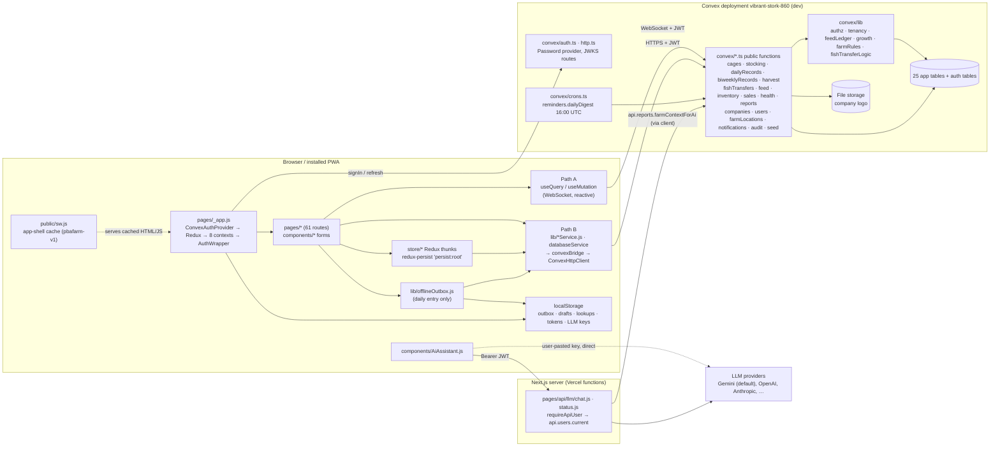
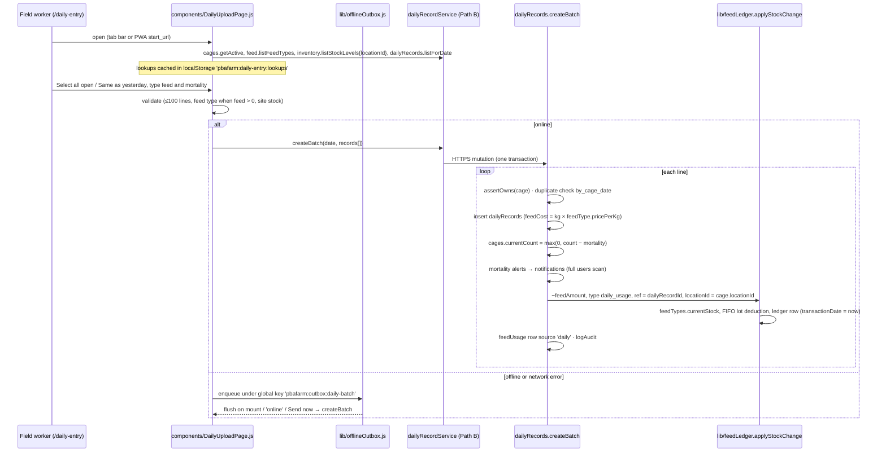

# Architecture 01 — Current Architecture (as built)

Branch `docs/discovery` (code of PRs #8–#12 and #14; PR #7's page edits are not on this branch). PR state, verified 2026-11-18 after discovery: #7–#13 are merged to `main` and deployed to `vibrant-stork-860`; #14 (UI only) was merged into a stale branch and is not on `main`. See docs/project-management/CHANGELOG.md., 2026-11-18. Everything here is drawn from discovery docs 01–14; each claim cites the discovery section and the source location it cites. Debt items are referenced by their `TD-###` id in `docs/discovery/15-technical-debt-register.md`.

## 1. Summary

Anowa is a Next.js 15 **pages-router** single-page application, fully client-rendered (61 statically prerendered routes, no SSR, no middleware), backed by one Convex deployment that holds all data, business logic, authorization, one cron and file storage for logos. Two Next API routes proxy an LLM assistant. A hand-written service worker and a `localStorage` outbox give the daily-entry screen partial offline capability (doc 01 §1–§2, doc 12 §1).

| Layer | What it is | Evidence |
|---|---|---|
| Browser app | Next.js 15.2.8 pages router, React 19.1, JavaScript (no frontend type checking), Tailwind v4 tokens, in-house `components/ui` | doc 01 §1, §3 |
| Client state | 8 React contexts + Redux Toolkit with `redux-persist` (`persist:root`) + Convex reactive cache + ad-hoc `localStorage` keys | doc 10 §12 |
| Data access | Path A: `useQuery`/`useMutation` (27 files). Path B: `lib/*Service.js` → `lib/convexBridge.getConvexHttpClient()` (`ConvexHttpClient` with cached JWT; ~40 files), Supabase-era `{data, error}` wrappers; Redux thunks over Path B | doc 01 §2; doc 10 §13 |
| Backend | Convex 1.42.3, deployment `vibrant-stork-860` (**dev**). 25 app tables + auth tables, 64 queries, 76 mutations, 2 actions, 6 internal functions, no `returns` validators, no components installed | doc 04 header; doc 06 §3; doc 13 §1 |
| Auth | `@convex-dev/auth` 0.0.94, Password provider only, JWT 1 h / session 30 d, tokens in `localStorage` | doc 07 §2 |
| Authorization | `convex/lib/authz.ts` (`requireUser`, `requireRole`) + `convex/lib/tenancy.ts` (`listForCompany`, `assertOwns`, `writeCompanyId`, `writeLocationId`) applied **after** reading rows | doc 06 §1; doc 07 §3 |
| Background work | One cron `reminders.dailyDigest` at 16:00 UTC; no `ctx.scheduler` | doc 12 §10 |
| Server routes (Next) | `pages/api/llm/chat.js`, `status.js` | doc 13 §11–§12 |
| Offline | `public/sw.js` app-shell cache; `lib/offlineOutbox.js` for daily-entry batches only | doc 11 §5–§6; doc 13 §15–§16 |
| Hosting | Frontend on Vercel (inferred); backend deployed by `convex-deploy.yml` on push to `main` with a dev key | doc 01 §1, §5; doc 12 §7 |

Cloudflare: not used by this project (verified 2026-11-18; evaluated as a future option in docs/architecture/14–17).

## 2. Component diagram



Notes on the diagram:

- `AiAssistant` fetches `reports.farmContextForAi` itself and embeds it in the prompt; `/api/llm/chat` re-checks `api.users.current` and `companies.aiAssistantStatus` before calling the provider with a server key (doc 13 §11).
- With a user-pasted key the browser calls the provider directly, bypassing the server (doc 12 §5.1; TD-021).
- Every page is statically prerendered and client-rendered; route guards (`AuthWrapper`, `ProtectedRoute`) are UX only. All enforcement lives in Convex functions (doc 01 §10.1; doc 07 §5).

## 3. Request path and authorization

1. **Identity.** `getAuthUserId(ctx)` parses the JWT `sub` (`userId|sessionId`); `requireUser` loads the `users` row and throws if missing. It does **not** check `active`, `mustChangePassword` or company `status` (`convex/lib/authz.ts:7-17`; doc 07 §2.5; TD-001, TD-002, TD-011).
2. **Role.** `requireRole(user, 'admin' | 'super_admin')`: a global three-level hierarchy on `users.role` (`authz.ts:19-28`; doc 07 §3.1).
3. **Tenant.** Rows are read — usually with `ctx.db.query(table).collect()` across all tenants — and then filtered by `listForCompany(user, rows)`: super_admin sees everything; a member sees their `companyId`; a user with no company sees rows with no `companyId` (`tenancy.ts:18-27`; doc 04 F1, F8; TD-003, TD-080).
4. **Site.** `listForCompanyAndLocation` filters by `locationId` only when the client passes it; `users.locationIds` is never written, so site restriction is inert (doc 07 §3.3; TD-018).
5. **Write ownership.** `assertOwns` / `listForCompany(user,[doc])` on the primary id; 11 secondary ids are not checked (doc 06 §4.3; TD-005).
6. **Audit.** `logAudit` (66 of 76 mutations) writes `auditLogs` with the actor's `companyId` (doc 06 §3; TD-027).

## 4. Data model in one picture

The spine is `companies → farmLocations → cages → stockingHistory → (topupHistory, fishTransfers)`, with operational facts (`dailyRecords`, `biweeklyRecords`, `harvestRecords`, `sales`, `healthTreatments`) attached to **cage + date**, not to the stocking (doc 05 §2, R4). Fish population is one mutable number, `cages.currentCount`, written by 12 code paths (doc 08 §4). Feed stock is held three ways: `feedTypes.currentStock`, `feedInventory` lots and `feedInventoryTransactions` (doc 04 F5). Every `companyId` and `locationId` is optional (doc 04 §1). The ER diagram is in doc 05 §2.

## 5. Data flows for the four core field workflows

### 5.1 Daily feed and mortality entry



Evidence: doc 02 §5; doc 08 §5–§6; doc 11 §4.1, §5; `convex/dailyRecords.ts:37-82,365-442`. Known defects on this path: feed type not ownership-checked (TD-005), offline cold start blocked (TD-100), outbox not per user and no idempotency key (TD-026, TD-102), blank feed saved as 0 kg (TD-108), cross-tenant `listForDate` truncation (TD-081), feed issued via `/feed-issue` for the same cage deducted again (TD-046).

### 5.2 Stocking, top-up and fish transfer (with approvals)

| Step | Function | Writes | Evidence |
|---|---|---|---|
| Stock a cage | `StockingForm` → `stockingService.createStocking` → `stocking.createStocking` | `assertStockingAllowed` (status, ABW range, capacity, density); batch number via `allocateBatchNumber` (full scan of `stockingHistory`); `stockingHistory` row `pending_approval` (default) or `approved`; if approved, cage copy fields and `currentCount = fishCount` | doc 08 §3; `convex/stocking.ts:224-297` |
| Approve stocking | `/approvals` or `/stocking/[id]/details` → `approveStocking` (admin) | cage `currentCount` **overwritten**, `status: active`; no re-check of rules or of another open stocking; `currentWeight` not reset | TD-043, TD-044 |
| Top-up | `TopUpForm` → `createTopup` / `approveTopup` | `topupHistory`; cage `currentCount += fishCount`; no check that the cycle is open; negative counts accepted | TD-049 |
| Transfer | `FishTransferForm` → `fishTransfers.createFishTransfer` | `fishTransfers` + linked destination `stockingHistory` (empty cage) or `topupHistory` (active cage), both pending by default | doc 08 §9 |
| Approve transfer | `approveFishTransfer` → `applyFishTransfer` | source `currentCount -= qty` (or 0 + `empty` if full); destination overwritten (stocking branch) or `+= qty` (top-up branch, even if already approved) | TD-042, TD-051 |

The approvals page hides transfer-linked stockings/top-ups (`stocking.ts:656-669`), but their own approve endpoints accept them, which double counts (doc 09 S2, S3).

### 5.3 Bi-weekly sampling and growth

`/biweekly-entry` → `BiweeklyEntryForm` (ABW = Σ sample g ÷ Σ sample n) → `biweeklyRecordService` → `biweeklyRecords.create` (global `by_batch_code` uniqueness) → `biweeklySampling` children → `lib/growth.syncCageAbw` sets `cages.currentWeight` to the latest sample of **any** cycle. `cages.growth` (`lib/growth.cageCycleGrowth`) then derives cycle ABW, biomass, eFCR, SGR, ADG and survival on every read, from the current stocking's date window, daily records in that window, and the **live** cage count (doc 08 §7; doc 09 §2.1). Defects: carry-over ABW after restock (TD-044), live count used for past cycles (TD-061), mixed units between form and CSV (TD-062), cross-tenant batch-code oracle (TD-013), one cage at a time on phones (TD-109).

### 5.4 Harvest and sale

```mermaid
sequenceDiagram
  participant U as User (/harvest)
  participant HF as components/HarvestForm.js
  participant H as harvest.create / update / remove
  participant C as cages + stockingHistory
  participant S as sales.createSale
  HF->>H: suggestFcr(cage, date, kg) → prefill FCR (overridable)
  U->>HF: weight, ABW, type (complete/partial), grades
  HF->>H: create(... fcr from client)
  H->>H: harvestWarnings (DOC, ABW, FCR vs company rules)
  H->>C: applyHarvestToCage: partial → count −= n (clamped); complete → count 0, status harvested, close newest open stocking, store cageEffect
  U->>H: edit count/type later (any member)
  H->>C: undoHarvestOnCage then applyHarvestToCage (closes the NEWEST open stocking)
  U->>S: sale against harvestId (Σ kg ≤ harvest kg + 0.05)
```

`/harvest-sampling` instead calls `harvest.createFromSampling`, which inserts a **complete** harvest with `fcr: 1.5`, ABW in kg and no cage effect (TD-045). The edit path above is the source of TD-040 (introduced by PR #8, commit `d298c5c`) and TD-041. `harvest.remove` leaves linked sales pointing at a deleted row (TD-055). Withdrawal periods from `healthTreatments` are not checked (TD-063). Evidence: doc 08 §8, §10; doc 09 S5, S6, S12; `convex/harvest.ts:107-187,206-450`.

## 6. Cross-cutting runtime behaviour

| Concern | As built | Evidence |
|---|---|---|
| Reactivity | Path A screens update live; Path B screens refetch on mount and after save; notifications load once per user change | doc 10 §13; TD-105, TD-118 |
| Errors | 234 `throw new Error`, 0 `ConvexError`; `cleanError` strips Convex noise on the client; no error boundary | doc 12 §5b; TD-131, TD-107 |
| Logging / monitoring | `console.error` in the client only; nothing in `convex/`; no monitoring | doc 12 §5c–§5d; TD-152 |
| Scheduling | `crons.daily` → `dailyDigest`, all companies in one mutation, `.take()` windows across tenants | doc 12 §6.2; TD-081, TD-082 |
| Files | Company logo only: `generateLogoUploadUrl` → POST → `setLogo` | doc 12 §9 |
| Dates and time zones | `YYYY-MM-DD` strings in UTC everywhere; no org time zone | doc 12 §6.4; TD-066 |
| Offline | SW caches visited pages; outbox for daily entry; auth gate blocks offline cold start | doc 11 §5–§6; TD-100 |
| Deployment | Shared dev deployment used as production; laptops can push schema; no backups documented | doc 12 §7–§8; TD-150, TD-151 |

## 7. Strengths worth preserving

1. **All enforcement is server-side.** Every one of 142 public functions calls `requireUser`, `getAuthUserId` or `api.users.current`; there is no unauthenticated data access (doc 07 §1). The fix for scoping problems is to strengthen one central guard, not to add enforcement from scratch.
2. **Atomic batch daily entry.** `dailyRecords.createBatch` writes up to 100 lines, their ledger rows, lot deductions and alerts in one transaction, with line-numbered errors mapped back to the form (doc 02 §5; doc 10 §7.3). This is the right shape for an offline-capable write API.
3. **A real signed feed ledger.** `feedInventoryTransactions` is append-only with reversal rows; `applyStockChange` is the single writer of `currentStock`; per-site lots with FIFO and admin overrides with reasons; `stockTally` reconciliation; tested in `convex/siteStock.test.ts` (doc 08 §6; doc 04 §3.17). The production engine copies this pattern for fish.
4. **Cycle-aware growth library.** `convex/lib/growth.ts` has clean, tested formula helpers (biomass, FCR, SGR, ADG, days) (doc 09 §1 C1–C5; `convex/growth.test.ts`); only its inputs are wrong.
5. **Company settings with draft → publish** and server-side rule enforcement (`lib/farmRules.ts`, `companySettingsDrafts`) — the seed of the customization engine (doc 14 row 56).
6. **Field-oriented daily-entry UX**: "Same as yesterday", 16 px numeric inputs, QR deep links, `DependencyEmpty` prerequisites, offline outbox with error retention (doc 11 §1; doc 10 §10).
7. **Audit log on most mutations** with before/after values (doc 06 §3).
8. **Indexes for tenant and site scope already exist** on most tables (`by_company`, `by_company_location`), so PLAT-001 is mostly rewiring reads, not schema work (doc 04 F15).
9. **Convex as the platform**: one TypeScript backend with transactions, reactivity, scheduling and storage; `tsc --noEmit -p convex` passes strict (doc 12 §2).

## 8. Weaknesses

| # | Weakness | Consequence | TD rows |
|---|---|---|---|
| W1 | Tenant isolation by in-memory filter after cross-tenant reads | Read-limit outage for all tenants; a missed filter leaks everything | TD-080, TD-081, TD-003 |
| W2 | Identity = one `companyId` + one global role; `active` and company `status` ignored | Offboarding does not work; no multi-org users; no granular permissions | TD-001, TD-002, TD-016, TD-019 |
| W3 | No batch entity or fish movement ledger; `cages.currentCount` mutated by 12 paths | Double counts, overwrites, cross-cycle corruption, no history | TD-040–TD-052 |
| W4 | Feed stock in three drifting representations; transfers single-legged; no business dates | Per-site stock history cannot be rebuilt | TD-056, TD-057 |
| W5 | KPIs recomputed on read with inconsistent definitions, no rollups | Wrong management numbers, cost grows with data | TD-061, TD-086 |
| W6 | Two client data transports and three client state systems, none user-scoped | Stale screens, shared-device leakage | TD-105, TD-106, TD-026 |
| W7 | Offline only for one form, blocked on cold start | Field data loss | TD-100, TD-101 |
| W8 | No ops foundation: dev deployment as prod, no backups, no monitoring, plain `Error` | Unrecoverable incidents; prod error redaction | TD-150–TD-152, TD-131 |
| W9 | Hard-coded single-species, single-currency, UTC, English assumptions | Blocks non-Ghana tenants | TD-066, TD-119 |
| W10 | Test coverage on the riskiest modules is zero | Regressions undetected | TD-130 |

## 9. What the target architecture keeps, extends and replaces

| Keep as is | Extend | Replace over time |
|---|---|---|
| Next.js pages router, Convex, Convex Auth (upgrade), Tailwind tokens and `components/ui`, `DailyUploadPage` interaction model, feed ledger pattern, `lib/growth.ts` formula helpers, `companySettingsDrafts` publish flow, `auditLogs` | `companies` (org settings, locale), `farmLocations` (type, timezone, coordinates), `cages` (unit type), `lib/offlineOutbox.js` (all field forms), `lib/tenancy.ts` → `requireMember` | `cages.currentCount` as source of truth (→ derived cache of `stockEvents`), `listForCompany` post-filters (→ indexed reads), Path B services and Redux (→ `useQuery` hooks), plain `Error` (→ `ConvexError` codes), `crons.daily` fan-in (→ per-company scheduled fan-out) |

Target design: `02-target-architecture.md`. Detailed designs: docs 03–10 in this folder.
