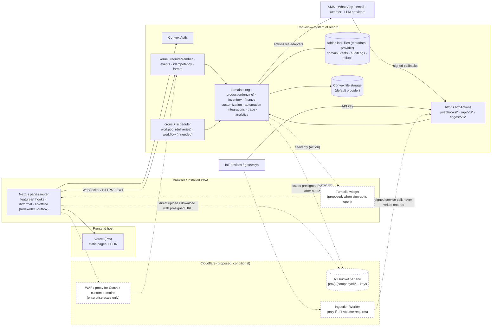

# Architecture 02 — Target Architecture

Status: proposed, 2026-11-18. Binding inputs: decisions D-001 … D-013 (recorded in `docs/project-management/DECISION-LOG.md`). Current state: `01-current-architecture.md`. Debt ids: `docs/discovery/15-technical-debt-register.md`.

## 1. Principles

1. **Evolve, do not rewrite (D-001).** Next.js pages router and Convex stay. New backend code is TypeScript; new frontend code may be TS or JS. No App Router migration, no big-bang conversion, no microservices.
2. **One modular Convex backend** with explicit domain boundaries: each domain owns its tables; other domains reach them only through that domain's library functions (inside the same transaction) or internal functions (scheduled). Table ownership is the boundary, not deployment units.
3. **Shared kernels instead of per-module logic.** Tenancy/authorization, the production engine, domain events, customization, and formatting/units each exist once (MASTER-PROMPT PART 10-C/D, PART 17 "Avoid duplicated business logic").
4. **Every tenant read is index-scoped and bounded (D-006).** No user-facing path reads a table without a `companyId`-prefixed index range; lists paginate; dashboards read rollups.
5. **History is append-only where it matters (D-004).** Fish stock, feed stock and audit are ledgers; corrections are reversal events.
6. **Additive schema change.** Optional fields + backfills + compatibility shims; renames only when unavoidable (none are planned: `companies` stays, `cages` stays).

## 2. Domain map (MASTER-PROMPT PART 10 A–J)

| Domain | Scope in the brief | Convex folder | Owns tables (existing → new) | Depends on kernels | First phase |
|---|---|---|---|---|---|
| A. Organization & enterprise | orgs, units, sites, invitations, teams, roles, permissions, audit, settings | `convex/org/` | `companies`, `companySettingsDrafts`, `users` (profile part), `userInvites` → `memberships`, `roles`, `invitations`; `farmLocations`; `auditLogs` | tenancy/authz, events | Phase 0–3 (SEC, ORG, FARM, PERM) |
| B. Production management (hatchery, nursery, cage, pond, tank/RAS) | unit-type specific workflows and screens | `convex/production/` (+ `hatchery/`, `nursery/` sub-folders later) | `cages` (generic unit), `dailyRecords`, `biweeklyRecords`, `biweeklySampling`, `harvestRecords`, `harvestSampling`, `stockingHistory`, `topupHistory`, `fishTransfers`, `healthTreatments` → `speciesCatalog`, `sizeGrades`, `unitGroups`, `waterQualityReadings` (later), `broodstock*` (later) | production engine, customization | Phase 4–6 |
| C. Shared production engine | batches, lineage, split/merge, movements, partial harvest, reconciliation, history | `convex/production/engine/` (library + internal functions; no UI-facing writes of its own) | → `batches`, `stockEvents`, `unitStock`, `batchDailyRollups` | tenancy/authz, events | Phase 4 (PROD) |
| D. Customization engine | custom fields/forms/terminology/dashboards/validation/branding | `convex/customization/` | `companies.settings.branding` → `customFieldDefs`, `terminology`, `formLayouts`, `dashboardLayouts`, `userPreferences` | tenancy/authz | Phase 8 (CUSTOM) |
| E. Automation engine | triggers, conditions, actions, schedules, approvals, escalations, history, retries | `convex/automation/` | `notifications` → `domainEvents`, `automationRules`, `automationRuns`, `tasks` | events, integrations | Phase 10 (AUTO) |
| F. Integration platform | org-supplied SMS/email/WhatsApp credentials, API keys, webhooks, weather, IoT, accounting | `convex/integrations/` + `convex/http.ts` | → `integrationConnections`, `messageDeliveries`, `apiKeys`, `webhookEndpoints`, `webhookDeliveries`, `inboundEvents` | tenancy/authz, events | Phase 11 (INT); email for invites earlier |
| G. Business management | inventory, warehouses, feed, procurement, suppliers, expenses, costing, sales, invoices, assets, tasks | `convex/inventory/`, `convex/finance/` | `feedTypes`, `feedSuppliers`, `feedPurchases`, `feedUsage`, `feedInventory`, `feedInventoryTransactions`, `customers`, `sales` → `inventoryItems` (generalized), `warehouses` (= site stores), `expenses`, `costAllocations`, `invoices` | tenancy/authz, production engine (feed per batch), events | Phase 9 (INV) |
| H. Traceability & compliance | genealogy, feed and treatment trace, harvest lots, dispatch, biosecurity, documents | `convex/trace/` | reads `batches`, `stockEvents`, ledgers → `harvestLots`, `dispatches`, `documents` (file metadata), `complianceTemplates` | production engine | Phase 12 (TRACE) |
| I. Analytics & intelligence | dashboards, comparisons, FCR, survival, forecasting, cost/kg, AI | `convex/analytics/` | `reports.ts` queries → rollup tables (`productionDailyRollups`, `batchDailyRollups`), `aiConversations` (optional) | production engine, formatting/units | PLAT-001 (Phase 0) then Phase 13 (ANLY) |
| J. Global support | currencies, languages, time zones, units, country settings | `convex/kernel/format/` (server) + `lib/format/` (client) | `companies.settings.locale` extended; `users.preferredLanguage` | — | Phase 1–2 (fields), i18n library when first non-English locale is committed (D-012) |
| Platform | super-admin, migrations, ops | `convex/platform/` | reads all; writes via owning domain libs | authz (platform admin) | Phase 0 (OPS-001, SEC-002) |

### 2.1 Target component diagram

Solid lines are the committed target. Dashed nodes and edges are **proposed, conditional** Cloudflare components that are adopted only when the trigger recorded in `14-cloudflare-adoption-assessment.md` fires; none is used today. Convex remains the source of truth in every variant.



## 3. Convex layout

```
convex/
  schema.ts                  single defineSchema; spreads per-domain table maps
  convex.config.ts           components: rate-limiter, migrations, (aggregate, workpool — evaluated, see §6)
  auth.ts  auth.config.ts  http.ts  crons.ts
  kernel/                    shared kernels — helpers only, no registered functions
    authz.ts                 requireMember, requirePlatformAdmin, MemberContext
    permissions.ts           permission catalog + role templates
    tenancy.ts               companyQuery(ctx, table, index) helpers, assertSameCompany
    errors.ts                ConvexError codes (appError('STOCK_NEGATIVE', …))
    events.ts                emitDomainEvent(ctx, member, event)
    idempotency.ts           withIdempotency(ctx, member, key, fn)
    customFields.ts          validateCustom(ctx, member, entity, custom)
    format/ dates.ts units.ts money.ts   org-timezone business dates, unit conversion
  org/
    tables.ts                companies, memberships, roles, invitations, farmLocations, auditLogs …
    companies.ts memberships.ts roles.ts invitations.ts sites.ts settings.ts audit.ts   (public)
    internal.ts              session revocation, backfills, invitation expiry
    lib/                     membership resolution, settings merge (from lib/farmRules.ts)
  production/
    tables.ts
    engine/                  postStockEvents, reverseOperation, stockAsOf, rebuildUnitStock (lib) + internal.ts
    units.ts batches.ts stocking.ts transfers.ts daily.ts sampling.ts harvest.ts health.ts species.ts
    internal.ts  lib/        growth.ts (moved from convex/lib/growth.ts), farmRules.ts
  inventory/  finance/  customization/  automation/  integrations/  trace/  analytics/  platform/
    (same shape: tables.ts, public modules, internal.ts, lib/)
  # legacy public modules kept as stable API paths during migration:
  cages.ts stocking.ts dailyRecords.ts biweeklyRecords.ts harvest.ts fishTransfers.ts feed.ts
  inventory.ts sales.ts health.ts reports.ts companies.ts users.ts farmLocations.ts
  notifications.ts audit.ts reminders.ts userAccounts.ts seed.ts
  lib/                       existing helpers; become re-exports of kernel/ and domain lib/ during migration
```

### 3.1 Rules

- **Public API stability.** Convex function names are file paths (`api.harvest.create`). Moving code would break every client call. Existing top-level modules therefore stay as the public API until their callers move; their handlers shrink to "authorize via kernel → call domain lib". New capabilities are registered under domain folders (`api.production.harvest.correct`). A legacy function is deleted only when a grep of `pages/ components/ lib/ contexts/ store/` shows no caller and one release has passed.
- **Public vs internal.** Public functions authorize with `requireMember` as their first line. Anything called only by the scheduler, crons, `httpAction`s or migrations is `internal*` (fixes TD-004, TD-009, TD-010 class of bugs).
- **Cross-domain writes go through the owner's lib.** For example `production/daily.ts` posts mortality through `production/engine` and feed through `inventory/lib/ledger.ts`; it never patches `cages.currentCount` or `feedTypes.currentStock` directly.
- **Validators.** Every new function has `args` and `returns` validators; no `v.any()` in new tables (TD-132). Paginated queries use `paginationOptsValidator` and `paginationResultValidator`.
- **Index naming** follows `by_field1_and_field2` for new indexes; existing names are left alone (renaming an index is a schema change with no benefit) (TD-074 accepted as-is).
- **Errors.** User-facing failures throw `ConvexError({ code, message, details })` from `kernel/errors.ts` (D-011, TD-131).

## 4. Shared kernels

| Kernel | Responsibility | Key API | Detailed design |
|---|---|---|---|
| Tenancy / authz | Resolve the caller's active membership, check user active, membership active, company approved, permission, site scope; index-scoped query helpers | `requireMember(ctx, { companyId?, permission, locationId? }): Promise<MemberContext>`; `requirePlatformAdmin(ctx)`; `companyIndex(ctx, table, indexName)` | `03-multi-tenant-design.md`, `10-security-architecture.md` |
| Production engine | Single writer of fish stock: batches, `stockEvents`, `unitStock`, `cages.currentCount` cache, rollups | `postStockEvents`, `reverseOperation`, `stockAsOf`, `batchPerformance` | `05-production-engine-design.md` |
| Events | Append a domain event in the same transaction as the change; dispatch to automation and webhooks asynchronously | `emitDomainEvent(ctx, member, { type, subject, data })` | `07-automation-engine-design.md` |
| Customization | Validate `custom` values against `customFieldDefs`; resolve terminology and form layouts | `validateCustom`, `resolveTerminology`, `getFormLayout` | `06-customization-engine-design.md` |
| Formatting / units (D-012) | Business date in org/site timezone; unit conversion (kg/lb, g/oz, m³/ft³, °C/°F); money in org currency with minor-unit rounding | server `kernel/format/*`; client `lib/format/{money,number,date,units}.js` | §5.3 and `04-organization-and-location-model.md` |

## 5. Frontend structure

D-001 keeps the pages router. The frontend change is a convention, applied screen by screen.

```
pages/                       routes stay where they are (URLs unchanged; QR labels keep working)
features/<domain>/           new: hooks (useQuery/useMutation wrappers), domain components, form configs
  production/  useUnits.js  useDailyEntry.js  DailyEntryScreen.jsx …
  org/  inventory/  customization/ …
components/ui/               design system primitives (existing)
lib/convex/                  client, error mapping (ConvexError code → message key)
lib/format/                  money, number, date (org timezone), units — the only place formatting happens
lib/offline/                 generalized outbox (from lib/offlineOutbox.js), per-user namespacing, reference cache
lib/i18n/                    message keys in English only until the first non-English locale (D-012)
```

### 5.1 Migration rules

| Current | Target | Approach | What could break | Compatibility |
|---|---|---|---|---|
| Path B `lib/*Service.js` + `lib/databaseService.js` (~40 files, TD-105) | `features/<domain>/use*.js` over `useQuery` / `useMutation`, plus a thin `callMutation` for the outbox | Migrate one screen per PR, starting with screens touched by Phase 0; keep the service function until its last caller is gone | Screens relying on refetch-after-save ordering; offline detection in `DailyUploadPage` relies on HTTP "Failed to fetch" (doc 10 §13) | The outbox keeps an HTTP transport for replay (see `08-mobile-and-offline-architecture.md`); reactive reads replace refetches |
| Redux + `redux-persist` (5 consumers, TD-106) | Removed | Replace `Layout.js` `fetchCages` and the 4 analytics/feed-types pages with hooks; then drop the store and purge `persist:root` once on load | Pages that read `state.cages` | Done after those 5 consumers move; a one-time `localStorage.removeItem('persist:root')` runs on startup |
| `DataContext`, `AnalyticsContext` (dead) | Removed | Delete | Nothing (0 consumers) | — |
| No error boundary (TD-107) | `components/ErrorBoundary.js` around the page in `_app.js`, plus `pages/_error.js` | Phase 0 (OPS-001) | — | — |
| Hard-coded `₵`, units, UTC dates (TD-119, TD-066) | `lib/format/*` reading org settings | Introduce helpers first, then replace call sites per screen | Display only | Values stored unchanged |
| Giant pages (TD-137) | Split when a screen is migrated, not before | Opportunistic | — | — |
| JavaScript only (TD-133) | Root `tsconfig.json` with `allowJs: true`, `checkJs: false`, `strict` for `.ts/.tsx`; new `features/` code may be TS and import `convex/_generated/api` types | Add in PLAT phase; CI runs `tsc --noEmit` | Build if `tsconfig` is wrong | JS files untouched |

### 5.2 Navigation

The Sidebar becomes configuration-driven (`features/nav/navConfig.js`, permission keys instead of `adminOnly`), filtered by the member's permissions from `org.memberships.current` and labelled through terminology overrides (`06-customization-engine-design.md`). The phone tab bar becomes configurable per organization (D-007 navigation config) (TD-110).

### 5.3 Formatting

All money, number, date and unit rendering goes through `lib/format`. The org settings (`companies.settings.locale`: `currency`, `timezone`, `unitSystem`, `locale`) arrive through `CompanySettingsContext`; per-user `preferredLanguage` comes with the membership. Storage stays canonical: kilograms, grams, cubic metres, °C, ISO dates, money as a number in the org currency rounded to minor units at write time.

## 6. What Convex does well here, and its limits (MASTER-PROMPT PART 11)

| Concern | Convex fit | Design response | Limit to watch |
|---|---|---|---|
| Multi-tenant isolation | No row-level security in the database; isolation is application code | One guard (`requireMember`) + index-first helpers that take `companyId` from the member context, never from arguments; tenant-isolation tests per domain (`03`) | A function that forgets the helper leaks; mitigated by review checklist and a lint-style test that every public function calls `requireMember` |
| Query scalability / read limits | Each query or mutation has per-transaction limits on documents and bytes read (order of tens of thousands of documents and ~16 MiB; confirm current values in Convex docs for 1.42+) | Index ranges with `companyId` prefix; `.take()`/`.paginate()` everywhere; rollups for dashboards; batch migrations via scheduler | Long-history reports per batch must read rollups, not raw `dailyRecords` |
| Index design | Compound indexes, ordered, `_creationTime` tiebreak; staged indexes backfill without blocking deploys | New indexes declared `staged: true` first on large tables, then enabled | Index count adds write cost; drop unused ones only after a release with no reads |
| Reactive subscriptions | Re-run when any document in the read set changes | Dashboard queries read a handful of rollup documents, so a write to `dailyRecords` only invalidates the rollup for that site/day | A subscription over a raw range of `dailyRecords` re-runs on every entry — avoid in lists that stay open |
| Large historical datasets | Fine for storage; reads must be bounded | Pagination; per-batch and per-day rollups; retention jobs for `notifications`, `auditLogs` previous values, `domainEvents` | No server-side joins: denormalize names that lists show (e.g. `unitName` on rollups) |
| Pagination | `paginate()` with cursors, reactive | All list endpoints paginated (`PLAT-001`) | Client components need cursor UIs; DataTable gets "load more" |
| File storage | Upload URLs, `getUrl`, storage ids | `documents` table holding storage id, company, subject, content type, size, checksum; serve URLs only from a query that checks membership; validate type/size in the attaching mutation | `getUrl` URLs are bearer URLs once issued; keep them short-lived in UI and never store them |
| Scheduled jobs | Crons + `ctx.scheduler.runAfter` | Crons only enqueue; per-company work fans out via scheduler (`PLAT-001`); org-local schedules computed from org timezone | One cron run must stay within mutation limits — fan out, never loop all tenants in one transaction |
| Background actions / retries | Actions for external I/O; no built-in retry | `@convex-dev/workpool` evaluated for bounded parallelism and retries of outbound messages and webhooks (D-008); otherwise `automationRuns` with attempt counters and scheduler back-off | Actions are not transactional: write intent first (mutation), call out (action), record result (mutation) |
| Rate limits | No app-level limiter built in | `@convex-dev/rate-limiter` for sign-up, invitations, report exports, LLM proxy, public API keys | — |
| Data retention | Manual | Internal batched delete jobs per table policy, scheduled per company | Deletes cost writes; run off-peak |
| Offline sync | None in the client SDK | Client outbox + server idempotency keys + reference-data cache (`08`) | Reactive `useMutation` queues in memory only; offline writes must go through the outbox |
| Analytics workloads | Not an OLAP engine | Write-time rollups (`productionDailyRollups`, `batchDailyRollups`); `@convex-dev/aggregate` evaluated for per-company counters and sums | Cross-organization benchmarking, ad-hoc BI and multi-year trend analysis do not fit — see §7 |
| External integrations | `fetch` in actions; `httpAction` for inbound | Adapter interface per channel, encrypted per-org credentials, signed webhooks (`09`) | Long-running syncs (accounting) need chunked, resumable jobs |
| Search | Full-text search indexes | Search indexes on `cages.name`, `customers.name`, `batches.batchNumber` when lists need it | One search field per index; filter fields must be declared |

## 7. When additional infrastructure is justified

| Candidate | Justify only when | Not before | Shape when needed |
|---|---|---|---|
| Analytics warehouse (D-001 candidate; not yet, D-020) | A required report cannot be served from rollups within read limits (for example multi-year, multi-farm comparisons, cross-tenant benchmarking), or customers ask for BI-tool access | Rollups (Phase 0/4) have been measured against real tenant sizes | One-way export from Convex (streaming export or a scheduled export job — check plan availability) into a columnar store; Convex stays the system of record |
| IoT ingestion gateway (D-001 candidate) | Sensor traffic exceeds what batched `httpAction` writes handle comfortably — roughly, sustained per-second readings from hundreds of probes, or raw time series kept beyond what rollups summarize | A pilot with a few dissolved-oxygen probes posting every few minutes, which Convex handles directly via `/ingest` `httpAction` writing `waterQualityReadings` and per-hour rollups | A small ingestion service buffering into a time-series store, forwarding alerts and hourly aggregates to Convex |
| External search | Never planned; Convex search indexes cover names, codes and notes | — | — |
| Object storage beyond Convex | Video or very large documents per org | Photos and PDFs fit Convex file storage | Signed upload to S3-compatible storage, metadata in `documents` |
| Specialized background processing | Accounting syncs or reports that run longer than action limits | Workpool/scheduler chunking has been tried | Queue worker outside Convex calling internal endpoints via signed `httpAction` |
| Local mobile database | Already in scope as IndexedDB in the PWA (`08`); not a server component | — | — |
| Native mobile app | PWA cannot meet a hard requirement (background sync on iOS, Bluetooth scales/probes) | D-010: PWA first | React Native / Expo sharing `features/` logic |

### 7.1 Infrastructure options (proposed)

Cloudflare is not used by this project (verified 2026-11-18). It was evaluated as an optional infrastructure provider for the candidates above; the result is trigger-based adoption with Convex as the source of truth, no D1/KV/Durable Objects as a second application database, and the frontend staying on Vercel.

- `14-cloudflare-adoption-assessment.md` — per-service assessment (R2, Workers, Queues, Workflows, Images, CDN, Turnstile, WAF, Access, DNS, Email, D1/KV/DO) and the Vercel vs OpenNext-on-Workers hosting comparison, each with an adoption stage.
- `15-cloudflare-vs-convex-responsibility-matrix.md` — owner now / owner target / boundary contract per capability (Workers never write business records; Convex issues all presigned URLs; file metadata in Convex with `companyId`).
- `16-storage-cost-and-scaling-assessment.md` — Convex storage vs R2 cost model at 10/100/1,000 organizations, break-even, residency, backup/lifecycle, and the provider-neutral `files` table.
- `17-cloudflare-adoption-roadmap.md` — stages mapped to roadmap phases, proposed `CF-0xx` tracker ids and decisions to log.

The "Object storage beyond Convex" row above is refined by doc 16: photos and PDFs stay on Convex storage behind a `files` abstraction until volume, original-resolution media, expiring-link or jurisdiction requirements justify R2.

## 8. Proposed changes and their impact (Rule 3)

| Change | What exists | Problem | Why | Affected | Dependents / what could break | Compatibility |
|---|---|---|---|---|---|---|
| Domain folders + kernels | Flat `convex/*.ts` with helpers in `convex/lib` | Logic duplicated across modules (cage count writers, feed ledger callers, rules) | Single owners for stock, auth and events | New `convex/kernel/`, `convex/<domain>/`; existing modules shrink | Every client call path — mitigated by keeping legacy module names | Legacy modules stay as API; `convex/lib/*` re-export moved helpers until callers switch |
| `requireMember` replaces `requireUser`/`requireRole`/`listForCompany` | Post-read filters, global roles | TD-001–TD-003, TD-016, TD-080 | One audited guard, index-first reads | All 142 public functions, `convex/lib/{authz,tenancy}.ts` | Super_admin and company-less user behaviour changes (intended) | Phase 0 adds checks inside `requireUser`; Phase 1–3 swap call sites module by module |
| Production engine | `cages.currentCount` mutated by 12 paths | TD-040–TD-052 | Correct, reconstructable stock | `stocking.ts`, `fishTransfers.ts`, `harvest.ts`, `dailyRecords.ts`, `cages.ts`, `lib/growth.ts`, reports | Any code reading `currentCount` keeps working (cache kept); count values may change after backfill reconciliation | Backfill + dual-write + reconciliation report before switching reads (`05`) |
| Rollups for dashboards | KPIs recomputed from all rows | TD-080, TD-086 | Bounded reads, cheaper subscriptions | `reports.ts`, `Dashboard.js` | Numbers change where old definitions were wrong (TD-061) | Show both during one release with a "definition changed" note |
| Frontend `features/` + `lib/format` + `lib/offline` | Path B services, Redux, ad-hoc formatting | TD-105, TD-106, TD-119, TD-101 | Live data, consistent formatting, offline everywhere | Screen by screen | Offline behaviour of daily entry | Outbox keeps HTTP replay transport |

## 9. Sequencing

Phase 0 (Stabilize: SEC-001, SEC-002, PROD-000, OPS-001, PLAT-001, offline cold start) uses the existing structure with minimal new tables (indexes, `ConvexError`, error boundary). The kernel folder is introduced in Phase 0 only for `kernel/errors.ts` and the hardened `requireUser`. `memberships` (ORG-001) and `requireMember` follow in Phase 1, sites in Phase 2, the permission catalog in Phase 3, the production engine in Phase 4. Customization, automation and integrations reuse the kernels and come later. The roadmap owns the dates (`docs/roadmap/03-development-roadmap.md`).
