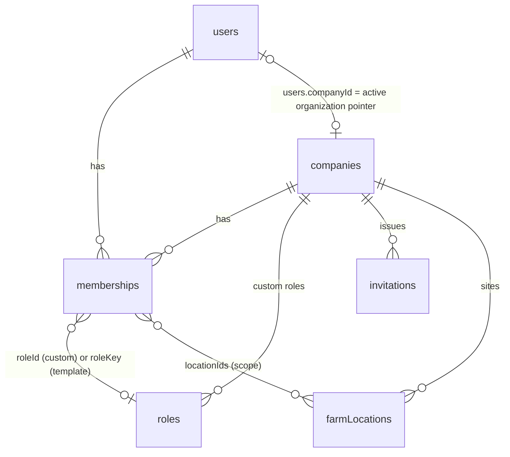

# Architecture 03 — Multi-Tenant Design

Status: proposed. Binding decisions: D-002 (organization = `companies`, `memberships` table, `users.companyId` kept as active-organization pointer), D-005 (central `requireMember` guard, permission catalog, no shared unassigned pool, platform admin separate), D-006 (company-indexed, paginated reads; bounded fan-out crons). Retires TD-001, TD-002, TD-003, TD-005, TD-006, TD-007, TD-008, TD-016, TD-017, TD-018, TD-019, TD-080, TD-081, TD-082, TD-083.

## 1. Current state (from discovery)

| Aspect | As built | Evidence |
|---|---|---|
| Tenant | `companies` row with `status` pending/approved/rejected | doc 04 §3.2 |
| Membership | One optional `users.companyId`; one global `users.role` (`user`/`admin`/`super_admin`) | doc 05 §3.2; doc 07 §3.6 |
| Guard | `requireUser` loads the user, ignores `active`, `mustChangePassword`, company `status` | `convex/lib/authz.ts:7-17`; doc 07 X1, X2, V5 |
| Isolation | `listForCompany(user, rows)` filters **after** reading; company-less users see rows with no `companyId`; super_admin sees all | `convex/lib/tenancy.ts:18-43`; doc 04 F1 |
| Reads | 57 full-table `.collect()` across tenants; `take(N)` windows on non-tenant indexes | doc 04 F7, F8 |
| Writes | `companyId` from `writeCompanyId(user)` (undefined for company-less users); secondary ids not ownership-checked | doc 06 §1, §4.3 |
| Site scope | `users.locationIds` never written; site filters optional | doc 07 §3.3 |
| Invitations | `userInvites` one row per email, no token/expiry, claimed by unverified email | doc 07 §3.5 |
| Platform admin | `role: 'super_admin'` passes every tenant check, including writes | doc 07 §3.8 |

## 2. Target model



- An **organization** is a `companies` row; "organization" is the word in docs and UI (D-002). No rename.
- A **membership** grants a user a role in one organization, optionally limited to some sites. A user can hold several memberships.
- `users.companyId` remains and means "active organization" (the one the UI is working in). It is only ever set to a company where the user has an active membership.
- **Platform admin** (`users.role === 'super_admin'`) is not a tenant role. It opens `convex/platform/*` functions only. Working inside a tenant requires an explicit, time-boxed support membership (§6).

## 3. Schema

New tables live in `convex/org/tables.ts` and are spread into `convex/schema.ts`.

```ts
// convex/org/tables.ts
import { defineTable } from 'convex/server'
import { v } from 'convex/values'

export const membershipStatus = v.union(
  v.literal('invited'), v.literal('active'), v.literal('suspended'), v.literal('removed'),
)

export const orgTables = {
  memberships: defineTable({
    userId: v.id('users'),
    companyId: v.id('companies'),
    /** Template key ('owner' | 'admin' | 'manager' | 'field_staff' | 'viewer') or a custom role key. */
    roleKey: v.string(),
    /** Set when roleKey refers to a custom role row. */
    roleId: v.optional(v.id('roles')),
    /** true = every site of the organization, now and future. */
    allLocations: v.boolean(),
    /** Bounded: the mutation refuses more than 100 entries. Ignored when allLocations. */
    locationIds: v.optional(v.array(v.id('farmLocations'))),
    status: membershipStatus,
    invitedBy: v.optional(v.id('users')),
    joinedAt: v.optional(v.number()),
    statusChangedAt: v.optional(v.number()),
    statusChangedBy: v.optional(v.id('users')),
    /** Support access granted by a platform admin; expires automatically. */
    supportExpiresAt: v.optional(v.number()),
    /** true for rows created by the users.companyId backfill. */
    legacy: v.optional(v.boolean()),
    updatedAt: v.number(),
  })
    .index('by_userId_and_companyId', ['userId', 'companyId'])
    .index('by_userId_and_status', ['userId', 'status'])
    .index('by_companyId_and_status', ['companyId', 'status']),

  roles: defineTable({
    companyId: v.id('companies'),
    key: v.string(),                 // unique per company, e.g. 'feed_officer'
    name: v.string(),
    description: v.optional(v.string()),
    basedOn: v.optional(v.string()), // template it was copied from
    permissions: v.array(v.string()),// bounded by the catalog (~60 keys); validated against it
    archived: v.boolean(),
    updatedAt: v.number(),
    updatedBy: v.optional(v.id('users')),
  }).index('by_companyId_and_key', ['companyId', 'key']),

  invitations: defineTable({
    companyId: v.id('companies'),
    email: v.string(),               // lower-cased
    roleKey: v.string(),
    roleId: v.optional(v.id('roles')),
    allLocations: v.boolean(),
    locationIds: v.optional(v.array(v.id('farmLocations'))),
    tokenHash: v.string(),           // SHA-256 of a random 32-byte token; token only in the email link
    status: v.union(v.literal('pending'), v.literal('accepted'), v.literal('revoked'), v.literal('expired')),
    invitedBy: v.id('users'),
    expiresAt: v.number(),
    acceptedBy: v.optional(v.id('users')),
    acceptedAt: v.optional(v.number()),
    createdAt: v.number(),
  })
    .index('by_tokenHash', ['tokenHash'])
    .index('by_companyId_and_status', ['companyId', 'status'])
    .index('by_email_and_status', ['email', 'status']),
}
```

Changes to existing tables (all additive):

| Table | Change | Purpose |
|---|---|---|
| `users` | add `.index('by_companyId', ['companyId'])` (staged) | Phase 0 reminders and admin lookups until memberships replace them (TD-083) |
| `users` | add `preferredLanguage: v.optional(v.string())` | D-012 per-user language |
| `companies` | add `.index('by_status_and_createdAt', ['status', 'createdAt'])` | Platform lists and cron fan-out without scanning |
| `auditLogs` | add `actorCompanyId: v.optional(v.id('companies'))`; `companyId` becomes the **record's** company; add `.index('by_companyId_and_tableName', …)`, `.index('by_recordId', ['recordId'])` | Tenants see platform-admin actions on their data (TD-027) |
| `userInvites` | frozen; read-only during migration, then dropped | Replaced by `invitations` |
| every tenant table | no schema change; `companyId` stays `v.optional` until the unscoped-row audit is clean, then made required table by table | See §8 step 6 |

## 4. Permission catalog and role templates

`convex/kernel/permissions.ts` (code, versioned with releases):

```ts
export const PERMISSIONS = [
  // organization
  'org.settings.manage', 'org.members.manage', 'org.roles.manage', 'org.sites.manage', 'org.audit.view',
  // production
  'production.units.manage', 'production.daily.record', 'production.daily.correct',
  'production.sampling.record', 'production.sampling.correct',
  'production.stocking.request', 'production.stocking.approve',
  'production.transfer.request', 'production.transfer.approve',
  'production.harvest.record', 'production.harvest.correct',
  'production.stock.adjust', 'production.health.record',
  // inventory & finance
  'inventory.view', 'inventory.purchase.record', 'inventory.purchase.correct', 'inventory.adjust',
  'inventory.transfer', 'inventory.prices.manage',
  'finance.sales.record', 'finance.sales.correct', 'finance.view',
  // reporting & platform features
  'reports.view', 'reports.export', 'ai.use',
  'customization.manage', 'automation.manage', 'integrations.manage',
] as const
export type Permission = (typeof PERMISSIONS)[number]

export const ROLE_TEMPLATES: Record<'owner' | 'admin' | 'manager' | 'field_staff' | 'viewer', readonly Permission[]> = { … }
```

| Template | Intent | Mapped from today | Notable exclusions |
|---|---|---|---|
| `owner` | Organization owner; cannot be removed while sole owner | `companies.submittedByUserId` of an approved company, else the earliest admin | — |
| `admin` | Full tenant administration | `users.role === 'admin'` | — |
| `manager` | Day-to-day operations and records, including corrections and approvals | `users.role === 'user'` (preserves today's operational access) | `inventory.prices.manage`, `finance.sales.correct`, `org.*`, `inventory.adjust` (these become admin-only in SEC-002 already, TD-016) |
| `field_staff` | Data capture on assigned sites | none (new; opt-in) | approvals, corrections of others' records, finance, exports |
| `viewer` | Read-only | none (new) | every write |

Rules: segregation of duties is a policy flag per organization (`settings.approvals.requireDifferentApprover`), enforced in approve mutations by comparing `createdBy` with the caller (TD-042). A membership change takes effect on the next function call (no cached permissions).

## 5. The guard

```ts
// convex/kernel/authz.ts
export type MemberContext = {
  user: Doc<'users'>
  company: Doc<'companies'>
  membership: Doc<'memberships'>
  companyId: Id<'companies'>
  permissions: ReadonlySet<Permission>
  /** 'all' or the explicit set of site ids the member may touch. */
  siteScope: 'all' | ReadonlySet<Id<'farmLocations'>>
}

export async function requireMember(
  ctx: QueryCtx | MutationCtx,
  opts: {
    permission: Permission
    companyId?: Id<'companies'>          // defaults to user.companyId (active organization)
    locationId?: Id<'farmLocations'> | null
  },
): Promise<MemberContext>
```

Checks, in order, each failing with `ConvexError({ code })`:

| # | Check | Code | Fixes |
|---|---|---|---|
| 1 | Authenticated (`getAuthUserId`) and user row exists | `UNAUTHENTICATED` | — |
| 2 | `user.active !== false` | `ACCOUNT_DISABLED` | TD-001 |
| 3 | `user.mustChangePassword !== true` (only `users.current` and `userAccounts.changePassword` skip this) | `PASSWORD_CHANGE_REQUIRED` | TD-011 |
| 4 | Target company = `opts.companyId ?? user.companyId`; missing → no tenant access | `NO_ORGANIZATION` | TD-003 |
| 5 | Membership `by_userId_and_companyId` exists with `status === 'active'`. Support memberships expire through a job scheduled at grant time (`ctx.scheduler.runAt(supportExpiresAt, …)`) that sets `status: 'removed'`, so the guard never reads the wall clock inside a query | `NOT_A_MEMBER` | TD-019, TD-017 |
| 6 | `company.status === 'approved'` | `ORGANIZATION_INACTIVE` | TD-002 |
| 7 | Permission in role (template from code, custom from `roles`) | `FORBIDDEN` | TD-016 |
| 8 | If `opts.locationId`: site belongs to company, is active, and is in `siteScope` | `SITE_FORBIDDEN` | TD-018 |

Companion helpers:

```ts
assertSameCompany(m: MemberContext, doc: { companyId?: Id<'companies'> } | null, label: string): asserts doc
assertSiteInScope(m: MemberContext, locationId: Id<'farmLocations'> | undefined): void
sitesToQuery(m: MemberContext, requested?: Id<'farmLocations'> | null): 'company' | Id<'farmLocations'>[]
requirePlatformAdmin(ctx): Promise<Doc<'users'>>   // role === 'super_admin' && active
```

`assertSameCompany` is called on **every** id argument a function dereferences, not only the primary one (fixes TD-005, TD-006: `applyStockChange` receives the `MemberContext` and calls it on the feed type).

## 6. Reads, writes and platform access

### 6.1 Index-first reads (D-006, PLAT-001)

Pattern for every tenant list:

```ts
export const list = query({
  args: { locationId: v.optional(v.id('farmLocations')), paginationOpts: paginationOptsValidator },
  returns: paginationResultValidator(dailyRecordView),
  handler: async (ctx, args) => {
    const m = await requireMember(ctx, { permission: 'reports.view', locationId: args.locationId })
    const scope = sitesToQuery(m, args.locationId)
    const q = scope === 'company'
      ? ctx.db.query('dailyRecords').withIndex('by_company', (q) => q.eq('companyId', m.companyId))
      : ctx.db.query('dailyRecords').withIndex('by_company_location', (q) =>
          q.eq('companyId', m.companyId).eq('locationId', scope[0]))
    return await q.order('desc').paginate(args.paginationOpts)
  },
})
```

When a member is limited to several sites and asks for "all my sites", the query takes the per-site indexes in turn (bounded by the number of sites) or the UI requires a site selection; it never reads the company index and filters afterwards, because that would read rows outside scope.

PLAT-001 index additions (staged first, then enabled; names follow the guideline):

| Table | New index | Replaces |
|---|---|---|
| `dailyRecords` | `by_companyId_and_date` (`['companyId','date']`), `by_companyId_and_locationId_and_date` | `by_date` + `take(500/2000)` in `listForDate`, reminders, dashboards |
| `harvestRecords`, `biweeklyRecords`, `sales`, `healthTreatments` | `by_companyId_and_<dateField>` | full scans in `reports.*`, `health.activeWithdrawals` |
| `sales` | `by_companyId_and_cageId` | full scan per cage in `listCagePnL` |
| `stockingHistory`, `topupHistory`, `fishTransfers` | `by_companyId_and_status` | global `by_status` + `take(100)` |
| `stockingHistory` | `by_companyId_and_batchNumber` | full scan in `allocateBatchNumber` |
| `biweeklyRecords` | `by_companyId_and_batchCode` | global `by_batch_code` (TD-013) |
| `cages` | `by_companyId_and_status` exists as `by_company_status` — use it | `by_status` + `take(300)` |
| `users` | `by_companyId` | `take(5000)` |
| `auditLogs` | `by_companyId_and_tableName`, `by_recordId` | `by_table` global |

### 6.2 Writes

- `companyId` always comes from `m.companyId`; it is never an argument.
- `locationId` comes from the referenced unit (`cage.locationId`) or an argument checked with `assertSiteInScope`.
- Every referenced id is checked with `assertSameCompany`.
- Write helpers stamp `createdBy: m.user._id` and, in Phase 1+, emit a domain event (`07`).

### 6.3 Platform administration

`convex/platform/*` holds the only cross-tenant functions: company approval/rejection/removal, platform lists, migrations, support access. Each calls `requirePlatformAdmin` and writes an audit row with `companyId` = target company and `actorCompanyId` = none, so the tenant sees it (TD-027).

Support access: `platform.support.grantAccess({ companyId, reason, hours })` creates a membership `roleKey: 'admin'`, `supportExpiresAt`, `status: 'active'`, audited in the tenant's log; an internal job flips it to `removed` at expiry. Tenant APIs never special-case `super_admin` again (TD-017).

### 6.4 Crons

Crons enqueue, they do not loop tenants (TD-082): `reminders.dailyDigest` becomes `internal.automation.scheduler.tick`, which pages through `companies.by_status_and_createdAt` (`approved`) and calls `ctx.scheduler.runAfter(0, internal.reminders.digestForCompany, { companyId })` per company; each per-company mutation reads only that company's indexed rows.

## 7. Session revocation and offboarding (SEC-001)

| Event | Action |
|---|---|
| `org.memberships.suspend/remove` | membership status change; if it was the user's active org, clear `users.companyId` (UI routes to the organization picker) |
| `users.deactivate` (platform-wide account disable, admin of the user's only org or platform admin) | `active:false`; internal mutation deletes the user's `authSessions` (index `userId`) and their `authRefreshTokens` (index `sessionId`); existing access JWTs die within 1 hour, and step 2 of the guard rejects them immediately |
| Company rejected/removed | guard step 6 blocks all members at once; optional session revocation for members whose only active membership was this company |
| Password change | revoke other sessions (keep the current `sessionId` from the JWT `sub`) |

`users.current` returns `{ …, accessState: 'ok' | 'disabled' | 'no_organization' | 'organization_inactive' | 'password_change_required' }` so the client can sign out or route instead of failing every query.

## 8. Migration from today

| Step | Phase | What | Backfill / dual-write | Compatibility shim | Verification |
|---|---|---|---|---|---|
| 1 | 0 (SEC-001) | Harden `requireUser`: checks 2, 3, 6 above (company status read only when `user.companyId` is set); `listForCompany`/`assertOwns` return nothing / throw for company-less non-platform users; session revocation on deactivate | none | Behaviour change only for disabled users, removed companies, company-less users (intended). Company-less super_admins keep platform functions | convex-test: disabled user, removed company, company-less user each refused on a sample of functions per module |
| 2 | 0 (SEC-001) | **Unscoped-row audit**: `internal.platform.audit.countUnscoped` pages each tenant table counting `companyId === undefined` | read-only | — | Report to owner before step 3 |
| 3 | 0 (SEC-001) | Quarantine unscoped rows: rows whose owner can be inferred (cage → company, `createdBy` user now in a company) get that `companyId`; the rest move to a platform-owned company "Unassigned data (quarantine)" with `status: 'rejected'` so no tenant sees them and a platform admin can reassign | batched internal migration via `@convex-dev/migrations`, 200 rows per batch | No schema change needed | Count of unscoped rows = 0 for every table |
| 4 | 0 (SEC-002, PLAT-001) | Ownership checks on secondary ids; `backfillLocations` → `internalMutation`; staged indexes; reads switched to indexes | none | Old indexes kept until reads move | Tenant-isolation test suite (§9) |
| 5 | 1 (ORG-001) | Create `memberships`, `invitations`; backfill one membership per `users` row with `companyId` (role mapping §4; `allLocations = !(user.locationIds?.length)`; status `suspended` if `active === false`) | **Dual-write**: `companies.approve`, `users.invite`, `userAccounts.createWithPassword`/`finalizeCreatedUser`, `users.update` (role), `users.deactivate/reactivate` write both the user fields and the membership | `requireMember` falls back to a synthesized membership from `users.companyId` + `users.role` if no row exists (logged), until the backfill check passes | Invariant query: every user with `companyId` has an active/suspended membership for it; fallback hit counter = 0 for 7 days, then the fallback is removed |
| 6 | 1 (ORG-001) | Invitations: `org.invitations.create/revoke/accept`; email delivery (needs INT email adapter, `09`); `users.invite` and `claimInvite` stop changing existing users (immediate SEC-002 guard: refuse users who exist) | `userInvites` pending rows copied into `invitations` with a fresh token emailed to the invitee, or left to expire | `AuthContext` stops auto-calling `claimInvite`; invitation acceptance page `/invite/[token]` | V2/V3 negative tests |
| 7 | 1 (ORG-001) | Organization switcher: `org.memberships.listMine`, `org.memberships.setActive(companyId)` patches `users.companyId` | — | Single-org users see no switcher | — |
| 8 | 3 (PERM) | Swap call sites from `requireUser`/`requireRole` to `requireMember({ permission })` module by module; custom roles UI; site assignment UI (writes `memberships.locationIds`) | — | `requireRole` kept as a wrapper mapping `'admin'` to a permission until the last call site moves | Per-module permission tests |
| 9 | after 8 | Make `companyId` required on tenant tables, one table per deploy (schema validation fails if any row lacks it — step 3 guarantees none) | — | — | Deploy passes schema validation |

## 9. Testing

- `convex/test/tenancy.ts` fixture: two approved companies A and B, each with owner, manager, field_staff, viewer, a disabled user, a company-less user, a platform admin.
- For every public function: B's members get `NOT_A_MEMBER`/empty results for A's ids; disabled, company-less and removed-company users are refused; permission matrix spot-checks per template.
- A meta-test imports every module in `convex/` and asserts each exported public function's source references `requireMember` or `requirePlatformAdmin` (string scan), so a new function cannot ship without the guard.

## 10. Risks

| Risk | Mitigation |
|---|---|
| Quarantine moves real data a tenant expects to see (legacy single-farm rows) | Step 2 report reviewed by the owner before step 3; quarantined rows are reassignable, not deleted |
| Role mapping changes what `user`-role staff can do | `manager` keeps today's operational permissions; only the TD-016 money edits move to admin, announced with SEC-002 |
| Fallback membership hides backfill gaps | Fallback is logged and counted; removed only after a clean week |
| Super admins lose implicit tenant access | Support access grant is one call and audited |
| `locationIds` on a membership grows unbounded | Capped at 100 in the mutation; larger orgs use `allLocations` or (later) business-unit scopes |

## 11. Open questions

1. Is self-service sign-up meant to stay open, or should accounts be invitation-only after the first owner (doc 07 Q5)?
2. Should the registering user become `owner` automatically on approval (proposed) or should the platform admin choose?
3. Is segregation of duties for approvals required by default or opt-in per organization?
4. Are there users today who need access to two companies (decides the priority of the switcher)?
