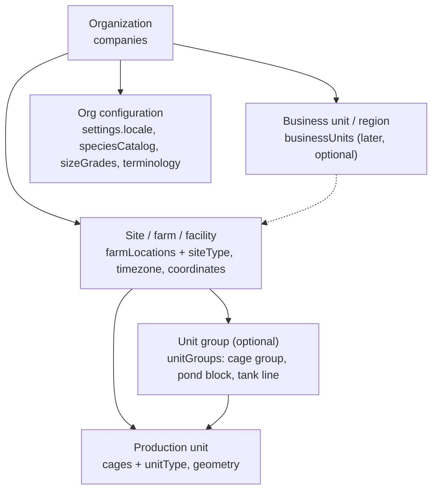

# Architecture 04 — Organization and Location Model

Status: proposed. Binding decisions: D-002 (organization = `companies`), D-003 (organization → optional business unit/region later → site = `farmLocations` extended → production unit = `cages` with `unitType`), D-007 (terminology from configuration), D-012 (org-level currency, timezone, unit system, locale; species and size grades per organization). Retires or prepares TD-018, TD-066, TD-114, TD-119, and the structural part of TD-019 (with `03`).

## 1. Current state

| Level | As built | Evidence |
|---|---|---|
| Organization | `companies`: name, code, status, branding, `settings` (`farmRules`, `stockingRules`, `feedRules`, `locale.currency` limited to `'GHS' \| 'USD' \| 'EUR'`, `aiAssistantEnabled`), draft → publish via `companySettingsDrafts` | doc 04 §3.2–3.3; `convex/schema.ts:63-124` |
| Business unit / region | Does not exist | doc 05 §3.2 ("no farm entity between company and site") |
| Site | `farmLocations`: name, code, address, notes, active. No type, timezone, coordinates. "Main farm" auto-created by `ensureDefaultLocation` and `companies.approve` | doc 04 §3.5; `convex/lib/tenancy.ts:114-148` |
| Production unit | `cages` only: free-text `dimensions`, `size` (m³ used for density), `capacity`, free-text `location`, `species` string, cycle copies (`stockingDate`, `initialCount`, `currentCount`, `initialAbw`, `currentWeight`) | doc 04 §3.6; `convex/schema.ts:147-181` |
| Species | Free string; client list of 5 in `lib/fishSpecies.js` | doc 05 §3.3 |
| Size grades | Hard-coded tilapia grades in `components/HarvestForm.js` `SIZE_CATEGORIES`; stored as `harvestRecords.sizeBreakdown: v.any()` | doc 08 §8; doc 10 §14 |
| Time | UTC `YYYY-MM-DD` strings; no time zone anywhere | doc 12 §6.4; doc 11 §5.3 |
| Units of measure | kg, g, m³, °C, mg/L hard-coded in labels; bag size default 20 kg | doc 10 §14; doc 09 X13 |
| Site scoping in UI | `LocationContext` + `localStorage` `pba_active_location_id`; inventory pages, export and feed overview ignore it | doc 02 KF12; doc 10 §13 |

## 2. Target hierarchy



- Sites stay directly under the organization. `businessUnitId` on `farmLocations` is added only when a customer needs regions or subsidiaries (ENT phase); nothing below depends on it.
- A **production unit** is any physical container that holds fish: cage, pond, tank, raceway, hatchery tank, incubator, hapa. The generic table stays `cages` (D-003); code and UI call it a "unit", labels come from terminology (`06`).
- Warehouses/stores for feed and supplies are sites (or later, a `warehouses` table owned by inventory); they do not hold fish and have no units.

## 3. Schema changes

All additive. Existing fields keep their meaning.

### 3.1 `companies`

```ts
// settings.locale today: v.optional(v.object({ currency: v.optional(v.union(v.literal('GHS'), v.literal('USD'), v.literal('EUR'))) }))
locale: v.optional(v.object({
  currency: v.optional(v.string()),        // ISO 4217; widened from the 3-value union (all old values stay valid)
  timezone: v.optional(v.string()),        // IANA, e.g. 'Africa/Accra'
  unitSystem: v.optional(v.union(v.literal('metric'), v.literal('imperial'))),
  locale: v.optional(v.string()),          // BCP 47 for number/date formatting, e.g. 'en-GH'
  countryCode: v.optional(v.string()),     // ISO 3166-1 alpha-2
})),
```

`validateSettingsForPublish` (`convex/companies.ts`) gains: currency in `Intl.supportedValuesOf('currency')`, timezone resolvable by `Intl.DateTimeFormat`, locale parseable. `lib/farmRules.mergeSettings` supplies defaults (`currency 'GHS'`, `timezone 'Africa/Accra'`, `unitSystem 'metric'`, `locale 'en-GH'`) so existing companies behave exactly as today.

### 3.2 `farmLocations`

```ts
farmLocations: defineTable({
  // existing: companyId, name, code, address, notes, active, updatedAt
  siteType: v.optional(v.union(
    v.literal('cage_farm'), v.literal('pond_farm'), v.literal('hatchery'), v.literal('nursery'),
    v.literal('ras_facility'), v.literal('mixed'), v.literal('store'),
  )),
  timezone: v.optional(v.string()),                         // falls back to company timezone
  coordinates: v.optional(v.object({ lat: v.number(), lng: v.number() })),
  waterBody: v.optional(v.string()),                        // lake / reservoir / river name
  region: v.optional(v.string()),
  countryCode: v.optional(v.string()),
  businessUnitId: v.optional(v.id('businessUnits')),        // added in the ENT phase only
  custom: v.optional(customValues),                         // D-007, see 06
})
  .index('by_company', ['companyId'])                       // existing
  .index('by_companyId_and_active', ['companyId', 'active'])
```

### 3.3 `cages` as the generic production unit

```ts
export const unitType = v.union(
  v.literal('cage'), v.literal('pond'), v.literal('tank'), v.literal('raceway'),
  v.literal('hatchery_tank'), v.literal('incubator'), v.literal('hapa'),
)

cages: defineTable({
  // existing fields unchanged, including size (m³), capacity, dimensions (free text), status, species
  unitType: v.optional(unitType),                           // read as 'cage' when absent
  groupId: v.optional(v.id('unitGroups')),
  geometry: v.optional(v.object({
    shape: v.optional(v.union(v.literal('circular'), v.literal('square'),
                               v.literal('rectangular'), v.literal('irregular'))),
    diameterM: v.optional(v.number()),
    lengthM: v.optional(v.number()),
    widthM: v.optional(v.number()),
    depthM: v.optional(v.number()),
    areaM2: v.optional(v.number()),                         // ponds: stocking density per m²
    volumeM3: v.optional(v.number()),                       // mirrors `size` (see rule below)
  })),
  coordinates: v.optional(v.object({ lat: v.number(), lng: v.number() })),
  currentBatchId: v.optional(v.id('batches')),              // engine cache, see 05
  custom: v.optional(customValues),                         // type-specific extras (net mesh, liner, aerators…)
})
  // existing indexes kept
  .index('by_companyId_and_unitType', ['companyId', 'unitType'])
  .index('by_locationId_and_groupId', ['locationId', 'groupId'])
```

Rules:

- `size` remains the canonical volume used by `assertStockingAllowed` density checks (`convex/lib/farmRules.ts:209-243`). New forms write `geometry.volumeM3` and `size` together; `geometry.volumeM3` is never read by rules until `size` is retired (not planned).
- Density rules choose the basis by unit type: fish per m³ (cage, tank, raceway) or fish per m² (pond, from `areaM2`). Defaults come from the species (`§3.5`), overridable in company settings as today.
- Only fields that the production engine or rules read become typed columns. Everything else type-specific (net mesh size, liner type, pump model) is a custom field (D-007), so adding a unit type does not need a schema change.

### 3.4 `unitGroups` (new)

```ts
unitGroups: defineTable({
  companyId: v.id('companies'),
  locationId: v.id('farmLocations'),
  name: v.string(),
  kind: v.union(v.literal('cage_group'), v.literal('pond_block'), v.literal('tank_line'), v.literal('other')),
  sortOrder: v.number(),
  active: v.boolean(),
  updatedAt: v.number(),
}).index('by_companyId_and_locationId', ['companyId', 'locationId'])
```

Used for navigation ("Block A"), batch daily entry by group, and QR/route ordering in the field.

### 3.5 Species and size grades per organization (D-012)

```ts
speciesCatalog: defineTable({
  companyId: v.id('companies'),
  code: v.string(),                     // 'nile_tilapia' — the value already stored on cages/stockingHistory
  name: v.string(),
  scientificName: v.optional(v.string()),
  active: v.boolean(),
  defaults: v.object({
    targetHarvestAbwG: v.optional(v.number()),
    harvestDocMinDays: v.optional(v.number()),
    harvestDocMaxDays: v.optional(v.number()),
    initialAbwMinG: v.optional(v.number()),
    initialAbwMaxG: v.optional(v.number()),
    maxDensityFishPerM3: v.optional(v.number()),
    maxDensityFishPerM2: v.optional(v.number()),
    targetFcr: v.optional(v.number()),
  }),
  updatedAt: v.number(),
}).index('by_companyId_and_code', ['companyId', 'code']),

sizeGrades: defineTable({
  companyId: v.id('companies'),
  speciesCode: v.optional(v.string()),  // null = applies to all species
  key: v.string(),                      // 'SS'
  label: v.string(),                    // 'SS 300–400 g'
  minG: v.optional(v.number()),
  maxG: v.optional(v.number()),
  sortOrder: v.number(),
  active: v.boolean(),
}).index('by_companyId_and_speciesCode', ['companyId', 'speciesCode']),
```

Rule resolution order for a harvest or stocking check: species default → company `farmRules`/`stockingRules` override → (later) site override. Today's company settings keep winning because they are applied last, so behaviour does not change for existing tenants.

### 3.6 Regions, business units and subsidiaries (FARM-004, ENT-001, built)

Optional grouping between the organization and its sites. A single-site farm uses none of it; every field below is optional and every screen works without it.

```ts
businessUnits: defineTable({
  companyId: v.id('companies'),
  name: v.string(),
  code: v.optional(v.string()),
  kind: v.union(v.literal('region'), v.literal('business_unit')),
  parentId: v.optional(v.id('businessUnits')),   // at most 3 levels, no cycles
  description: v.optional(v.string()),
  active: v.boolean(),
  …
}).index('by_companyId_and_parentId', ['companyId', 'parentId'])

farmLocations.businessUnitId: v.optional(v.id('businessUnits'))

companyLinks: defineTable({
  companyId: v.id('companies'),        // the parent
  childCompanyId: v.id('companies'),   // the subsidiary
  status: 'pending' | 'active' | 'declined' | 'ended',
  shareReports: v.boolean(),           // set by the subsidiary
  requestedBy/At, respondedBy/At, endedBy/At, note, updatedAt
}).index('by_companyId_and_status', …).index('by_childCompanyId_and_status', …)
```

- **Subsidiaries are separate organizations** (their own tenant, members, data), not a `businessUnits.kind`. A parent links one with `companyLinks.request({ childCode })`; the subsidiary's admins accept or decline (`respond`) and decide whether to share reports (`shareReports`, changeable any time with `setShareReports`). Either side can `end` the link. A subsidiary has at most one active parent; self-links and reverse links (A→B and B→A) are refused; at most 50 links per side.
- **Functions** (`convex/businessUnits.ts`, `convex/companyLinks.ts`): `businessUnits.list` (`org.view`, with site counts); `create`/`update`/`remove`/`assignSites` and every `companyLinks` call need `org.structure.manage` (admin-only). A unit with child units or sites cannot be removed. `businessUnits.siteReport({ from, to, businessUnitId? })` (`reports.view`) gives per-site KPIs for a unit and its descendants, within the caller's site scope.
- **Pickers**: `FarmLocationSelect` groups sites by unit (`<optgroup>`) once any site has one, and takes `businessUnitId` to restrict the list. Memberships still scope by site; scoping by unit (`memberships.businessUnitIds`) is not built.
- **Consolidated reporting** (ENT-002): see doc 03 §4 (`group.reports.view`) and `convex/groupReports.ts`.
- UI: `/organization-structure` (units, site assignment, subsidiary links), `/reports/regions`, `/group-reports`.

## 4. Functions

| Function | Kind | Permission | Notes |
|---|---|---|---|
| `org.sites.list({ includeInactive?, paginationOpts })` | query | any member | `by_companyId_and_active`; filtered to `siteScope` |
| `org.sites.create/update(...)` | mutation | `org.sites.manage` | Validates timezone, coordinates range; audit |
| `production.units.list({ locationId?, unitType?, groupId?, status?, paginationOpts })` | query | `reports.view` | Index chosen by args; returns `unitType ?? 'cage'` |
| `production.units.create/update(...)` | mutation | `production.units.manage` | Writes `size` and `geometry.volumeM3` together; status changes restricted (see `05`) |
| `production.units.archive(id)` | mutation | `production.units.manage` | Replaces hard delete (`cages.remove`, TD-054): refuses when the unit has stock or open batches; sets `status`… see below |
| `org.species.list/upsert`, `org.sizeGrades.list/upsert` | query / mutation | `org.settings.manage` for writes | Seeded on migration |
| `kernel/format/dates.businessDate(ctx, { locationId })` | helper | — | Today's date in the site's timezone, for mutation validation |

Unit archive: `cages.status` has no "archived" value; adding `v.literal('archived')` to the `cageStatus` union is additive. `cages.remove` stays for units with no history (no child rows) and is otherwise refused.

## 5. Business dates and time zones (D-012, TD-066)

- Every operational date stays a `YYYY-MM-DD` string meaning "the farm's local calendar day" — no change to stored data.
- The client default for "today" comes from `lib/format/date.todayIn(siteTimezone)` instead of `new Date().toISOString().split('T')[0]` (31 call sites, doc 11 §5.3).
- Mutations validate the format (`/^\d{4}-\d{2}-\d{2}$/` plus a real-date check) and refuse dates after the site's local today (`businessDate` computed from `Date.now()` in the mutation, allowed there).
- Crons that act "per day" compute the date per organization timezone; the daily reminder runs at a configured local time per organization (`07`), not 16:00 UTC for all.
- Ledger rows gain a business date (`05`, `INV`), keeping `transactionDate` as the insert time.

## 6. Units of measure (D-012)

Storage is metric and canonical (kg, g, m³, m², °C, mg/L). `kernel/format/units.ts` and `lib/format/units.js` convert for display and input when `unitSystem === 'imperial'`. Forms accept input in the display unit and convert before calling the mutation; mutations never receive imperial values. Bag size stays in kg per feed type (`feedTypes.bagSizeKg`), with the company default (`feedRules.defaultBagSizeKg`) replacing literal 20s (TD-119, doc 09 X13).

## 7. Migration

| Step | Phase | Change | Backfill | Compatibility | What could break |
|---|---|---|---|---|---|
| 1 | 0/1 | Widen `settings.locale` (currency to `v.string()`, add timezone, unitSystem, locale, countryCode) | `mergeSettings` defaults only; no data write needed | Old values valid; `lib/money.js` and `useCurrency` keep working; `useCurrency`'s static 3-currency table is replaced by `Intl` in `lib/format/money.js` | Pages showing `₵` literals keep showing them until migrated (cosmetic) |
| 2 | 2 (FARM) | `farmLocations` fields | Set `timezone` = company timezone, `siteType` = `cage_farm` for companies whose units are all cages (owner confirms) | Fields optional; UI shows "not set" | — |
| 3 | 2 (FARM) | `cages.unitType`, `geometry`, `groupId`, `unitGroups` | `unitType` left undefined (= cage); `geometry.volumeM3 = size` where `size` is set | Every reader treats missing `unitType` as `'cage'` | Code that switches on `unitType` must default it — enforced by a `unitTypeOf(cage)` helper |
| 4 | 2 (FARM) | `speciesCatalog`, `sizeGrades` | Per company: the 5 codes from `lib/fishSpecies.js` + distinct `species` strings found on its `cages` and `stockingHistory`; size grades from `HarvestForm.SIZE_CATEGORIES` | `species` stays a string code on rows; the catalog adds names and defaults; the client list remains a fallback until forms read the catalog | Unknown free-text species become catalog rows named after the code; owner can rename |
| 5 | 2 (FARM) | Site scoping in inventory pages, export and feed overview (TD-114) | — | "All sites" remains available to members with `allLocations` | Totals on those pages change from company-wide to site when a site is selected (intended) |
| 6 | ENT | `businessUnits` | none | — | — |

## 8. Proposed changes and impact (Rule 3)

| Change | Exists | Problem | Why | Files | Dependents / break risk | Backward compatibility |
|---|---|---|---|---|---|---|
| Keep `cages` as generic unit with `unitType` | `cages` only | Ponds, tanks, hatcheries impossible (doc 14 §3) | D-003: no rename, one engine | `convex/schema.ts`, `convex/cages.ts`, `pages/cages/*`, `components/CageManageModals.js`, `CreateCageForm`, `QuickCreateModals` | ~every page reads cages (doc 04 §3.6); none break because the field is optional | Missing `unitType` = cage |
| Site timezone and type | `farmLocations` text only | UTC dates wrong outside UTC+0; no map/weather | D-012, INT weather needs coordinates | `convex/farmLocations.ts`, `pages/farm-locations.js`, `contexts/LocationContext.js` | Reminder timing (moves to local time) | Defaults equal today's behaviour for Ghana |
| Species/grades catalog | Hard-coded lists | Tilapia-only assumptions (PART 17 "avoid hardcoded species") | D-012 | `lib/fishSpecies.js`, `components/HarvestForm.js`, `components/StockingForm.js`, `convex/lib/farmRules.ts` | Harvest form grade inputs | Seeded with today's values |
| `archived` unit status instead of hard delete | `cages.remove` hard-deletes and orphans | TD-054 | History preservation | `convex/cages.ts`, cage pages | Admin "Delete" button semantics | `remove` still works for units with no history |

## 9. Risks

- Org-level timezone defaults may be wrong for a tenant already outside Ghana; the owner must confirm each existing tenant's timezone before reminders move to local time.
- Allowing arbitrary ISO currencies without FX means multi-currency reporting across organizations is still impossible; within one organization a single currency is assumed (multi-currency per organization is an ENT item).
- `unitType` values are a closed union; adding one later is an additive schema change but must be added to every switch through `unitTypeOf`.

## 10. Open questions

1. Do any current tenants operate outside Ghana or in more than one time zone?
2. Should density limits for ponds use fish/m² or kg/m³?
3. Do customers need site-level overrides of farm rules (different target ABW per site), or are species defaults plus company settings enough?
4. Is a "store" site type enough for feed warehouses, or are warehouses separate from farm sites?
