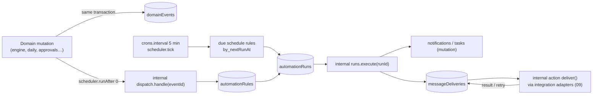

# Architecture 07 — Automation Engine Design

Status: proposed. Binding decision D-008: `automationRules` (trigger event or schedule, conditions, actions) and `automationRuns` (history, retries) executed through the Convex scheduler, with `@convex-dev/workpool` evaluated for retries; domain events emitted from the production engine and other mutations into an events/outbox table. Related: D-006 (bounded per-company fan-out), D-009 (external channels through integration adapters), D-012 (schedules in the organization's time zone). Retires TD-064 (alert logic), TD-081/TD-082 (reminder part), TD-118, and prepares the approval notifications missing today (doc 14 row 26).

## 1. Current state

| Capability | As built | Evidence |
|---|---|---|
| Scheduled work | One cron: `crons.daily('daily entry and low stock reminders', { hourUTC: 16 }, internal.reminders.dailyDigest)`; uses `crons.daily` against the guideline | `convex/crons.ts:8-13`; doc 06 §2.1 |
| Reminder logic | `dailyDigest` loops up to 1,000 companies in one mutation; per company reads active cages, `dailyRecords.by_date` `take(2000)` across tenants, `users.take(5000)` across tenants; writes deduplicated notifications (`missed-entry:<date>:<user>`, `low-stock:<date>:<user>`) | `convex/reminders.ts:16-134`; doc 12 §6.2 |
| Event-driven alerts | Mortality threshold notifications coded inside `dailyRecords.insertDailyRecord`, no dedupe, full `users` scan | `convex/dailyRecords.ts:274-316`; doc 08 §5 |
| Notifications | `notifications` per user, bell loaded once per user change (not reactive), no retention | doc 13 §6; doc 04 §3.22 |
| Approvals | `pending_approval` status on stocking, top-up, transfer; no notification to approvers; no escalation | doc 08 §3; doc 14 row 26 |
| Scheduler / queues / retries | None (`ctx.scheduler` unused) | doc 12 §10 |
| External channels | None (no SMS/email/WhatsApp/push) | doc 13 §7–10 |

Kept: the deduplication-key idea (`notifications.by_dedupe`) and the per-company reminder logic, which become a template rule and a "check".

## 2. Model



Convex scheduling is transactional: a function scheduled inside a mutation runs only if that mutation commits. `domainEvents` plus `ctx.scheduler.runAfter(0, …)` therefore gives an outbox without a polling relay; `dispatchStatus` exists for audit and for re-dispatch after a failed handler.

## 3. Schema

`convex/automation/tables.ts`:

```ts
domainEvents: defineTable({
  companyId: v.id('companies'),
  type: v.string(),                         // catalog key, e.g. 'stock.mortality.recorded'
  subjectTable: v.string(),                 // 'cages' | 'batches' | 'stockingHistory' | …
  subjectId: v.string(),
  locationId: v.optional(v.id('farmLocations')),
  actorUserId: v.optional(v.id('users')),
  origin: v.union(v.literal('user'), v.literal('automation'), v.literal('system'), v.literal('api')),
  businessDate: v.optional(v.string()),
  data: v.record(v.string(), v.union(v.string(), v.number(), v.boolean(), v.null())), // ≤ 40 keys
  dispatchStatus: v.union(v.literal('pending'), v.literal('dispatched'), v.literal('failed')),
  occurredAt: v.number(),
})
  .index('by_companyId_and_type_and_occurredAt', ['companyId', 'type', 'occurredAt'])
  .index('by_dispatchStatus_and_occurredAt', ['dispatchStatus', 'occurredAt']),

automationRules: defineTable({
  companyId: v.id('companies'),
  name: v.string(),
  enabled: v.boolean(),
  templateKey: v.optional(v.string()),      // set for rules created from a template
  triggerKind: v.union(v.literal('event'), v.literal('schedule')),
  triggerEventType: v.optional(v.string()), // flat for indexing
  schedule: v.optional(v.object({
    frequency: v.union(v.literal('daily'), v.literal('weekly'), v.literal('monthly'), v.literal('interval')),
    localTime: v.optional(v.string()),      // 'HH:MM' in the org (or site) time zone
    daysOfWeek: v.optional(v.array(v.number())),
    dayOfMonth: v.optional(v.number()),
    everyMinutes: v.optional(v.number()),   // ≥ 15
    checkKey: v.string(),                   // from the code catalog of checks (§5)
    checkParams: v.optional(v.record(v.string(), v.union(v.string(), v.number(), v.boolean()))),
  })),
  conditions: v.array(v.object({            // ≤ 10, all must hold
    field: v.string(),                      // 'data.dailyMortalityPct' | 'subject.unitType' | 'settings.farmRules.dailyMortalityAlertPct'
    op: v.union(v.literal('eq'), v.literal('neq'), v.literal('gt'), v.literal('gte'),
                v.literal('lt'), v.literal('lte'), v.literal('in'), v.literal('is_set')),
    value: v.optional(v.union(v.string(), v.number(), v.boolean(), v.array(v.string()))),
    valueFrom: v.optional(v.string()),      // compare with another field, e.g. a settings threshold
  })),
  actions: v.array(automationAction),       // ≤ 5, union below
  throttle: v.optional(v.object({ perSubjectMinutes: v.number() })),
  nextRunAt: v.optional(v.number()),        // schedule rules only
  version: v.number(),
  updatedBy: v.id('users'),
  updatedAt: v.number(),
})
  .index('by_companyId_and_triggerEventType_and_enabled', ['companyId', 'triggerEventType', 'enabled'])
  .index('by_enabled_and_nextRunAt', ['enabled', 'nextRunAt'])
  .index('by_companyId_and_templateKey', ['companyId', 'templateKey']),

automationRuns: defineTable({
  companyId: v.id('companies'),
  ruleId: v.id('automationRules'),
  ruleVersion: v.number(),
  triggerEventId: v.optional(v.id('domainEvents')),
  subjectKey: v.optional(v.string()),       // throttling and dedupe per subject
  dedupeKey: v.string(),                    // `${ruleId}:${eventId}` or `${ruleId}:${localDate}:${subjectKey}`
  scheduledFor: v.number(),
  status: v.union(v.literal('queued'), v.literal('running'), v.literal('succeeded'),
                  v.literal('partial'), v.literal('failed'), v.literal('skipped')),
  attempt: v.number(),
  actionResults: v.array(v.object({         // ≤ 5
    actionIndex: v.number(),
    status: v.union(v.literal('ok'), v.literal('queued'), v.literal('failed'), v.literal('skipped')),
    deliveryIds: v.optional(v.array(v.id('messageDeliveries'))), // ≤ 50; bulk sends summarized
    taskId: v.optional(v.id('tasks')),
    error: v.optional(v.string()),
  })),
  error: v.optional(v.string()),
  startedAt: v.optional(v.number()),
  finishedAt: v.optional(v.number()),
})
  .index('by_dedupeKey', ['dedupeKey'])
  .index('by_companyId_and_ruleId_and_scheduledFor', ['companyId', 'ruleId', 'scheduledFor'])
  .index('by_companyId_and_status_and_scheduledFor', ['companyId', 'status', 'scheduledFor']),

tasks: defineTable({
  companyId: v.id('companies'),
  locationId: v.optional(v.id('farmLocations')),
  unitId: v.optional(v.id('cages')),
  title: v.string(),
  description: v.optional(v.string()),
  assigneeUserId: v.optional(v.id('users')),
  assigneeRoleKey: v.optional(v.string()),
  dueDate: v.optional(v.string()),
  status: v.union(v.literal('open'), v.literal('done'), v.literal('cancelled')),
  source: v.optional(v.object({ ruleId: v.optional(v.id('automationRules')), runId: v.optional(v.id('automationRuns')),
                                 eventId: v.optional(v.id('domainEvents')) })),
  completedBy: v.optional(v.id('users')),
  completedAt: v.optional(v.number()),
  updatedAt: v.number(),
})
  .index('by_companyId_and_status_and_dueDate', ['companyId', 'status', 'dueDate'])
  .index('by_assigneeUserId_and_status', ['assigneeUserId', 'status']),
```

Action union:

```ts
const recipients = v.object({
  roleKeys: v.optional(v.array(v.string())),
  userIds: v.optional(v.array(v.id('users'))),
  siteMembersOfSubject: v.optional(v.boolean()),   // members whose site scope includes the subject's site
})
export const automationAction = v.union(
  v.object({ kind: v.literal('notify'), recipients,
             channels: v.array(v.union(v.literal('in_app'), v.literal('sms'), v.literal('email'),
                                       v.literal('whatsapp'), v.literal('push'))),
             templateKey: v.string() }),             // message template with {{placeholders}} from event data
  v.object({ kind: v.literal('create_task'), recipients, title: v.string(), dueInHours: v.optional(v.number()) }),
  v.object({ kind: v.literal('webhook'), endpointId: v.id('webhookEndpoints') }),
  v.object({ kind: v.literal('escalate'), afterMinutes: v.number(), recheck: v.string() /* check key */,
             recipients, channels: v.array(v.string()), templateKey: v.string() }),
)
```

`notifications` gains `ruleId`, `runId` (optional) and a retention policy (§7).

## 4. Event catalog (initial)

| Event type | Emitted by | Key data |
|---|---|---|
| `stock.stocked`, `stock.transferred`, `stock.graded`, `stock.merged`, `stock.adjusted`, `stock.corrected`, `stock.occupancy.closed` | production engine (`05` §8) | unit, batch, qty, kg, date |
| `stock.mortality.recorded` | engine on mortality events | `dailyMortalityPct`, `cumulativeMortalityPct`, count, cause |
| `stock.harvested` | engine | count, kg, type, computed FCR |
| `daily.batch.recorded` | `dailyRecords.createBatch` (one per batch, not per line) | lines, units, date |
| `sampling.recorded` | biweekly create | ABW, unit, batch |
| `approval.requested`, `approval.decided` | stocking, top-up, transfer, stock operations | kind, subject, requester |
| `inventory.stock.low` | feed ledger when a site balance crosses the threshold | feed type, site, balance, minimum |
| `inventory.purchase.recorded` | `feed.createPurchase` | kg, cost |
| `health.treatment.recorded` | `health.create` | withdrawal end date |
| `org.member.invited`, `org.member.joined` | org module | — |

Events are emitted for business-meaningful changes only, one per operation (a 100-line daily batch is one event plus one `stock.mortality.recorded` per line whose thresholds are breached), which bounds scheduled-function volume.

## 5. Checks (for schedule rules)

Scheduled rules do not run arbitrary queries. Each `checkKey` is an internal query in `convex/automation/checks/*.ts` that takes `(companyId, localDate, params)`, reads only that company's indexed rows, and returns a bounded list of subjects:

| Check | Replaces / adds | Reads |
|---|---|---|
| `missed_daily_entry` | today's `digestForCompany` missed-entry part | open occupancies per site (`unitStock`) + `dailyRecords.by_companyId_and_date` |
| `low_feed_stock` | low-stock part of the digest, now per site with `lowStockMultiplier` (fixes doc 09 X9) | feed balances per site |
| `sampling_overdue` | new | latest sample date per open occupancy (`unitStock.lastAbwDate`) vs `params.days` |
| `approvals_pending` | new | `stockingHistory/topupHistory/fishTransfers/stockOperations.by_companyId_and_status` |
| `harvest_window` | new | occupancy DOC vs species `harvestDocMinDays` |
| `withdrawal_ending` | new | `healthTreatments.by_companyId_and_withdrawalUntil` |
| `tasks_overdue` | new | `tasks.by_companyId_and_status_and_dueDate` |

## 6. Execution

| Step | Function | Kind | Behaviour |
|---|---|---|---|
| Emit | `kernel/events.emitDomainEvent(ctx, m, event)` | helper in the caller's mutation | Inserts `domainEvents` (`pending`), schedules `dispatch.handle` |
| Dispatch | `internal.automation.dispatch.handle({ eventId })` | internalMutation | Loads enabled rules by `by_companyId_and_triggerEventType_and_enabled`; ignores events with `origin: 'automation'` unless a rule opts in (loop guard); evaluates conditions (pure function `evaluateConditions`); applies throttle via the latest run for `(ruleId, subjectKey)`; inserts runs with `dedupeKey` (skips existing); schedules `runs.execute`; marks the event `dispatched` |
| Tick | `internal.automation.scheduler.tick({ cursor? })` | internalMutation from `crons.interval('automation tick', { minutes: 5 }, …)` | Reads `by_enabled_and_nextRunAt` up to now, `take(100)`; per rule inserts a run and advances `nextRunAt` (computed in the org/site timezone, DST-safe through `Intl`); reschedules itself with a cursor if more are due |
| Execute | `internal.automation.runs.execute({ runId })` | internalMutation | For schedule rules, runs the check (`ctx.runQuery` of an internal query) to get subjects; per action: `in_app` → insert notifications (dedupe key); `create_task` → insert task; external channels → insert `messageDeliveries` rows (`queued`) and enqueue `integrations.deliver` (`09`); `webhook` → insert `webhookDeliveries`; `escalate` → schedule a follow-up run at `afterMinutes`, which re-runs the check and acts only if still true |
| Deliver | `internal.integrations.deliver({ deliveryId })` | internalAction | Decrypts credentials, calls the provider adapter, records the result through an internal mutation; on transient failure schedules a retry with exponential back-off (1, 5, 30, 120 min; max 5 attempts) — or via `@convex-dev/workpool` if adopted (§8) |
| Settle | `internal.automation.runs.settle({ runId })` | internalMutation | Rolls up action results into run status (`succeeded`/`partial`/`failed`) |

Guards: per organization ≤ 50 enabled rules, ≤ 2,000 runs per day, per-channel monthly budgets for paid channels (SMS/WhatsApp), `@convex-dev/rate-limiter` on deliveries per organization. Every rule change is audited; runs are the execution history shown in the UI with a "retry" action for failed runs (`automation.manage`).

## 7. Notifications

- `NotificationContext` switches to `useQuery(api.notifications.listForCurrentUser, { paginationOpts })` and a bounded unread count (TD-118, TD-085); `notifications.create/createBulk` become internal (TD-010).
- Retention: an internal job deletes read notifications older than 90 days and unread ones older than 180 days, per company, in batches.
- Deep links in notifications are relative paths only, validated on insert.

## 8. `@convex-dev/workpool` evaluation (D-008)

| Need | Workpool | Hand-rolled with scheduler |
|---|---|---|
| Bounded parallelism for provider calls (avoid SMS API rate limits) | Built in (per-pool `maxParallelism`) | Needs a counter document (contention) |
| Retries with back-off for actions | Built in | `attempt` field + `runAfter` |
| Completion callback to update `messageDeliveries` | `onComplete` mutation | Action calls internal mutation |
| Added dependency and component tables | Yes | No |

Recommendation: adopt workpool for outbound deliveries and webhooks only (one pool per channel), keep rule dispatch and execution as plain internal mutations. Decision recorded once the INT phase starts; nothing earlier depends on it.

## 9. Templates

`convex/automation/templates.ts` (code) defines rule templates; enabling one creates an `automationRules` row with `templateKey` that the organization can edit:

| Template | Trigger | Default action |
|---|---|---|
| `missed_daily_entry` | schedule daily at 16:00 local, check `missed_daily_entry` | in-app to site members (today's behaviour); SMS optional |
| `low_feed_stock` | schedule daily, check `low_feed_stock` | in-app to `admin`, `manager` |
| `mortality_spike` | event `stock.mortality.recorded`, condition `data.dailyMortalityPct ≥ settings.farmRules.dailyMortalityAlertPct` | in-app to admins (today's behaviour, now deduplicated per unit per day) |
| `cumulative_mortality` | same event, `data.cumulativeMortalityPct ≥ settings.farmRules.cumulativeMortalityAlertPct` | in-app to admins |
| `approval_requested` | event `approval.requested` | in-app to members with the approve permission |
| `approval_pending_escalation` | event `approval.requested` + `escalate` after 24 h, check `approvals_pending` | notify admins |
| `sampling_overdue` | schedule weekly, check `sampling_overdue` (14 days) | task for site managers |

## 10. Migration

| Step | Phase | Change | Compatibility | Verification |
|---|---|---|---|---|
| 1 | 0 (PLAT-001) | `dailyDigest` fans out per company via the scheduler; reads switch to company-scoped indexes; `crons.daily` → `crons.cron('0 16 * * *', …)` | Same reminders, same dedupe keys | `convex/reminders.test.ts` extended with two tenants |
| 2 | 10 (AUTO) | Tables `domainEvents`, `automationRules`, `automationRuns`, `tasks`; `emitDomainEvent` in the engine and approval paths | Events are additive; nothing consumes them until rules exist | — |
| 3 | 10 | Seed each approved company with enabled `missed_daily_entry`, `low_feed_stock`, `mortality_spike`, `cumulative_mortality` rules equivalent to today | Old cron and inline mortality alerts disabled in the same deploy that enables the rules (feature flag per company) | Side-by-side comparison on staging: same notifications for a recorded day |
| 4 | 10 | Remove `reminders.dailyDigest` and inline alerts in `dailyRecords.ts` | — | — |
| 5 | 10–11 | External channels once integrations exist (`09`) | In-app remains default | Delivery logs |

## 11. Risks

- Event volume: one scheduled dispatch per event; bounded by emitting per operation and by threshold-only mortality events.
- Rule loops: automation-originated events ignored by default.
- Time-zone bugs in schedules: `nextRunAt` computed with `Intl.DateTimeFormat` for the zone and tested across DST transitions; Ghana has no DST, so most current tenants are unaffected.
- Paid-channel cost: budgets per organization and rate limits; SMS off by default.
- Notification fatigue: throttle per subject, digest-style templates.

## 12. Open questions

1. Which channel do field staff actually read — SMS, WhatsApp or in-app (doc 13 Q2)?
2. Should reminder time be per site (different shifts) or per organization?
3. Are generic approval workflows (approval chains, amounts) needed beyond stocking, top-up, transfer and stock operations?
4. Who may create rules: only `admin`, or managers for their sites?

## 13. As built (Phase 10, 2026-11-18)

Differences from the design above, kept deliberately small:

| Topic | As built |
|---|---|
| Outbox | `domainEvents { companyId, locationId?, type, payload, createdAt, processedBy? }` (index `by_company_and_createdAt`), written by `convex/lib/events.ts` `emitDomainEvent(ctx, type, payload, { companyId, locationId })`. Dispatch is scheduled only when the company has an enabled rule for the type; consumers append their name to `processedBy`. Kept 30 days (`prune domain events` cron). |
| Events emitted | `daily.recorded` (one per daily line: cage, date, mortality, daily/cumulative mortality %, feed, DO, temperature, Secchi); `stock.<type>` once per production-engine operation and type (`stock.stock_in`, `stock.harvest`, …). |
| Rules | `automationRules.trigger` is a union (`event` with `eventType`, or `schedule` with `localTime`, `daysOfWeek`, `check`, `params`); `eventType` and `nextRunAt` are flattened for indexes. `match: 'all' | 'any'`. Actions: `notify` (channels `in_app`, `sms`, `whatsapp`, `email`; title/message/link templates; optional in-app dedupe key) and `create_task`. Webhook and escalate actions wait for INT-005 / AUTO-004. |
| Execution | `executeRun` (internal action): `startRun` mutation writes in-app notifications and tasks once (`localDone`) and plans deliveries; `sendAll` (Effect, `convex/automation/deliver.ts`) sends through `messaging/deliver.deliverMessage` with concurrency 4 and a 45 s per-send timeout (timeouts not retried); `finishRun` retries transient failures at 1, 5, 30 min (4 attempts), then settles `succeeded` / `partial` / `failed`. Admins can re-run failed or partial runs. Workpool not adopted. |
| Preferences | `notificationPreferences` per user: channel switches and quiet hours (company time); quiet hours skip external sends only. |
| Time zone | `companies.settings.timezone`, default `UTC` (= the legacy 16:00 UTC, Accra time). |
| Legacy reminders | The three built-in templates reproduce `reminders.dailyDigest` exactly (text, recipients, dedupe keys). Migration M17 `automation/migrations:seedBuiltInRules` creates them; `reminders.companyDigest` skips companies that have them. Inline mortality alerts in `dailyRecords` stay until a company enables the `high_mortality` rule, which then replaces them. |
