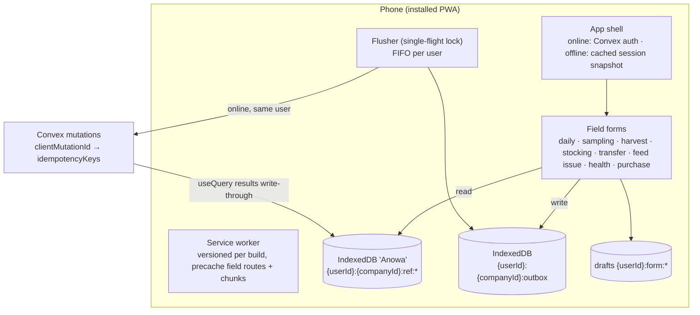

# Architecture 08 — Mobile and Offline Architecture

Status: proposed. Binding decision D-010: generalize `lib/offlineOutbox.js` to all field forms; server-side idempotency (`clientMutationId`) so retries never double-write; outbox and caches namespaced per user and cleared at sign-out; offline-capable app shell (cached last-known user/session, cached reference data); PWA first, no native app now. D-013 puts the offline cold-start hang in Phase 0. Retires TD-026, TD-100, TD-101, TD-102, TD-108, TD-109, TD-110 (field part), TD-117, TD-155, and the mobile part of TD-088.

## 1. Current state

| Area | As built | Evidence |
|---|---|---|
| Field-ready screen | `/daily-entry` (`components/DailyUploadPage.js`, 919 lines): multi-cage batch, "Same as yesterday", numeric inputs, `localStorage` draft, QR deep link, offline outbox | doc 11 §1, §4.1 |
| Other field forms | Biweekly, harvest, purchase, transfer, stocking, feed issue, health, sales: no outbox; biweekly and purchase have no draft; `useMutation` forms hang offline | doc 11 §5.2; doc 10 §7.2, §13 |
| Cold start offline | `AuthWrapper` waits for `useConvexAuth` and `api.users.current`; skeleton forever | doc 11 §5.1 (`pages/_app.js:112-116`, `contexts/AuthContext.js:55-56`) |
| Outbox | One global `localStorage` key `pbafarm:outbox:daily-batch`; no user scoping; no idempotency key; flush only while `/daily-entry` is open; regex network detection; no flush lock | doc 13 §16; `lib/offlineOutbox.js:8,51-58` |
| Shared phones | Outbox, drafts (`pbafarm:form:*`), lookups cache, `persist:root`, LLM keys survive sign-out; next user flushes the previous user's queue | doc 12 §5.2; doc 10 §12 |
| Service worker | `pbafarm-v1` never bumped or pruned; caches non-OK navigations; precaches only `/daily-entry`, `/dashboard` HTML; Google Fonts not cached | doc 11 §6; `public/sw.js` |
| Manifest | SVG icons only; fixed "Anowa" name; `start_url: /daily-entry` | doc 13 §15 |
| Dates | "Today" in UTC at 31 sites; drafts keep module-load dates | doc 11 §5.3; doc 10 §7.2 |
| Weight | ~295 KB gz JS on Home and Cages tabs (recharts), tour engine and Redux in `_app` | doc 11 §9 |

What to keep: the daily-entry interaction model, line-level error mapping, `DependencyEmpty`, the outbox's distinction between network and data errors and its retention of failed items for the user to resolve.

## 2. Target architecture



## 3. Offline app shell (Phase 0 for the cold-start part)

**Session snapshot.** When online and signed in, `AuthContext` writes `{ userId, companyId, name, roleKey, permissions, siteScope, companySettings (locale, terminology version), savedAt }` to `pbafarm:{userId}:session` and the last signed-in `userId` to `pbafarm:lastUser`. It contains no tokens (Convex Auth keeps its own JWT/refresh token in `localStorage`).

**Offline start.** `AuthWrapper` renders the app in *offline mode* when all hold: `navigator.onLine === false` or the Convex auth state is still loading after 4 s; a snapshot exists for `pbafarm:lastUser`; the snapshot is younger than 14 days. Offline mode:

- shows a persistent "Offline — entries will be sent when you reconnect" banner;
- enables only field routes (daily entry, sampling, harvest, stocking request, transfer request, feed issue, health) with data from the reference cache; other routes show "Needs connection";
- never shows another user's cached data (namespaced keys);
- switches back to normal mode as soon as `useConvexAuth` resolves; if the server then reports `accessState !== 'ok'` (disabled, removed, no organization — `03` §7), the app signs out and the outbox for that user is kept for an admin decision (§6), not flushed.

Security: offline mode reveals only data that this user already had on this device; every queued write is still authenticated and authorized by the server on replay. A disabled user can still type entries offline, but they are refused on replay (`ACCOUNT_DISABLED`).

## 4. Reference-data cache

Stored in IndexedDB (not `localStorage`: size limits, synchronous writes, silent write failures — doc 11 §5.2), through a small wrapper `lib/offline/store.js` over the native API or `idb-keyval` (~1 KB; the only new dependency proposed here, justified by IndexedDB's verbose native API).

| Key (`{userId}:{companyId}:ref:` + …) | Content | Source query (online) | Refresh |
|---|---|---|---|
| `units:{locationId}` | Units with open occupancy, batch number, count, last ABW, unit type, group | `production.units.listForField({ locationId })` | Write-through on every `useQuery` result |
| `feedTypes` + `siteStock:{locationId}` | Feed types, bag sizes, site balances | `feed.listFeedTypes`, `inventory.listStockLevels({ locationId })` | Same |
| `species`, `sizeGrades`, `mortalityCauses` | Org lists (`04`) | org config queries | On change |
| `customFieldDefs:{entity}`, `formLayouts:{formKey}`, `terminology` | Customization (`06`) | customization queries | On version change |
| `members` | Names and ids for pickers (supervisor fields store ids, not names — TD-067) | `org.memberships.directory` | Daily |
| `dailyLogged:{locationId}:{date}` | Units already logged for the date | `dailyRecords.listForDate` (company + date index) | Write-through |

Keys include `locationId` where data is site-specific, fixing the stale-site lookups cache (doc 11 §5.2).

## 5. Outbox

### 5.1 Item format and registry

```js
// lib/offline/outbox.js
/** @typedef {{
 *   id: string,                 // = clientMutationId (crypto.randomUUID())
 *   kind: OutboxKind,           // registry key
 *   args: object,               // mutation args, canonical units, includes clientMutationId
 *   userId: string, companyId: string, locationId?: string,
 *   createdAt: number, attempts: number, nextAttemptAt: number,
 *   status: 'queued' | 'sending' | 'needs_attention',
 *   lastError?: { code: string, message: string, fieldErrors?: Record<string,string>, lineIndex?: number }
 * }} OutboxItem */

export const OUTBOX_KINDS = {
  'daily.batch':        api.dailyRecords.createBatch,
  'sampling.create':    api.biweeklyRecords.create,        // later production.sampling.createBatch
  'harvest.create':     api.harvest.create,
  'stocking.request':   api.stocking.createStocking,
  'transfer.request':   api.fishTransfers.createFishTransfer,
  'feed.issue':         api.feed.createIssue,
  'health.create':      api.health.create,
  'purchase.create':    api.feed.createPurchase,
}
export function enqueue(kind, args, ctx /* { userId, companyId, locationId } */): Promise<OutboxItem>
export function flush({ userId, companyId }): Promise<{ sent: number; failed: number }>
export function pending({ userId, companyId }): Promise<OutboxItem[]>
export function discard(id): Promise<void>
export function clearUser(userId): Promise<void>
```

Offline is **create-only**: corrections, approvals, deletes and settings require a connection. This removes edit conflicts from the offline problem.

### 5.2 Flushing

- Triggers: app start, `online`, `visibilitychange` to visible, a 60 s timer while items are queued, and "Send now". The flusher lives in `_app.js` (not only in `/daily-entry`), so queued items go out from any screen.
- Single flight: `navigator.locks.request('pbafarm-outbox', …)` where available, else a `BroadcastChannel` leader election; prevents concurrent flushes from several tabs (doc 13 §16 d).
- Order: FIFO per (user, company); a `needs_attention` item does not block later items unless they depend on it (same unit and date).
- Transport: the Convex React client's `mutation()` once connected (no second client); the HTTP client is kept only as a fallback if the WebSocket is not connected after the `online` event.
- Only items whose `userId` equals the signed-in user and whose `companyId` equals the active organization are flushed (TD-026).
- Error handling by `ConvexError` code (D-011), not by regex: network errors → back-off (30 s, 2 min, 10 min, 30 min); `IDEMPOTENT_REPLAY` → success; validation codes (`STOCK_NEGATIVE`, `DUPLICATE_ENTRY`, `CUSTOM_FIELD_*`, `SITE_FORBIDDEN` …) → `needs_attention` with field and line errors, opening the form pre-filled for correction.

### 5.3 Server idempotency

```ts
// convex/kernel/tables.ts
idempotencyKeys: defineTable({
  companyId: v.id('companies'),
  userId: v.id('users'),
  key: v.string(),                 // clientMutationId
  operation: v.string(),           // 'dailyRecords.createBatch'
  result: v.optional(v.string()),  // JSON of the original return value, ≤ 4 KB
  createdAt: v.number(),
}).index('by_userId_and_key', ['userId', 'key'])
  .index('by_createdAt', ['createdAt'])

// convex/kernel/idempotency.ts
export async function withIdempotency<T>(
  ctx: MutationCtx, m: MemberContext,
  key: string | undefined, operation: string,
  run: () => Promise<T>,
): Promise<T>   // returns the stored result when the key exists for this user and operation
```

Every mutation in `OUTBOX_KINDS` (and the new production operations in `05` §4) takes `clientMutationId: v.optional(v.string())`. Because the key row and the business writes commit in one transaction, a lost response followed by a retry returns the first result instead of "Daily record already exists" (TD-102). Keys older than 30 days are deleted by a batched job. The natural uniqueness (one daily record per unit and date) stays as a second guard.

## 6. Sign-out and shared devices (D-010)

`AuthContext.signOut()`:

1. If the user's outbox has items: block with "You have N entries not sent. Connect and send them, or discard them." Options: *Send now* (if online), *Discard*, *Cancel*. This honours "cleared at sign-out" without silently losing field data.
2. `clearUser(userId)`: outbox, reference cache, session snapshot, drafts (`pbafarm:{userId}:form:*`), active location.
3. Remove global legacy keys once: `persist:root`, `pbafarm:outbox:daily-batch` (after migrating its items, §9), `pbafarm:daily-entry:lookups`, `pbafarm_llm_settings`, `pbafarm:form:*`.
4. Then `convexSignOut()`.

Forced sign-out (server `accessState` disabled/removed): the outbox is not flushed and not deleted automatically; the next sign-in by the same user offers it again; a different user only sees "Entries from another account are stored on this device" with a discard option for admins.

## 7. Field UX changes

| Change | Fixes | Where |
|---|---|---|
| Sticky footer with Save and line count; 48 px primary actions; confirm on "Clear all" and "Discard" | TD-108, TD-110 | `components/ui` `FormActions`, daily entry |
| Blank feed means "not recorded" (validation asks), explicit "0" allowed | TD-108 (owner to confirm, doc 11 Q7) | daily entry validation |
| Per-unit compact line: the two typed numbers first, unit and feed type as chips | TD-108 | daily entry layout |
| Save allowed for lines with enough stock; short lines flagged individually | TD-108 | daily entry |
| Multi-unit sampling batch (`production.sampling.createBatch`) with `?unit=` deep link and QR route | TD-109 | new sampling screen |
| In-app QR scanner (`BarcodeDetector` where supported, camera-app fallback); labels encode a short code `/{companyCode}/u/{unitCode}` resolved by a query, not the raw id or print-time origin | TD-117 | `pages/cages/qr-codes.js`, new `/u/[code]` route |
| Toasts above the tab bar; AI button moved into the More menu on phones | TD-110 | `Toast.js`, `AiAssistant.js` |
| Outdoor theme (3:1 borders, larger helper text), theme toggle on phones | TD-110 | `styles/theme.css`, `Header.js` |
| "Today" from the site time zone, computed at render | TD-066 | `lib/format/date.js` |
| Configurable phone tab bar | TD-110 | `06` navigation |

## 8. Service worker and PWA

| Change | Detail |
|---|---|
| Versioned cache | Cache name includes the build id (generated into `public/sw.js` at build time, or `sw.js?v=<buildId>` registration); `activate` deletes other `pbafarm-*` caches (TD-155) |
| Precache field routes | `/daily-entry`, `/sampling`, `/harvest`, `/stocking`, `/fish-transfers`, `/feed-issue`, `/health` HTML plus their chunks from the build manifest |
| Only cache `res.ok` | No cached 500s or redirects |
| Update prompt | "New version available — reload" when a waiting worker exists; no mid-session `skipWaiting` |
| Fonts | Self-host with `next/font` so offline typography works and no third-party request (doc 13 §25) |
| Icons and name | PNG 192/512 + maskable, `apple-touch-icon` PNG; manifest name from the platform brand, organization branding inside the app |
| Bundle | `recharts` and `xlsx` via `next/dynamic`/dynamic `import()`; tour engine loaded on demand; Redux removed (`02` §5.1) — target ≤ 220 KB gz first load on field routes |
| Background Sync | Not used: the service worker cannot read the Convex auth token and the API is Chromium-only; flushing stays in the page |

## 9. Migration

| Step | Phase | Change | Compatibility | What could break |
|---|---|---|---|---|
| 1 | 0 | Offline cold start: session snapshot + offline mode for `/daily-entry` only | Online behaviour unchanged | Auth edge cases (expired refresh token while offline) — offline mode still renders; replay fails with `UNAUTHENTICATED`, items kept, user signs in again |
| 2 | 0 (recommended with SEC-001) | Namespace the existing outbox and drafts by user; migrate the global `pbafarm:outbox:daily-batch` items to the namespace of the first user who signs in **only if** each item's recorded user matches (items have no user today → they are shown to the next signed-in admin as "unattributed entries" to send or discard) | Daily entry continues to work | An unattributed queue on a shared phone needs an admin decision |
| 3 | 0 (OPS-001) | `ConvexError` codes on `dailyRecords.createBatch`; client classification by code | Messages unchanged in dev; preserved in prod | — |
| 4 | 7 (MOBILE) | `idempotencyKeys` + `clientMutationId` on outbox mutations | Optional arg | — |
| 5 | 7 | `lib/offline/*` (IndexedDB, registry, global flusher, sign-out purge); move daily entry onto it | `localStorage` items migrated once | Storage quota errors surfaced, not swallowed |
| 6 | 7 | Offline for sampling (batch), harvest, stocking, transfer, feed issue, health, purchase — one form per release | Forms keep online behaviour | Each form needs component tests for offline enqueue and replay |
| 7 | 7 | SW versioning, precache, fonts, icons, bundle splitting | — | First load after deploy fetches new chunks (expected) |

## 10. Native app: when it would be justified

Only if a hard requirement cannot be met by the PWA: reliable background sync on iOS, Bluetooth scales or probes, kiosk/MDM deployment, or very long offline periods with large reference data. The `features/` hooks and `lib/offline` registry are written without DOM assumptions where practical so a React Native client could reuse them. Not planned (D-010).

## 11. Risks

- Offline mode on a phone shared by several users shows the last user's cached data to anyone who opens the app offline; mitigated by namespacing, sign-out purge, and the 14-day snapshot limit, but a device left signed in remains a device left signed in. A PIN lock for offline mode is an option (open question).
- IndexedDB can be evicted under storage pressure on cheap phones; the app requests `navigator.storage.persist()` and shows a warning when not granted.
- Create-only offline means corrections wait for signal; acceptable for field work, confirmed with the owner.
- Idempotency keys add one indexed read and one write per offline-capable mutation.

## 12. Open questions

1. Are phones shared between staff or between sites (decides PIN lock and the sign-out flow strictness) — doc 12 Q4, doc 11 Q3?
2. Should blank feed mean "not fed" or "not recorded" (doc 11 Q7)?
3. How long can a phone stay offline in practice (decides the snapshot age limit and cache size)?
4. Are cage QR labels already deployed (changing the encoded URL format needs a redirect from the old `/daily-entry?cage=<id>` form, which is kept)?
