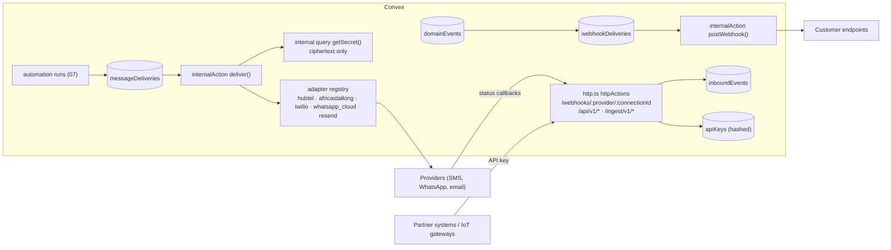

# Architecture 09 — Integration Architecture

Status: proposed. Binding decision D-009: per-organization credentials stored encrypted (key in Convex environment, decrypted only inside actions, never returned to clients, write-only in the UI); outbound providers behind an adapter interface (SMS: Hubtel, Africa's Talking, Twilio; WhatsApp Cloud API; email); inbound via signed `httpAction` webhooks; public API via organization API keys stored hashed. Related: D-008 (automation emits deliveries), D-011 (separate deployments, so separate keys), D-001 (no extra infrastructure now). Addresses MASTER-PROMPT PART 10-F; retires TD-020, TD-021 (credential part) and the "completely missing" integration rows of doc 13.

## 1. Current state

| Integration | Status | Evidence |
|---|---|---|
| Convex HTTP router | Only `auth.addHttpRoutes(http)`; no app `httpAction` | doc 13 §13; `convex/http.ts:6` |
| Outbound from Convex | None; no action calls an external API | doc 06 §4.6; doc 13 §7–10 |
| Email, SMS, WhatsApp, push | Completely missing (no password reset or invitation mail possible) | doc 13 §7–10 |
| LLM | Next route `pages/api/llm/chat.js` with server env keys; browser path with user-pasted keys in plaintext `localStorage`; no rate limit, client-chosen model | doc 13 §11; doc 12 §5.1, §5.4 |
| Public API / API keys / webhooks | Completely missing | doc 13 §14 |
| Weather, IoT, accounting, payments, FX | Completely missing | doc 13 §26–31 |
| Credential storage | None besides platform env vars | doc 13 gap table |

Nothing here needs migrating except the LLM key handling.

## 2. Architecture



## 3. Schema

`convex/integrations/tables.ts`:

```ts
export const integrationProvider = v.union(
  v.literal('hubtel'), v.literal('africastalking'), v.literal('twilio'),
  v.literal('whatsapp_cloud'), v.literal('resend'), v.literal('sendgrid'),
  v.literal('open_meteo'), v.literal('openweather'),
  v.literal('llm_gemini'), v.literal('llm_openai'), v.literal('llm_anthropic'),
)

integrationConnections: defineTable({
  companyId: v.id('companies'),
  provider: integrationProvider,
  channel: v.union(v.literal('sms'), v.literal('whatsapp'), v.literal('email'),
                   v.literal('weather'), v.literal('llm'), v.literal('accounting')),
  displayName: v.string(),
  status: v.union(v.literal('draft'), v.literal('active'), v.literal('error'), v.literal('disabled')),
  config: v.record(v.string(), v.union(v.string(), v.number(), v.boolean())), // NON-secret: senderId, fromEmail, phoneNumberId, region
  secretHint: v.optional(v.string()),        // last 4 characters, for the write-only UI
  isDefaultForChannel: v.boolean(),
  lastTestedAt: v.optional(v.number()),
  lastError: v.optional(v.string()),
  createdBy: v.id('users'),
  updatedAt: v.number(),
}).index('by_companyId_and_channel_and_status', ['companyId', 'channel', 'status']),

integrationSecrets: defineTable({            // read only by internal queries; never by public functions
  companyId: v.id('companies'),
  ownerTable: v.union(v.literal('integrationConnections'), v.literal('webhookEndpoints')),
  ownerId: v.string(),
  ciphertext: v.bytes(),                     // AES-256-GCM
  iv: v.bytes(),                             // 12 bytes, random per encryption
  keyVersion: v.number(),                    // which INTEGRATIONS_KEK_V{n} encrypted it
  updatedAt: v.number(),
}).index('by_ownerTable_and_ownerId', ['ownerTable', 'ownerId']),

messageDeliveries: defineTable({
  companyId: v.id('companies'),
  connectionId: v.optional(v.id('integrationConnections')), // undefined = platform channel (in-app, platform email)
  channel: v.union(v.literal('sms'), v.literal('whatsapp'), v.literal('email'), v.literal('push')),
  to: v.string(),
  recipientUserId: v.optional(v.id('users')),
  templateKey: v.string(),
  body: v.string(),                          // rendered, ≤ 4 KB
  status: v.union(v.literal('queued'), v.literal('sending'), v.literal('sent'), v.literal('delivered'),
                  v.literal('failed'), v.literal('cancelled')),
  attempts: v.number(),
  nextAttemptAt: v.optional(v.number()),
  providerMessageId: v.optional(v.string()),
  error: v.optional(v.string()),
  runId: v.optional(v.id('automationRuns')),
  costEstimate: v.optional(v.number()),
  createdAt: v.number(),
  updatedAt: v.number(),
})
  .index('by_companyId_and_createdAt', ['companyId', 'createdAt'])
  .index('by_providerMessageId', ['providerMessageId'])
  .index('by_status_and_nextAttemptAt', ['status', 'nextAttemptAt']),

apiKeys: defineTable({
  companyId: v.id('companies'),
  name: v.string(),
  prefix: v.string(),                        // public 10-char id, e.g. 'pbk_7Hq2xK'
  hash: v.string(),                          // SHA-256 hex of the full key; full key shown once
  scopes: v.array(v.string()),               // ≤ 20, from the scope catalog
  locationIds: v.optional(v.array(v.id('farmLocations'))),
  createdBy: v.id('users'),
  createdAt: v.number(),
  expiresAt: v.optional(v.number()),
  revokedAt: v.optional(v.number()),
  lastUsedHour: v.optional(v.number()),      // updated at most hourly to avoid write contention
})
  .index('by_prefix', ['prefix'])
  .index('by_companyId', ['companyId']),

webhookEndpoints: defineTable({
  companyId: v.id('companies'),
  url: v.string(),                           // https only; validated (§7)
  eventTypes: v.array(v.string()),           // ≤ 30, from the event catalog (07 §4)
  status: v.union(v.literal('active'), v.literal('disabled')),
  consecutiveFailures: v.number(),
  disabledReason: v.optional(v.string()),
  createdBy: v.id('users'),
  updatedAt: v.number(),
}).index('by_companyId_and_status', ['companyId', 'status']),

webhookDeliveries: defineTable({
  companyId: v.id('companies'),
  endpointId: v.id('webhookEndpoints'),
  eventId: v.id('domainEvents'),
  status: v.union(v.literal('queued'), v.literal('succeeded'), v.literal('failed'), v.literal('abandoned')),
  attempts: v.number(),
  nextAttemptAt: v.optional(v.number()),
  responseStatus: v.optional(v.number()),
  lastError: v.optional(v.string()),
  createdAt: v.number(),
}).index('by_endpointId_and_createdAt', ['endpointId', 'createdAt']),

inboundEvents: defineTable({
  companyId: v.optional(v.id('companies')),
  provider: v.string(),
  connectionId: v.optional(v.id('integrationConnections')),
  externalId: v.string(),                    // provider event/message id, for dedupe
  signatureValid: v.boolean(),
  kind: v.string(),                          // 'delivery_status' | 'inbound_message' | 'reading'
  payload: v.string(),                       // JSON, ≤ 64 KB, treated as untrusted data
  status: v.union(v.literal('received'), v.literal('processed'), v.literal('ignored'), v.literal('failed')),
  receivedAt: v.number(),
}).index('by_provider_and_externalId', ['provider', 'externalId']),
```

Secrets sit in their own table so no public query can return them by accident: public functions never read `integrationSecrets`, and a test asserts that no exported query or mutation references it.

## 4. Credential protection (D-009)

| Concern | Design |
|---|---|
| Algorithm | AES-256-GCM via Web Crypto (`crypto.subtle`) inside actions; additional authenticated data = `companyId:ownerTable:ownerId:provider`, so a ciphertext copied to another row fails to decrypt. If `crypto.subtle` is unavailable in the default Convex runtime, the encrypt/decrypt helpers move to a `"use node"` action file using `node:crypto` (verify during INT-001) |
| Key | `INTEGRATIONS_KEK_V1` (32 random bytes, base64) in the Convex deployment environment; different per dev/staging/prod deployment (D-011) |
| Write path | Public **action** `integrations.connections.setSecret({ connectionId, secret })`: authorizes via `ctx.runQuery(internal.org.authz.checkPermission, { permission: 'integrations.manage' })` (identity propagates to the internal query), encrypts, stores through `internal.integrations.secrets.put`. The plaintext is never written to any table or log |
| Read path | Only `internal` actions (`deliver`, `postWebhook`, `test`) load the ciphertext via an internal query and decrypt in memory |
| UI | Write-only: shows provider, sender, `secretHint` (`••••1234`), last test result; "Replace" and "Test" buttons |
| Rotation | Add `INTEGRATIONS_KEK_V2`; internal job re-encrypts rows with `keyVersion < 2` in batches; remove V1 when none remain |
| Deletion | Disabling a connection keeps the secret; deleting removes the secret row; both audited (audit records the action, never the value) |
| Logging | Adapters must not log request bodies containing credentials; errors are truncated and stripped of auth headers before storage |

## 5. Outbound adapters

```ts
// convex/integrations/adapters/types.ts
export type DecryptedCredentials = Record<string, string>   // e.g. { clientId, clientSecret } or { apiKey }

export interface MessagingAdapter {
  provider: IntegrationProvider
  channel: 'sms' | 'whatsapp' | 'email'
  configSchema: Record<string, 'string' | 'number' | 'boolean'>   // validated on save
  send(input: {
    to: string                       // E.164 phone or email
    body: string
    subject?: string                 // email
    templateName?: string            // WhatsApp approved template
    templateParams?: string[]
  }, creds: DecryptedCredentials, config: Record<string, unknown>): Promise<{ providerMessageId: string; accepted: boolean }>
  classifyError(err: unknown): 'transient' | 'permanent'
  verifyCallback?(req: Request, creds: DecryptedCredentials, config: Record<string, unknown>): Promise<boolean>
  parseCallback?(body: unknown): { providerMessageId: string; status: 'delivered' | 'failed'; error?: string }[]
}
```

Registry in `convex/integrations/adapters/index.ts`. Initial adapters, in order of likely use for Ghanaian farms (doc 13 Q2, to confirm): `hubtel` (SMS), `africastalking` (SMS), `whatsapp_cloud` (WhatsApp, template messages; 24-hour session rule), `twilio` (SMS/WhatsApp for other markets), `resend` (email over HTTP — the default Convex runtime has `fetch` but no raw sockets, so SMTP is not offered).

Delivery flow (from `07` §6): `messageDeliveries` row `queued` → `internal.integrations.deliver({ deliveryId })` action → `adapter.send` → `internal.integrations.deliveries.markSent/markFailed`; transient errors retry with back-off (1, 5, 30, 120 min, max 5), permanent errors fail immediately; per-organization rate limit and monthly budget checked before sending. `@convex-dev/workpool` is the candidate for parallelism limits and retries (`07` §8).

**Platform channels** (not organization credentials): invitation and password-reset email use a platform email connection configured in the deployment environment (for example `RESEND_API_KEY`, or the `@convex-dev/resend` component), because they are needed before an organization has configured anything (`03` §8 step 6, TD-008, TD-023).

## 6. Inbound webhooks

`convex/http.ts` adds routes; every handler is an `httpAction` that does only: authenticate the sender → store an `inboundEvents` row (dedupe by `provider + externalId`) → schedule internal processing → respond quickly.

| Route | Purpose | Authentication |
|---|---|---|
| `POST /webhooks/twilio/:connectionId` | SMS/WhatsApp status and inbound messages | `X-Twilio-Signature` HMAC over URL + params with the connection's auth token |
| `GET/POST /webhooks/whatsapp/:connectionId` | Meta verification challenge; message status, inbound replies | `hub.verify_token` on GET; `X-Hub-Signature-256` HMAC-SHA256 with the app secret on POST |
| `POST /webhooks/hubtel/:connectionId`, `/webhooks/africastalking/:connectionId` | Delivery reports | Provider mechanism where one exists (to verify per provider); otherwise an unguessable per-connection path token stored hashed, plus payload treated as untrusted and cross-checked against `messageDeliveries.providerMessageId` |
| `POST /ingest/v1/readings` | IoT / sensor readings (later) | API key with scope `ingest:write`; batch ≤ 500 readings |

Inbound replies (for example a worker replying "12 dead" on WhatsApp) are stored and shown; turning them into records is a later feature and would go through the same validated mutations as the UI.

## 7. Outbound webhooks

- Subscriptions per organization (`webhookEndpoints`), created by `integrations.manage`.
- Dispatch from `domainEvents` (`07`): one `webhookDeliveries` row per (endpoint, event) whose `eventTypes` match.
- Payload: `{ id, type, occurredAt, companyId, data }` with header `X-PBA-Signature: t=<unix>,v1=<hex HMAC-SHA256(secret, t + "." + body)>`; the signing secret is stored in `integrationSecrets` and shown once.
- Retries with back-off for 24 hours; the endpoint is disabled after 20 consecutive failures, with a notification to admins.
- URL validation: `https:` only; hostname must not be an IP literal, `localhost`, or a private, loopback or link-local range; ports 443/8443 only. Convex `fetch` resolves DNS itself, so DNS-rebinding to internal addresses cannot be fully excluded; impact is limited because Convex functions run outside the customer's network and the response body is not returned to the tenant (only status code).

## 8. Public API

| Aspect | Design |
|---|---|
| Transport | `httpAction` routes under `/api/v1/` in `convex/http.ts`, JSON |
| Authentication | `Authorization: Bearer pbk_<prefix>_<secret>`; lookup `apiKeys.by_prefix`; constant-time comparison of SHA-256(full key) with `hash`; refuse revoked/expired keys; refuse if the organization is not approved |
| Authorization | Scopes from a catalog (`units:read`, `batches:read`, `daily:write`, `harvest:read`, `inventory:read`, `events:read`); optional `locationIds` restriction; the handler builds an `ApiKeyContext` (company, scopes, site scope) and calls the same internal domain functions as the UI, so validation and the production engine are shared |
| Writes | `POST /api/v1/daily-records:batch` maps to the same handler as `dailyRecords.createBatch`, requiring `Idempotency-Key` (stored in `idempotencyKeys`, `08` §5.3) |
| Reads | Cursor pagination (`?cursor=&limit=` ≤ 200) over the same indexed queries |
| Limits | `@convex-dev/rate-limiter` per key and per organization; request body ≤ 1 MB |
| Versioning | Path version; additive changes only within v1 |
| Audit | Every write audited with `actorApiKeyId` |

## 9. Other integrations (later phases)

| Integration | Design sketch | Depends on |
|---|---|---|
| Weather | Daily scheduled action per site with `coordinates` (`04`) calling Open-Meteo (no key) or an org's OpenWeather key; stores a small `weatherObservations` table (site, date, temperature, rainfall, wind); used by dashboards and automation conditions | Site coordinates (FARM) |
| IoT sensors | `/ingest/v1/readings` → `waterQualityReadings` (unit, parameter, value, measuredAt) + hourly rollups + threshold events; a separate gateway only when volume justifies it (`02` §7) | INT API keys, POND/RAS phases |
| Accounting (Xero, QuickBooks, Sage) | Export-first: chart-of-account mapping table, scheduled export of sales and expenses as journals via OAuth connection; resumable cursor jobs | Finance (INV phase) |
| Payments / mobile money | Out of scope until invoicing exists | Finance |
| LLM | Move the assistant behind a Convex action `ai.chat` that reads farm context through internal queries (the client no longer supplies context), applies a model allow-list, message-size cap and `@convex-dev/rate-limiter` per user and organization; organization-provided LLM keys become `integrationConnections` with channel `llm`; user-pasted browser keys are removed; `/api/llm/*` retired after the switch | SEC (TD-020, TD-021) |

## 10. Migration

| Step | Phase | Change | Compatibility | What could break |
|---|---|---|---|---|
| 1 | 0/SEC | LLM route hardening in place: role/permission check (`ai.use`), model allow-list, size cap, rate limit; stop echoing provider errors; remove browser-key path or keep behind an admin flag | Assistant keeps working with server keys | Users who pasted their own key lose that option (intended) |
| 2 | 1 (ORG-001) | Platform email channel for invitations and password reset | — | Requires a verified sending domain |
| 3 | 11 (INT) | Tables, crypto helpers, adapter registry, connections UI (`/settings/integrations`) | New | — |
| 4 | 10–11 | Automation `notify` with SMS/WhatsApp/email through connections | In-app remains default | Paid-channel costs (budgets) |
| 5 | 11 | API keys, `/api/v1` read endpoints, then write endpoints with idempotency | New | — |
| 6 | 11 | Outbound webhooks | New | — |
| 7 | 11/13 | LLM via Convex action; retire `/api/llm/*` | Same UI | Provider model ids updated in one place (TD-140) |

## 11. Risks

- Key compromise in the Convex environment exposes all organizations' credentials for that deployment; mitigated by restricting Convex team access, separate keys per deployment, rotation procedure, and minimal scopes requested from providers.
- Provider differences (Hubtel/Africa's Talking callback authentication) need verification against current provider documentation before going live.
- WhatsApp business-initiated messages require pre-approved templates; free-form alerts only inside the 24-hour customer window.
- Public API abuse: per-key rate limits, scopes, revocation, audit.

## 12. Open questions

1. Which SMS provider and which WhatsApp setup do current customers use or prefer (doc 13 Q2)?
2. Should password reset be email, SMS or admin-only (doc 13 Q3)?
3. Who pays for messages: the organization's own provider account (D-009 assumes yes) or a platform-billed bundle?
4. Is there an immediate partner (buyer, feed supplier, certifier) that needs API access, which would move the public API earlier?

## 13. As built (Phase 11)

### 13.1 Domain events used by integrations

- The outbox is AUTO-001's `domainEvents` table and `emitDomainEvent(ctx, type, payload, { companyId, locationId })` (`convex/lib/events.ts`). Phase 11 adds two event types to the shared catalog (`convex/automation/templates.ts` `EVENT_TYPES`): `sampling.recorded` (one per sampling save) and `inventory.stock.low` (edge-triggered when a feed type first reaches its minimum, from `applyStockChange`).
- Daily entries (`daily.recorded`) and stock movements (`stock.*`: stocking approval, transfers, harvest) come from AUTO-001 and the production engine; Phase 11 does not emit duplicates.
- Events from public API writes carry `origin: 'api'` and `apiKeyId` in their payload.

### 13.2 Public API v1 (INT-004)

- Keys: `pbk_<10 base62>_<32 base62>`, generated in an action (`apiKeys.create`), SHA-256 stored in `apiKeys.hash`, shown once. Scopes from `convex/integrations/apiScopes.ts`; optional site list; optional expiry; revoke. `lastUsedAt` written at most every 5 minutes. A key stops working when its creator is deactivated or leaves the company, or the company is no longer approved.
- Requests: `Authorization: Bearer <key>` → `internal.publicApi.authorize` (constant-time hash compare, scope, `apiPerKey` 120/min burst 60, `apiPerCompany` 600/min) → internal query/mutation. httpActions are Effect programs (`convex/integrations/apiHttp.ts`); all failures are `{ error: { code, message } }` with 400/401/403/404/413/422/429 (Retry-After).
- Reads: `GET /api/v1/{cages|daily-records|sampling|harvests|feed-stock|sales}` (cursor pages, `limit` ≤ 200, `from`/`to` on dated lists, newest first) and `GET /api/v1/{resource}/{id}`. Company-indexed; site-limited keys filter by site, so a page may hold fewer than `limit` items.
- Writes: `POST /api/v1/daily-records` and `POST /api/v1/sampling` call the same functions as the UI batch screens (`saveDailyBatch`, `saveSamplingBatch`). The actor is the key's creator downgraded to role `user` and limited to the key's sites (`convex/lib/apiActor.ts`), so admin overrides are never available; `logAudit` records `apiKeyId`. `Idempotency-Key` is required: same key and body replays the stored response (`Idempotent-Replayed: true`), a different body is 422, a refused write stores nothing. Keys are kept 30 days (`prune api idempotency keys` cron).
- Contract: `GET /api/v1/openapi.json` (OpenAPI 3.1, `convex/integrations/openapi.ts`); in-app docs at `/api-docs`; key management at `/api-keys` (admins).

### 13.3 Outbound webhooks (INT-005)

- Tables: `webhookEndpoints` (url, eventTypes, status, consecutiveFailures, secretHint) and `webhookDeliveries` (payload kept for exact redelivery, status `pending|succeeded|failed`, attempts, responseStatus, short lastError; never the response body). Signing secrets live in `integrationSecrets.webhookEndpointId`, AAD `companyId:webhookEndpoints:endpointId`.
- Trigger: `emitDomainEvent` schedules `internal.webhooks.fanOut` when an active endpoint of the company subscribes to the type (the same pattern as automation). `fanOut` is idempotent per (event, endpoint) and adds `webhooks` to `processedBy`.
- Body: `{ id, type, occurredAt, companyId, siteId, data }` (`data` = event payload). Headers: `X-PBA-Signature: t=<unix>,v1=<hex HMAC-SHA256(secret, t + "." + body)>`, `X-PBA-Event-Id`, `X-PBA-Event-Type`, `X-PBA-Delivery-Id`. Receivers dedupe by event id.
- Delivery: `internal.webhooks.deliver` (action, Effect): 10 s per attempt, redirects refused, two quick jittered retries on network errors/5xx/timeouts (safe: receivers dedupe). Then scheduled retries after 1 m, 5 m, 30 m, 2 h, 4 h and 12 h (7 attempts, about 19 hours); then `failed`, redeliverable by hand. Twenty failed attempts in a row turn the endpoint off and notify the company's admins.
- Automation: action `{ kind: 'webhook', endpointId }` sends the triggering event (plus `rule`) or, for schedule rules, the check result as type `automation.rule`.
- Retention: deliveries 30 days (`prune webhook deliveries` cron).

### 13.4 Weather and sensor ingestion (INT-006, INT-007)

- Weather: `fetch site weather` cron (03:00 UTC) runs `internal.weather.refreshAll`, which pages through active sites of approved companies that have `latitude`/`longitude` (FARM-001) and calls Open-Meteo `/v1/forecast` with `past_days=1&forecast_days=3` in the site's time zone, five sites at a time (Effect: 10 s timeout, two retries on 5xx/network, Schema-checked body). Rows go to `weatherObservations` (one per site and local date; forecast rows are replaced later). Sites without coordinates are skipped. Admins can refresh a site (30-minute cooldown). The dashboard "Site conditions" card reads `weather.forSites` (client passes the date; no wall clock in the query).
- Sensors: `POST /ingest/v1/readings` (API key, scope `ingest:write`, shared rate limits). Up to 500 readings `{ deviceId, parameter, value, measuredAt, cageId?, siteId? }`; each is checked on its own (`convex/integrations/sensorLogic.ts`: parameter catalog and ranges, not more than 5 minutes ahead or 90 days back); stored rows link to the key's company cage or site and respect the key's site list; repeats of (device, parameter, measuredAt) count as duplicates, so gateways can resend. One `sensor.readings.recorded` event per batch carries `minDissolvedOxygen` and `maxTemperatureC` for automation rules. Response `{ accepted, duplicates, rejected: [{ index, reason }] }`, 422 when nothing was stored.
- Stays Convex-native (doc 14): a Cloudflare Worker in front of ingestion only when a trigger in doc 14 fires (sustained volume, device protocols other than HTTPS JSON, or edge buffering needs).


### 13.5 Inbound signed webhooks (INT-003)

- Admins (`integrations.manage`) create up to 10 inbound webhooks per company at `/inbound-webhooks`. Each has a public URL `<CONVEX_SITE_URL>/webhooks/in/inw_<24 base62>` and a `whsec_` signing secret shown once, AES-GCM encrypted in `integrationSecrets` (AAD `companyId:inboundWebhooks:id`, key `INTEGRATIONS_ENCRYPTION_KEY`). Rotating makes a new secret at once and leaves the webhook off until an admin turns it on.
- Senders sign like our outbound webhooks: `X-PBA-Signature: t=<unix>,v1=<hex HMAC-SHA256(secret, t + "." + body)>`, plus `X-PBA-Event-Id` (or a JSON `id`) and an optional `X-PBA-Event-Type`. The httpAction (`convex/integrations/inboundHttp.ts`, Effect) checks the size (≤ 256 KB), the timestamp (± 300 s), the HMAC (constant-time) and the JSON body; a per-webhook token bucket (600/min) applies.
- Replay protection and idempotency: `inboundWebhookEvents` is unique per (webhook, event id). A repeat within the tolerance window returns 200 `{ duplicate: true }` and only bumps a counter; a replay outside the window fails the timestamp check. Accepted events emit `inbound.webhook.received` (automation can react) and are audited; rejected requests are logged (60/hour per webhook) with the reason. Event log retention 30 days (`prune inbound webhook events` cron).
- Turning payloads into domain records is per integration and not part of INT-003; the event is stored and handed to automation.

### 13.6 Accounting export (INT-008)

- `/accounting-export` (`reports.export` + `finance.view`): sales, payments received (INV-009 `salePayments`), feed purchases and expenses for a date range (≤ 366 days) and optionally one site, read by `accountingExport.entries` (company-indexed, site scope enforced, at most 2000 rows per source with a `truncated` flag).
- `convex/lib/accountingExport.ts` turns rows into balanced two-line journal entries on a default chart (1000 cash, 1100 receivables, 1300 feed inventory, 2000 payables, 4000 fish sales, 6000 expenses; a credit sale debits receivables, a payment moves receivables to cash) and writes CSV in three layouts: a generic double-entry journal, QuickBooks Online journal-entry import and Xero manual-journal import. The CSV is built in the browser; nothing is sent to a third party.
- Follow-up (not built): live sync through OAuth connections, with a per-company account mapping table and a resumable cursor job (§9).

### 13.7 LLM gateway (INT-009)

- Organization keys: `llmCredentials` (one per company and provider: model, optional base URL, enabled, default, key hint). The key is AES-GCM encrypted in `integrationSecrets` (AAD `companyId:llmCredentials:id`), saved by an action and decrypted only in actions. Admin page `/ai-settings` (`integrations.manage`).
- Calls: `pages/api/llm/chat.js` and `insights.js` keep the SEC-004 guards (`ai.use`, model allow-list, message caps, per-user and per-company limits in `lib/llmProxyGuard.js`). They first call the Convex action `llmGateway.chat`, which re-checks `ai.use`, applies the same limits per user and company (`llmPerUser*`, `llmPerCompanyHour`) and calls the provider with the org key (Effect, `requestJson`, no retry on 4xx). If the company has no enabled key, the route falls back to the server key as before. Responses carry `keySource: 'org' | 'server'`.
- Usage log: `llmUsage` rows (user, provider, model, feature, source `org_key | server_key`, tokens, estimated cost from a public price table, duration, ok/error). Org-key rows are written by the action; server-key rows are reported by the authenticated Next route (`llmGateway.recordServerUsage`, rate limited 150/hour per user). Retention 400 days (`prune llm usage` cron). `/ai-settings` shows 30-day totals, top users and the paginated log.

### 13.8 Sensor analytics and alerts (ANLY-006)

- `/sensors` (`production.view`): per-unit and parameter min / average / max / last and breach counts over 24 h, 7 days or 30 days (`sensorAnalytics.summary`), and a bucketed time series chart with the allowed range (`sensorAnalytics.series`, bucket size picked to keep ≤ 240 points). Ranges come from the unit's water-quality thresholds (company overrides included). Site scope is enforced; another company's unit returns nothing.
- Alerts: on each ingest batch, `evaluateSensorReadings` takes the worst value per unit and parameter. A breach of dissolved oxygen, temperature, pH or ammonia notifies members with `production.view` at the unit's site through `convex/lib/notify.ts` (so each user's channel preferences and quiet hours apply). Low oxygen goes to in-app, SMS, WhatsApp and email as an error; others to in-app and email as warnings. At most one alert per unit and parameter per hour (`sensorBreachAlertPerUnit`), with a dedupe key per hour; the link opens `/sensors?unit=<id>`.

### 13.9 IoT ingestion Worker (CF-008)

- `workers/iot-ingest` (Cloudflare Worker, TypeScript, not deployed): `POST /v1/readings` authenticates a device from the KV registry `DEVICES` (`device:<id>` → `{ companyLabel, secret? | tokenSha256?, cageId?, siteId?, disabled? }`) by HMAC (`X-Device-Signature`, same scheme as §13.5) or a bearer token compared by SHA-256; checks and batches up to 2000 readings (body ≤ 1 MB), pins the device's cage or site, and forwards in chunks of 500 to Convex `POST /ingest/v1/readings` with one `ingest:write` API key held as a Worker secret (`CONVEX_INGEST_KEY`). Retries only network errors, timeouts and 5xx (safe: Convex dedupes by device, parameter and time); 4xx comes back to the device.
- The direct Convex endpoint stays live (rollback path). Deploy steps and follow-ups (Queues for bursts, registry management UI) are in `workers/iot-ingest/README.md`.
