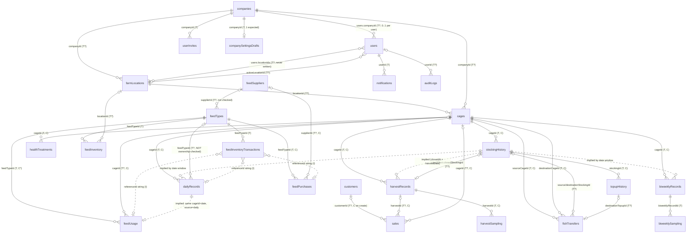

# 05 — Database Relationships

## Stage header

| Item | Detail |
| --- | --- |
| **Objective** | Map how the entities in the Convex schema relate today: users, companies, memberships, sites, cages, species, batches, stock movements, feeding, sampling, water quality, inventory, harvests, sales, notifications, audit. Mark cardinality and say whether each link is **typed**, **checked at write** or only **implied**. |
| **Files inspected** | `convex/schema.ts`; all write paths in `convex/*.ts` and `convex/lib/*.ts` (same set as doc 04); `lib/fishSpecies.js`; `components/PersonPicker.js` (how supervisor names are stored). |
| **Findings** | The model has a clear spine: company → site → cage → stocking (batch) → daily, biweekly and harvest records. Most of the joins that matter are not enforced. There is no membership entity, no species entity, and no fish-movement ledger. The batch identity (`stockingHistory`) is not referenced by daily, biweekly, harvest, sales or feed rows; they attach to the **cage** and are assigned to a cycle only by date window. Deleting a cage orphans everything under it. |
| **Dependencies** | Doc 04 (table detail), doc 08 (business logic), doc 09 (calculations), and the architecture documents on the organization and location model and the production engine. |
| **Risks** | Cycle attribution by date window breaks when a cage is restocked on the same day as a harvest, or when records are back-dated. Orphaned rows after `cages.remove`. Cross-tenant references (doc 04, F2). |
| **Outstanding questions** | Do production users ever stock a cage while the previous stocking is still open? Do they use `harvestType: 'partial'` followed by a complete harvest? Both affect how cycle boundaries are derived. |
| **Completion status** | Complete (from code). Not verified against production data. |

---

## 1. Link strength legend

Convex has no foreign keys. `v.id('t')` checks only that the value is an id for table `t`; it does not check that the document exists. In this document:

| Mark | Meaning |
| --- | --- |
| **T** | Typed: `v.id(...)` in the schema |
| **C** | Checked at write: the mutation loads the target, verifies it exists and (usually) verifies company ownership |
| **T?** | Typed but optional in the schema |
| **I** | Implied only: free-text string, copied value, or derived by date range or matching. No id stored |
| **—** | Does not exist |

No relationship has cascade semantics in the database. Cascades are written by hand only where noted.

---

## 2. Entity relationship diagram

The diagram shows the application tables. Auth library tables are summarized in §3.1. Lines drawn for **implied** relationships are labelled "implied".

---

## 3. Entity-by-entity

### 3.1 Identity: users, accounts, sessions

| Relationship | Cardinality | Strength | Where |
| --- | --- | --- | --- |
| `authAccounts.userId` → `users` | many accounts : 1 user (only one, `password`, in practice) | T (library) | `@convex-dev/auth` |
| `authSessions.userId` → `users` | many : 1 | T (library) | library |
| `authRefreshTokens.sessionId` → `authSessions` | many : 1 | T (library) | library |
| `users.email` ↔ `authAccounts.providerAccountId` | 1 : 1 | I (same lower-cased string) | `auth.ts:7-14`, `userAccounts.ts:52-62` |

No app table references `authSessions` or `authAccounts`. Deactivating a user (`users.active = false`) touches neither, and `requireUser` ignores the flag (doc 04, `users`; doc 07).

### 3.2 Organization, membership and sites

| Relationship | Cardinality | Strength | Notes |
| --- | --- | --- | --- |
| `users.companyId` → `companies` | user 0..1 : company many | T? | **This is the whole membership model.** A user can belong to at most one company. Role is a single field on the user (`users.role`), not per company. A user who moves companies loses the old one. |
| membership table | — | — | **Completely missing.** No join table, no per-company role, no invitation status history. |
| `userInvites.companyId` → `companies` | many : 1 | T | Pending invite keyed by email (I to `users.email`). Deleted when claimed. |
| `companies.submittedByUserId` / `approvedBy` → `users` | many : 1 | T? | Registration provenance |
| `companySettingsDrafts.companyId` → `companies` | 0..1 : 1 (by convention) | T | Read with `.first()`; uniqueness not enforced |
| `farmLocations.companyId` → `companies` | many : 1 | T? | A site belongs to one company. Sites with no company form the shared "greenfield" pool (doc 04, F1). |
| `users.activeLocationId` → `farmLocations` | many : 0..1 | T?, C (`farmLocations.setActiveLocation` checks company and site access) | UI context only, not an authorization grant |
| `users.locationIds[]` → `farmLocations` | many : many | T?, **never written** | Partially implemented: read by `tenancy.assertLocationAccess` and `farmLocations.list`, but no mutation sets it. Site restriction is therefore inert. |
| company → "farm" | — | — | There is **no "farm" entity** between company and site. "Farm" in the UI means a `farmLocations` row. |

### 3.3 Production units, species and batches

| Relationship | Cardinality | Strength | Notes |
| --- | --- | --- | --- |
| `cages.locationId` → `farmLocations` | many : 1 | T?, C on create and update (`writeLocationId`) | `cages.location` keeps a parallel **free-text** site name (I) |
| `cages.companyId` → `companies` | many : 1 | T? | |
| species | — | **I** | **No species table.** `cages.species` and `stockingHistory.species` are free strings. The client offers a fixed list (`lib/fishSpecies.js`: nile_tilapia, african_catfish, red_tilapia, mixed, other); the server accepts any string. No species-specific growth, FCR or density rules exist. |
| `stockingHistory.cageId` → `cages` | cage 1 : many stockings over time | T, C (`assertOwns`) | **The de facto batch.** One open (approved, not `closedAt`, not `deletedAt`) stocking per cage is *expected*. This is not enforced: `approveStocking` does not check for an existing open stocking. |
| batch identity | — | partial | `stockingHistory.batchNumber` (string, auto `CAGE-YYYYMMDD[-n]`). Per-company uniqueness is attempted only when auto-allocated. No other table stores `stockingId` except `topupHistory`, `fishTransfers` and `harvestRecords.cageEffect.closedStockingId`. |
| cage ↔ current batch | cage 1 : 0..1 open stocking | **I** (copied fields) | `cages.stockingDate`, `initialCount`, `initialAbw`, `species` and `status: 'active'` are **copies** of the approved stocking (`stocking.ts:278-286, 410-418`; `fishTransfers.ts:90-98`). `lib/growth.currentStocking` re-derives "current" by sorting approved, non-deleted stockings by date and picking the first one without `closedAt` (`growth.ts:38-47`). |
| `topupHistory.stockingId` → `stockingHistory` | many : 1 | T, C (`assertOwns`; must be approved) | A top-up has no `cageId`. The cage is reached through the stocking. |
| batch splitting and merging | — | I | A partial fish transfer into an empty cage creates a **new** stocking (new batch number) in the destination (`fishTransfers.ts:254-289`). Into an active cage, it creates a top-up on the destination's current stocking (`:290-326`). Lineage survives only as `fishTransfers.sourceStockingId` and the free-text `stockingHistory.sourceCage` and `notes`. |

### 3.4 Stock movements (fish)

All fish movement ends in **one number**, `cages.currentCount`. No movement table holds signed quantities for all event types.

| Movement | Record of the event | Link to batch | Effect on `cages.currentCount` | Strength |
| --- | --- | --- | --- | --- |
| Stocking | `stockingHistory` row | is the batch | **Set** to `fishCount` on approve (`stocking.ts:410-418`) or immediately if no approval is required | T |
| Top-up | `topupHistory` row | `stockingId` (T) | `+= fishCount` on approve (`stocking.ts:580-586`) | T |
| Transfer out | `fishTransfers` (source side) | `sourceStockingId` (T?, best-effort) | `-= quantity`, or set to 0 and status `empty` (`lib/fishTransferLogic.ts:25-45`) | T |
| Transfer in | `fishTransfers` plus a new `stockingHistory` or `topupHistory` | `destinationStockingId` / `destinationTopupId` (T?) | Set (new stocking) or `+=` (top-up) (`fishTransfers.ts:80-120`) | T |
| Daily mortality | `dailyRecords.mortality` (+ `mortalityCause` free text) | **I** (cage + date) | `-= mortality`; corrected by difference on update; restored on delete (`dailyRecords.ts:267-272, 511-520, 562-570`) | T to cage, I to batch |
| Harvest, partial | `harvestRecords` with `cageEffect.fishRemoved` | **I** | `-= estimatedCount`, floored at 0 (`harvest.ts:118-130`) | T to cage |
| Harvest, complete | `harvestRecords` with `cageEffect` | `cageEffect.closedStockingId` (T?) | Set to 0, status `harvested`, stocking `closedAt` set (`harvest.ts:132-160`) | T |
| Harvest from sampling | `harvestRecords` + `harvestSampling` | **none** | **No effect** (doc 04, F9) | — |
| Health event | `healthTreatments.fishAffected` | I | None | — |
| Manual correction | `auditLogs` only | — | Admin edits `currentCount` directly (`cages.update`) | — |

A source cage emptied by a full transfer is **not closed**: its stocking keeps no `closedAt`. A harvest marks the cage `harvested`, and `allowStockOnlyEmptyStatuses` decides whether it can be restocked.

### 3.5 Feeding and feed inventory

| Relationship | Cardinality | Strength | Notes |
| --- | --- | --- | --- |
| `feedTypes.companyId` → `companies` | many : 1 | T? | Feed catalog is company-wide; there is no per-site feed type |
| `feedTypes.supplierId` → `feedSuppliers` | many : 0..1 | T?, **not checked** on create or update | |
| `feedPurchases.feedTypeId` → `feedTypes` | many : 1 | T, C | |
| `feedPurchases.supplierId` → `feedSuppliers` | many : 1 (required by mutation) | T?, C | |
| `feedPurchases.locationId` → `farmLocations` | many : 1 | T?, C (`writeLocationId`) | Site that received the feed |
| `feedUsage.feedTypeId` → `feedTypes` | many : 1 | T, C for issue and usage; **not ownership-checked** for daily (`dailyRecords.deductDailyFeed`) | |
| `feedUsage.cageId` → `cages` | many : 0..1 | T?, C | |
| `dailyRecords.feedTypeId` → `feedTypes` | many : 0..1 | T?, **existence only, no ownership check** | Also stores `feedType` (name), `feedPrice` and `feedCost` copies (I) |
| `dailyRecords` ↔ `feedUsage` (source=`daily`) | 1 : 0..1 | **I** (same `cageId` + `usageDate`) | Created together in `deductDailyFeed`. Matched for deletion by cage and date, not by id (`dailyRecords.ts:97-105`). |
| `feedInventory.feedTypeId` → `feedTypes` | many : 1 | T | Lot (feed type × site × batch × expiry). Merge key is computed in code (`feedLedger.ts:56-63`). |
| `feedInventory.locationId` → `farmLocations` | many : 0..1 | T? | `null` = "shared" stock usable by any site (`feedLedger.ts:86-106`) |
| `feedInventoryTransactions.feedTypeId` → `feedTypes` | many : 1 | T | |
| `feedInventoryTransactions.referenceId` → purchase / usage / daily record / transaction / feed type | many : 0..1 | **I** (string) | Polymorphic and untyped. `reverseDailyFeed` relies on it (`by_reference`). |
| `feedTypes.currentStock` ↔ Σ ledger ↔ Σ lots | 1 : derived | **I** (denormalized) | Three representations (doc 04, F5) |
| Feed ↔ batch | — | **I** | Feed is attributed to a production cycle only by `dailyRecords` date window in `lib/growth.cageCycleGrowth` (`growth.ts:80-88`). `feedUsage` issues to a cage are **not** counted in cycle feed or eFCR. Only `dailyRecords.feedAmount` is. |

### 3.6 Sampling and growth

| Relationship | Cardinality | Strength | Notes |
| --- | --- | --- | --- |
| `biweeklyRecords.cageId` → `cages` | many : 1 | T, C | `batchCode` is a sampling-event code, **unrelated** to `stockingHistory.batchNumber` |
| `biweeklySampling.biweeklyRecordId` → `biweeklyRecords` | many : 1 | T | Hand-written cascade delete. Never read. |
| biweekly → batch | — | **I** | By date window `[stockingDate, closedAt or asOf]` (`growth.ts:68-77`) |
| `cages.currentWeight` ← latest `biweeklyRecords.averageBodyWeight` | 1 : derived | I (cached by `syncCageAbw`) | Uses the latest sample regardless of cycle |
| `harvestSampling.harvestId` → `harvestRecords` | many : 1 | T, C | Hand-written cascade delete. `cageId` is T? and **not checked**. |

### 3.7 Water quality

**No dedicated entity.** Dissolved oxygen, temperature and Secchi depth are optional columns on `dailyRecords` and on `biweeklyRecords` (`schema.ts:264-269, 288-290`). Readings are tied to a cage and date (I). They are not tied to a site-level sensor or sample point.

No query aggregates, thresholds or alerts on these values. `reports.exportBundle` does not even export them. Status: Partially implemented.

### 3.8 Inventory other than feed

**Completely missing.** There is no table for medicines or chemicals, fingerlings stock, nets or equipment. `healthTreatments.productName` and `dosage` are free text, and treatments do not draw down any inventory. "Inventory" in the app means feed only.

### 3.9 Harvests and sales

| Relationship | Cardinality | Strength | Notes |
| --- | --- | --- | --- |
| `harvestRecords.cageId` → `cages` | many : 1 | T, C | |
| `harvestRecords` → batch | many : 0..1 | T? via `cageEffect.closedStockingId` (complete harvests only); otherwise **I** by date | Partial harvests have no batch link |
| `sales.harvestId` → `harvestRecords` | many : 0..1 | T?, C on create | Sold weight ≤ harvest weight is checked only on create (`sales.ts:239-250`). Deleting a harvest **leaves its sales pointing at a missing row**. |
| `sales.cageId` → `cages` | many : 0..1 | T?, C | Copied from the harvest when omitted |
| `sales.customerId` → `customers` | many : 0..1 | T?, C on create, **not ownership-checked on update** | `sales.customerName` is a copy, or a free-text buyer when there is no customer (I) |
| `customers.companyId` → `companies` | many : 1 | T? | Company-wide; no site |

### 3.10 Health

`healthTreatments.cageId` → `cages`: many : 1, T, C. There is no link to a batch, to `dailyRecords.mortality`, or to inventory. `withdrawalUntil` is computed (`health.ts:93-99`), and `harvest.create` never reads it, so a harvest during a withdrawal window is not blocked or warned about.

### 3.11 Notifications and audit

| Relationship | Cardinality | Strength | Notes |
| --- | --- | --- | --- |
| `notifications.userId` → `users` | many : 1 | T, C (same company, except a user with no company can target another user with no company) | `link` is a free-text URL path. `companyId` is copied from the recipient. `locationId` is never set. |
| `notifications.dedupeKey` | unique by convention | I | `missed-entry:<date>:<userId>` and `low-stock:<date>:<userId>` (`reminders.ts:94,105`) |
| `auditLogs.userId` → `users` | many : 0..1 | T? | Always the actor |
| `auditLogs.recordId` → any table | many : 0..1 | **I** (string) + `tableName` string | Polymorphic, untyped. `tableName` naming is inconsistent (`daily_records` vs `dailyRecords`). |
| `auditLogs.companyId` → `companies` | many : 0..1 | T? | Actor's company, not the record's |

---

## 4. Integrity gaps by relationship

| # | Gap | Consequence | Where |
| --- | --- | --- | --- |
| R1 | `cages.remove` hard-deletes a cage with no check and no cascade | Orphaned `stockingHistory`, `topupHistory` (through stocking), `dailyRecords`, `biweeklyRecords`, `harvestRecords`, `harvestSampling`, `sales`, `healthTreatments`, `feedUsage` and `fishTransfers`. Reports then show "Unknown cage" or raw ids (`harvest.ts:76`, `reports.ts:474`). | `cages.ts:277-294` |
| R2 | `harvest.remove` does not handle linked `sales` | Sales reference a deleted harvest; P&L still counts the revenue | `harvest.ts:317-345` |
| R3 | No single open-stocking invariant | Two approved open stockings on one cage. `currentStocking` picks the latest by `stockingDate`; the cage copy reflects whichever was approved last. | `stocking.ts:385-427` |
| R4 | Daily, biweekly, harvest and sales rows link to cage, not batch | Cycle attribution by date only. Back-dated entries or same-day restocking go to the wrong cycle. Historical cycle KPIs after restocking rely on `closedAt` being right. | `growth.ts:53-123` |
| R5 | `dailyRecords` ↔ `feedUsage` linked by (cage, date) | Deleting or editing one daily record removes every `source: 'daily'` usage row for that cage and date | `dailyRecords.ts:97-105` |
| R6 | Ledger `referenceId` is an untyped string | No referential checks; reversal-by-reference depends on string equality | `feedLedger.ts:272-285` |
| R7 | Free-text references | `cages.location`, `feedInventory.location`, `stockingHistory.sourceLocation`, `sourceCage`, `transferSupervisor` and `samplingSupervisor`, `topupHistory.sourceLocation`, `healthTreatments.administeredBy`. People are stored as names (`components/PersonPicker.js` resolves to a name string), so renaming a user breaks the trail. | schema |
| R8 | Cross-tenant ids accepted | `dailyRecords.feedTypeId`, `feedTypes.supplierId`, `harvestSampling.cageId`, `sales.customerId` (update), `inventory.createTransfer` locations | doc 04, F2 |
| R9 | `users.locationIds` never written | User ↔ site assignment cannot be configured in-app; site restriction is inert | `tenancy.ts:67-80` |
| R10 | `companyId` optional on every child | Rows written by users without a company are unowned and shared | `tenancy.ts:18-43` |

---

## 5. Answers to the specific questions in the brief

| Question | Answer (status) |
| --- | --- |
| Do memberships exist? | **No.** A user has one `companyId` and one global `role`. Completely missing as an entity. |
| Companies = organizations? | Yes. `companies` is the tenant root, with approval workflow and settings. Implemented and working. |
| Farms vs locations? | There is no farm entity. `farmLocations` are sites under a company. Implemented but incomplete: assignment is not writable and reads are not site-enforced. |
| Production units? | `cages` only. There is no pond, tank or raceway type and no unit-type field. Implemented and working for cages. |
| Species? | Free-text code on `cages` and `stockingHistory`; no table. Partially implemented. |
| Batches? | `stockingHistory` acts as the batch. Production records attach to the cage, not to the batch. Partially implemented. |
| Stock movements? | Events in four tables (`stockingHistory`, `topupHistory`, `fishTransfers`, `harvestRecords.cageEffect`) plus daily mortality. The balance is one mutable counter (`cages.currentCount`). No unified movement ledger. Implemented but incomplete. |
| Feeding? | `dailyRecords.feedAmount` (production view) plus `feedUsage` and `feedInventoryTransactions` (stock view), linked by convention. Implemented but potentially defective (doc 04, F2 and F5). |
| Sampling? | `biweeklyRecords` (+ unused `biweeklySampling`) for growth; `harvestSampling` for harvest grading. Implemented and working, apart from the global batch-code uniqueness. |
| Water quality? | Columns on daily and biweekly records only; no analysis. Partially implemented. |
| Inventory? | Feed only (lots plus ledger). Non-feed inventory is completely missing. |
| Harvests? | `harvestRecords` with an undo-able cage effect, except harvests created from sampling. Implemented but potentially defective (doc 04, F9). |
| Sales? | `sales` + `customers`. Implemented and working for create, list and delete. Edit is wired on the server but has no UI caller. |
| Notifications? | Per-user rows; mortality alerts and daily cron reminders. Implemented and working, with no retention. |
| Audit? | `auditLogs` written by most mutations. Implemented but incomplete (doc 04, F20). |
