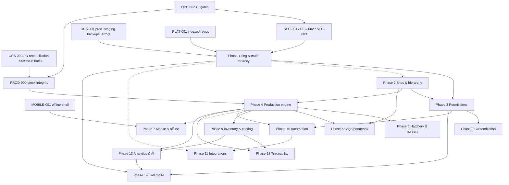

# 03 — Development Roadmap

Date: 2026-11-18. Status: **Proposed — awaiting owner approval** (MASTER-PROMPT PART 16). Nothing in this document is authorized for implementation yet.

Inputs: discovery docs 01–14, `docs/project-management/DECISION-LOG.md` (D-001..D-013), `02-feature-gap-analysis.md`, `04-migration-and-compatibility-plan.md` (migration IDs M0–M20), `05-testing-and-quality-plan.md`, `06-release-strategy.md`. Tracker IDs refer to `docs/project-management/MASTER-TRACKER.md`.

Order: **Phase 0 (Stabilize, D-013)**, then the brief's Phases 1–14 (PART 14). Phases 8–14 are described more briefly but with concrete tables, files and criteria.

Rules that apply to every phase:
- Every PR follows MASTER-PROMPT Rule 3: what exists, the problem, why change, files affected, dependents, what could break, backward compatibility. The PR template carries these headings.
- Schema changes follow widen → backfill → dual-write → switch reads → narrow (`04-migration-and-compatibility-plan.md` §1). No destructive migration without owner approval and a recovery plan (PART 16).
- A feature is "Verified" only after tests pass in CI, it is checked in staging, and the tracker is updated (PART 16).

---

## Phase 0 — Stabilize

**Business objectives.** Stop data corruption and unauthorized access that exist today. Give the business a real production deployment with backups. Ship nothing new.

**Exit criteria for the phase.** All Phase 0 tracker items Verified; the regression suite covers doc 09 scenarios S2, S3, S5, S6, S7, S8, S9, S12, S13 and doc 07 X1–X3, V1, V2, V4; production and staging deployments exist with a recorded restore drill; no user-facing query scans another tenant's rows.

### 0.1 PR reconciliation and merge order (OPS-000) — do this first

**What the brief assumed.** PR #7 (daily records view/edit) is independent; the stack #8 → #9 → #10 → #11 → #12 → #14 is open; #8 contains the harvest-edit defect (doc 09 S5) and must be fixed before it merges. The intended order was:

1. Fix S5 (and S6) on the #8 branch `feat/harvest-closes-cage`, with a regression test.
2. Merge #7 (independent).
3. Merge #8, then #9, #10, #11, #12, #14 in stack order, each rebased on `main` and green in CI.

**What GitHub shows (verified 2026-11-18, `gh pr view`, `git merge-base`).**

| PR | Branch → base | State | On `main`? |
|---|---|---|---|
| #7 Daily records page | `feat/daily-records-view` → `main` | Merged 00:54 UTC | Yes (`436ee37`) |
| #8 Harvest closes the cage | `feat/harvest-closes-cage` → `main` | Merged 00:54 UTC | Yes (`d298c5c`) |
| #9 Growth metrics | → `feat/harvest-closes-cage` | Merged 00:52 UTC, before #8 | Yes, via #8 (`4e21d2c`) |
| #10 Real feed KPIs | → `feat/growth-metrics` | Merged into stack branch | Yes, via #13 (`17ab355`) |
| #11 Daily reminders | → `fix/real-feed-kpis` | Merged into stack branch | Yes, via #13 (`c9e982c`) |
| #12 Per-site stock | → `feat/daily-reminders` | Merged into stack branch | Yes, via #13 (`fd5f63d`) |
| #13 Per-site stock + reminders + optional grades | `feat/per-site-stock` → `main` | Merged 09:43 UTC | Yes (`aeab3c1`, includes `34b1963`) |
| #14 UI consistency | `ui/consistent-pages` → `feat/per-site-stock` | Merged 10:35 UTC, **after** #13 | **No** (`89d4f9d` is not an ancestor of `origin/main`) |

`convex-deploy.yml` ran on the #7, #8 and #13 merges (runs 44211587565, 44211664428, 44278533164), so `vibrant-stork-860` serves this code now. Consequences:
- S5 (Critical) is live, not pending. Any user can trigger it from `pages/harvest.js` (`harvest.update` has no role check; `convex/harvest.ts:263`, `requireRole` only in `remove` at `:321`).
- PR #7 shipped a daily-record edit UI (`pages/daily-data.js`, 497 lines; `lib/databaseService.js:109-180`). Doc 09 says S8 "becomes Critical as soon as an edit UI for daily records ships". It has shipped. Discovery docs 02 and 14 describe the branch without #7 and still say the correction UI is missing; `main` differs from them on this point.
- PR #7 changed `dailyRecords.list` to "date and cage-date indexes with a bounded take" (commit `436ee37` message). `by_date` is not company-prefixed, so it moves from a full scan (doc 12 §6.1) to a truncated-window read (doc 04 F7). Still in PLAT-001 scope.

**Actions (in order).**
1. Freeze merges to `main` that touch `convex/**` until step 2 lands (the deploy workflow ships every such merge to the live deployment).
2. Hotfix PROD-000 items S5, S6 and S8 on a branch from `main` (`fix/cycle-scoped-undo`), with regression tests; merge; confirm the deploy run.
3. Re-land #14: open a new PR from `ui/consistent-pages` rebased on `main`. `89d4f9d` touches 51 UI files and no `convex/` file; none of #7's files (`pages/daily-data.js`, `components/Sidebar.js`, `components/Layout.js`, `lib/databaseService.js`) are in it, so conflicts are not expected (Medium confidence until rebased). Run `npm test` and `npx next build`.
4. Check the Convex dashboard deploy history for `vibrant-stork-860`: if any developer ran `convex dev` from another branch after 09:43 UTC, the deployed functions differ from `main` (doc 12 §7 "Drift"). Redeploy `main` if so.
5. Set tracker items PROD-901..UX-901 (the shipped PR work) to **Testing** until verified in staging (OPS-001).
6. Delete the merged stack branches after #14 is re-landed, so nothing else targets them.

**Rollback.** Each hotfix is a normal revert. Reverting #8 itself is not recommended: it also carries #9, and `harvestRecords.cageEffect` rows written since 00:54 UTC would be orphaned.

### 0.2 SEC-001 — Enforce active user, active membership/company status; remove the unassigned shared pool

| Item | Detail |
|---|---|
| Existing dependencies | `convex/lib/authz.ts` (`requireUser`, `requireRole`), `convex/lib/tenancy.ts` (`listForCompany`, `assertOwns`, `writeCompanyId`, `ensureDefaultLocation`), `convex/users.ts` (`deactivate`, `current`), `convex/companies.ts` (`reject`, `remove`). Every one of the 142 public functions calls one of these (doc 07 §1). |
| DB changes | None in the schema. One read-only pre-flight (M1). |
| Backend changes | `requireUser`: refuse `active === false` (`ConvexError` code `USER_INACTIVE`); refuse `mustChangePassword` except for `users.current` and `userAccounts.changePassword` (`PASSWORD_CHANGE_REQUIRED`); load the user's company and refuse unless `status === 'approved'` (`COMPANY_NOT_APPROVED`), super_admin excepted. `users.deactivate`: delete the user's `authSessions` (index `userId`) and their `authRefreshTokens`. `listForCompany`/`assertOwns`: a non-super-admin without `companyId` gets `[]` / refusal. `writeCompanyId`: throw when undefined for a non-super-admin. Company-less super-admin writes through tenant APIs are refused (platform functions only). `ensureDefaultLocation`: no-op without a company. `companies.reject/remove`: revoke member sessions (optional flag). |
| Frontend changes | `pages/_app.js` `AuthWrapper`: company-less → `/register-company` (or `/pending-approval` when a registration is pending); `USER_INACTIVE`/`COMPANY_NOT_APPROVED` → sign out with a message. Add a link to `/register-company` reachable by a fresh sign-up (doc 07 §2.2 item 4). |
| Affected files | `convex/lib/authz.ts`, `convex/lib/tenancy.ts`, `convex/users.ts`, `convex/companies.ts`, `pages/_app.js`, `contexts/AuthContext.js`, `pages/signup.js`, `pages/pending-approval.js` |
| New files | `convex/lib/errors.ts` (error codes, shared with OPS-001); `convex/tenancy.test.ts`; `convex/internal/preflight.ts` (internal queries for M1) |
| API changes | Calls that used to succeed for inactive users, unapproved companies or company-less users now fail with coded errors. |
| Security | Closes doc 07 X1, X2, X3, V5. |
| Migration | M1 pre-flight first: count rows with no `companyId` in each of the 21 tables with an optional `companyId`; count company-less users and company-less super_admins; count users of non-approved companies. If unscoped rows exist, the owner decides per M1 (assign to a company or quarantine) **before** deploying. |
| Testing | convex-test: inactive user refused on a query and a mutation; session deleted on deactivate; user of a rejected company refused; company-less user sees `[]` and cannot create a cage; two company-less users cannot see each other's rows; super_admin still reaches `companies.*`. |
| Acceptance criteria | (1) A deactivated user's next call fails and the client signs out. (2) Members of a rejected/removed company cannot read or write. (3) A new sign-up without a company sees no data and is routed to registration. (4) Existing approved-company users see no change. |
| Rollback | Revert the PR. No data changed (unless M1 assigned rows, which is recorded and reversible from the M1 log). |

### 0.3 SEC-002 — Close cross-tenant and role gaps

| Item | Detail |
|---|---|
| Existing dependencies | `convex/farmLocations.ts:195-325` (`backfillLocations`), `convex/seed.ts:5`, `convex/notifications.ts:100-178`, `convex/dailyRecords.ts` (`insertDailyRecord`, `createBatch`, `update`, `createMany`), `convex/lib/feedLedger.ts:164` (`applyStockChange`), `convex/feed.ts:234,285`, `convex/harvest.ts:347`, `convex/sales.ts:283`, `convex/inventory.ts:249`, `convex/companies.ts:704-844`, `convex/biweeklyRecords.ts:92-96,156-160,203-210`, `convex/users.ts:97-133`. |
| DB changes | Add index `biweeklyRecords.by_company_and_batchCode` (M8). |
| Backend changes | (a) `backfillLocations`, `seed.seedDemo`, `notifications.create/createBulk` → `internalMutation`. (b) Ownership checks: `feedTypeId` in all four daily-record writers plus a defensive company check inside `applyStockChange`; `supplierId` in `createFeedType`/`updateFeedType`; `cageId` in `harvest.createSampling`; `customerId` in `sales.updateSale`; `fromLocationId`/`toLocationId` in `inventory.createTransfer`; storage ids in `setLogo`/`publishSettings` (accept only ids recorded from this company's upload); `writeLocationId` refuses foreign locations. (c) Role gates for high-risk writes (doc 07 V9), admin until PERM-002 replaces them: `harvest.update` when `estimatedCount`/`harvestType` change; `feed.updateFeedType` `pricePerKg`; `sales.updateSale` price/payment; `dailyRecords.createMany`, `biweeklyRecords.createMany`; `cages.update` `status`. (d) `users.update`: non-super-admins cannot modify a super_admin; keep at least one active admin (V6). (e) Biweekly batch-code uniqueness per company (V15). |
| Frontend changes | Hide actions the backend refuses (doc 02 KF2 list: cage edit/delete, feed type create/delete, supplier delete, purchase edit/void, stocking edit/delete, biweekly delete, harvest delete); remove the "Backfill existing data" button (`pages/farm-locations.js:139-147`); README: replace `npx convex run seed:seedDemo` instructions. |
| Affected files | listed above + `pages/cages/index.js`, `pages/cages/settings.js`, `pages/cages/[id].js`, `pages/feed-types.js`, `pages/feed-management/index.js`, `pages/feed-suppliers.js`, `pages/feed-purchases.js`, `pages/stocking-management.js`, `pages/biweekly-records.js`, `pages/harvest.js`, `README.md` |
| New files | `convex/crossTenant.test.ts` |
| Security | Closes V1, V4, V6, V7, V11, V14, V15 and the role parts of V9. |
| Migration | M8 index (additive). No data change. |
| Testing | One negative test per fixed path: company A passes company B's id and is refused; non-admin refused on each gated write; `backfillLocations` not callable from a client. |
| Acceptance criteria | No public mutation accepts an id from another company; no client can run a cross-tenant mutation; buttons shown match permissions. |
| Rollback | Revert. Index can stay. |

### 0.4 SEC-003 — Invitation takeover and super-admin protection

| Item | Detail |
|---|---|
| Existing | `users.invite` patches existing company-less users immediately, including super_admins (V2); `claimInvite` auto-runs in `contexts/AuthContext.js:30-33` and binds by unverified email (V3); one invite row per email (V13). |
| Backend | `invite` never changes an existing user's company or role; it creates a pending invite (one per company+email). `invite` refuses super_admin targets. `claimInvite` creates a pending membership request that a company admin approves (interim until email verification exists, SEC-005). Audit `claimInvite`, `reactivate`, `promoteToSuperAdmin` (doc 04 F20). |
| Frontend | Remove auto-claim from `AuthContext`; add "Pending join requests" to `components/UserManagement.js`. |
| DB | `userInvites` gains optional `status` and `companyId`-scoped lookup index `by_company_and_email` (M8). |
| Testing | V2 scenario (admin invites a company-less super_admin's email → refused); V13 (second company's invite does not overwrite the first). |
| Acceptance | No invite path changes an existing account's role or company without that company's admin approving and the user accepting. |
| Rollback | Revert; invites created in the new shape remain valid rows (extra optional fields). |

### 0.5 PROD-000 — Stock-integrity fixes with regression tests

All fixes are guards and corrections on the current model; the structural fix is Phase 4 (D-004). Each sub-item is one PR with its own regression test reproducing the doc 09 scenario first (test fails on `main`, passes after).

| Sub-item | Scenario (doc 09) | Current code | Fix |
|---|---|---|---|
| PROD-000a | S5 Critical: editing an old complete harvest after restock closes and zeroes the new cycle | `undoHarvestOnCage` always clears `closedAt` (`convex/harvest.ts:164-187`); `applyHarvestToCage` closes the **newest** open stocking (`:132-160`) | `harvest.update`: when the harvest's cycle is closed and a later stocking exists on the cage, refuse changes to `estimatedCount`/`harvestType` (`HARVEST_CYCLE_SUPERSEDED`), allow other fields. `undoHarvestOnCage` reopens `closedStockingId` only if the cage is still `harvested`. `applyHarvestToCage` closes the stocking that was open on `harvestDate` (stockingDate ≤ harvestDate), not the newest. Count/type edits become admin-only (SEC-002). |
| PROD-000b | S6 High: deleting an old partial harvest adds fish to a later cycle | `undoHarvestOnCage` partial branch `+= fishRemoved` unconditionally (`:183-185`) | Refuse undo when a later stocking or complete harvest exists after the harvest date. |
| PROD-000c | S8 High → Critical now that PR #7 shipped the edit UI | `dailyRecords.update/remove` apply mortality deltas to the current cage (`convex/dailyRecords.ts:511-520,562-570`) | Refuse mortality changes for records dated before the cage's current `stockingDate` or when the cage is `harvested`/`empty` (`RECORD_CYCLE_CLOSED`); feed edits still allowed (ledger reversal is cycle-independent). Show the reason in `pages/daily-data.js`. |
| PROD-000d | S2/S3 High: transfer-linked stocking/top-up approved directly → fish counted twice | `approveStocking`/`approveTopup` (`convex/stocking.ts:385-427,552-595`) don't check `fishTransfers`; `applyFishTransfer` adds even if the top-up was already approved (`convex/fishTransfers.ts:101-119`) | Refuse direct approval when a `fishTransfers` row references the row (new indexes `fishTransfers.by_destinationStockingId`, `by_destinationTopupId`, M8); in `applyFishTransfer` add only if the linked row was pending. Detail pages hide Approve for linked rows. |
| PROD-000e | S9 High: second stocking approval overwrites the count | `approveStocking` patches `initialCount = currentCount` without re-check (`stocking.ts:409-418`) | Re-run `assertStockingAllowed` at approval against the cage's current status and refuse if another approved open stocking exists. |
| PROD-000f | S7 High: previous cycle's ABW carried into new cycle | No stocking path resets `cages.currentWeight`; `cageCycleGrowth` falls back to it (`convex/lib/growth.ts:78`) | Set `currentWeight = initialAbw` on every stocking apply (`stocking.ts:278-286,410-418`, `fishTransfers.ts:90-98`); in `growth.ts` ignore `currentWeight` when no sample exists in the cycle window. One-off repair M0-b for cages restocked since their last sample. |
| PROD-000g | S12 Medium: `/harvest-sampling` writes a complete harvest with FCR 1.5, ABW in kg, no cage effect | `harvest.createFromSampling` (`convex/harvest.ts:386-450`), `pages/harvest-sampling.js:79` | **Blocked on OPEN-QUESTIONS Q-005.** Interim (safe either way): stop inserting `harvestRecords`; write a `harvestSampling` row instead; exclude existing sampling-page harvests from KPIs by tagging them (M0-c, `source: 'sampling_page'`). Final: if it is a harvest, route through `harvest.create`; if a pre-harvest sample, keep it as sampling and add a list view (`harvest.listSampling` has no caller). |
| PROD-000h | S14 Medium: feed issue + daily entry deduct stock twice | `feed.createIssue` (`convex/feed.ts:609-720`) and `deductDailyFeed` (`convex/dailyRecords.ts:37-82`) both deduct | **Blocked on Q-003.** Interim: when both exist for the same cage and date, the second write fails with `FEED_ALREADY_RECORDED` unless an admin overrides with a reason; warning text on `pages/feed-issue.js`. Final per owner answer: either issue moves stock to a cage-side bin (no consumption) or issue replaces daily feed. |
| PROD-000i | S13 High: a ledger row can be reversed repeatedly; reversing a `daily_usage` row desyncs the daily record | `inventory.reverseTransaction` (`convex/inventory.ts:352-394`) | Refuse if a reversal referencing the transaction exists; refuse `daily_usage` rows (edit the daily record instead). |

| Item | Detail |
|---|---|
| Business objective | Fish counts and feed stock stop drifting through normal UI use. |
| Affected files | `convex/harvest.ts`, `convex/dailyRecords.ts`, `convex/stocking.ts`, `convex/fishTransfers.ts`, `convex/lib/growth.ts`, `convex/inventory.ts`, `convex/feed.ts`, `pages/harvest.js`, `pages/daily-data.js`, `pages/harvest-sampling.js`, `pages/feed-issue.js`, `pages/stocking/[id]/details.js`, `pages/topup/[id]/details.js`, `convex/schema.ts` (indexes, optional `source` field) |
| New files | `convex/stockIntegrity.test.ts` (one `describe` per scenario) |
| DB changes | Additive indexes (M8); optional `harvestRecords.source` (M0-c). |
| Migration | M0-a: read-only report of cages whose `currentCount` disagrees with an approximate rebuild (doc 08 §15 formula), for the owner to review — no automatic correction. M0-b, M0-c as above. |
| Security | Count/type edits admin-only (with SEC-002). |
| Acceptance criteria | Each listed scenario has a test that fails on `main` and passes after; no existing test regresses; harvest, daily and approval pages show coded refusal messages. |
| Rollback | Per sub-item revert. M0-b/M0-c write optional fields only and keep the previous value in the migration log. |

### 0.6 OPS-001 — Production + staging deployments, backups, error handling, monitoring

| Item | Detail |
|---|---|
| Existing | One dev deployment `vibrant-stork-860` serving real data; deploy key on developer laptops; `convex-deploy.yml` deploys `main` with no tests; 0 `ConvexError`; no error boundary; no monitoring (doc 12 §5b–8). |
| Infrastructure | Create Convex **production** and **staging** deployments; Vercel production → prod, Vercel preview → staging. Developers use personal dev deployments (`npx convex dev` per developer); the shared dev deploy key is rotated and removed from `.env.local`. |
| Data move | One maintenance window: `npx convex export` from `vibrant-stork-860` → `npx convex import` into prod; env vars (`JWT_PRIVATE_KEY`, `JWKS`, `SITE_URL`, LLM keys) set on prod; Vercel env switched; smoke test; `vibrant-stork-860` kept read-only for 30 days as rollback. Procedure in `06-release-strategy.md` §3. Confirm first whether real users are on `vibrant-stork-860` (Q-002). |
| Backups | Enable scheduled backups on prod (plan-dependent; verify); monthly restore drill into a scratch deployment with a row-count comparison; runbook `docs/ops/backup-restore.md` (new). |
| Backend | `convex/lib/errors.ts`: `ConvexError({ code, message, details })`. Convert user-facing throws first: insufficient stock (`feedLedger.ts`), duplicates (`dailyRecords.ts:241`), batch line errors parsed at `components/DailyUploadPage.js:452`, permission refusals. |
| Frontend | `components/ErrorBoundary.js` wrapping the page in `pages/_app.js`; `pages/_error.js`; `lib/offlineOutbox.js` `cleanError` reads `error.data.code`; remove `.catch(() => null)` in `components/Dashboard.js:142-143`. |
| Monitoring | Frontend error monitoring (Sentry-class; vendor choice is Q-012); Convex log streaming (plan-dependent) or a scheduled health check; alert when the daily cron fails. |
| CI/CD | `convex-deploy.yml`: `main` → staging automatically after `npm test`; prod on a release tag with manual approval. |
| Acceptance | Prod and staging exist and are documented; a restore drill has been completed and recorded; validation messages appear in prod; a thrown render error shows the boundary, not a blank page; an error reaches the monitoring tool. |
| Rollback | Switch Vercel prod env back to `vibrant-stork-860` (kept read-write until cutover is verified, then read-only for 30 days). |

### 0.7 OPS-002 — CI gates

`vitest.config.mjs` `include` → `['convex/**/*.test.ts']` so `convex/lib/fishTransferLogic.test.ts` runs (doc 12 §4); `eslint.config.mjs` `ignores: ['.next/**', 'convex/_generated/**', 'archive/**']`; CI runs `eslint .` gating (remove `continue-on-error`, `.github/workflows/ci.yml:23-25`); CI runs `npx tsc --noEmit -p convex` and a tests tsconfig; Node 22 in CI; `convex-deploy.yml` runs `npm test` before deploying. Acceptance: a failing lint error, type error or test blocks merge; the orphaned test runs. Rollback: revert workflow changes.

### 0.8 PLAT-001 — Company-indexed, paginated reads (remove full-table scans)

| Item | Detail |
|---|---|
| Existing | 57 `ctx.db.query(t).collect()` scans (22 in `convex/reports.ts`); truncated cross-tenant windows (`dailyRecords.listForDate` 500, `reminders` 2000/5000/1000, `stocking.listPendingApprovals` 100, `audit.getByTable`, `cages.growthAll` 300) (doc 04 F7–F8); one-transaction cron (doc 12 §6.2); ~40 unused tenant indexes (doc 04 F15). |
| DB changes | Indexes from doc 04 F14: `users.by_companyId`, `dailyRecords.by_company_and_date`, `stockingHistory/topupHistory/fishTransfers.by_company_and_status`, `stockingHistory.by_company_and_batchNumber`, `sales.by_company_and_cage`, `auditLogs.by_company_and_tableName`, `feedInventory.by_feedType_and_location`, `feedInventoryTransactions.by_feedType_and_location`, `healthTreatments.by_company_and_withdrawalUntil` (M8). |
| Backend | Rewrite each scan to `withIndex('by_company…')` with a date range where relevant; paginate list endpoints used by pages (`dailyRecords.list`, `biweeklyRecords.list`, `harvest.list`, `sales.listSales`, `audit.list`, `fishTransfers.listFishTransfers`, `stocking.listStockingHistory`); `reminders.dailyDigest` pages through approved companies and schedules `digestForCompany` per company (`ctx.scheduler.runAfter(0, …)`); `crons.daily` → `crons.cron` (doc 04 F22); `reports.farmContextForAi` bounded to the company and last 30 days. Remove `Date.now()`/`new Date()` reads inside queries by passing `asOf` from the client (doc 04 F18). |
| Frontend | Pages that call the paginated endpoints use `usePaginatedQuery` or a "load more" in the service layer: `pages/daily-data.js`, `pages/biweekly-records.js`, `pages/harvest.js`, `pages/sales.js`, `pages/audit-logs.js`, `pages/fish-transfers.js`, `pages/stocking-management.js`; `components/Dashboard.js` stops loading the full daily history. |
| Affected files | `convex/reports.ts`, `convex/farmLocations.ts`, `convex/feed.ts`, `convex/inventory.ts`, `convex/stocking.ts`, `convex/biweeklyRecords.ts`, `convex/cages.ts`, `convex/companies.ts`, `convex/dailyRecords.ts`, `convex/fishTransfers.ts`, `convex/harvest.ts`, `convex/health.ts`, `convex/sales.ts`, `convex/users.ts`, `convex/lib/tenancy.ts`, `convex/reminders.ts`, `convex/crons.ts`, `convex/audit.ts`, `convex/schema.ts` + pages above |
| New files | `convex/scale.test.ts` (two companies; asserts results do not change when the other company has more rows than any `take` cap) |
| Security | Isolation becomes structural (doc 07 Risks #6). |
| Migration | Indexes only (M8). Deploy indexes in a release before the code that uses them if a table is large (Convex builds indexes on deploy; check backfill time on prod). |
| Acceptance | `grep "query('[a-zA-Z]*')\.collect()" convex/` returns no user-facing path; reminders produce identical output for one company regardless of other companies' data; dashboard loads with O(cages) reads. |
| Rollback | Revert per module; indexes remain. |

### 0.9 MOBILE-001 — Offline-safe app shell and per-user offline data

`AuthWrapper` (`pages/_app.js:112-116`) and `ProtectedRoute` (`components/ProtectedRoute.js:28-30`) render the cached shell when offline with a stored token and a cached last-known user (`AuthContext.js:15-18,55-56`), instead of waiting for Convex. Outbox key namespaced per user (`lib/offlineOutbox.js:8` → `pbafarm:outbox:<userId>:daily-batch`); flush refuses items owned by another user; sign-out clears `persist:root`, drafts (`hooks/usePersistedForm.js`), lookups cache, LLM settings, after warning if the outbox is non-empty. Acceptance: on a device in airplane mode, a previously signed-in user cold-starts into daily entry and queues a batch; a second user on the same phone never sends the first user's batch. Testing: Playwright offline test (`05-testing-and-quality-plan.md` §6). Rollback: revert.

### 0.10 Lower-priority Phase 0 items

- **SEC-004** (P2): LLM proxy rate limit, model allow-list, message-size cap, role gate (`pages/api/llm/chat.js`, doc 07 V10); open redirect fix `?next=//` (`pages/login.js:42-45`, V16); stop storing pasted LLM keys in plaintext `localStorage` or clear them at sign-out.
- **OPS-003** (P2): patch `@auth/core` to 0.41.3 and Next within 15.x (doc 12 §5.6); delete the dead `components/BulkUploadModal.js` (only consumer of `xlsx` parsing).

---

## Phase 1 — Organization and multi-tenancy

**Business objectives.** One person can belong to several organizations; organizations onboard themselves safely; invites are safe; organization profile carries currency, timezone and units.

| Heading | Detail |
|---|---|
| Existing dependencies | Phase 0 SEC-001/SEC-003 (guards), OPS-001 (staging for migration rehearsal), `companies`, `users.companyId`, `userInvites`, `components/UserManagement.js`, `components/Header.js` site switcher. |
| Database changes | New `memberships` (D-002) with `by_userId`, `by_companyId`, `by_companyId_and_userId`. `companies` gains optional `country`, `timezone`, `unitSystem`, `defaultLocale` (M3). `userInvites` gains `token` (hashed), `expiresAt`, `status`. |
| Backend changes | `convex/memberships.ts` (list mine, switch active org → patches `users.companyId`, accept/decline invite, admin list/suspend/remove). Guard reads membership for the active company (dual-read during migration: membership first, fallback to `users.companyId` + `users.role` until M2 verified). `companies.register` allowed for users who already belong to another org. Invites issue a signed expiring token. Password reset + email verification via Convex Auth `reset`/`verify` with the platform email adapter (INT-002 email slice pulled forward). |
| Frontend changes | Organization switcher in `components/Header.js`; `/invite/[token]` accept page; onboarding from sign-up → register org → pending page; `/reset-password`, `/verify-email` pages (listed in `pages/_app.js:76` but missing); organization profile section in `pages/company-settings.js`. |
| Affected files | `convex/schema.ts`, `convex/lib/authz.ts`, `convex/lib/tenancy.ts`, `convex/users.ts`, `convex/companies.ts`, `convex/auth.ts`, `contexts/AuthContext.js`, `components/Header.js`, `components/UserManagement.js`, `pages/_app.js`, `pages/company-settings.js`, `pages/register-company.js`, `pages/signup.js` |
| New files | `convex/memberships.ts`, `convex/memberships.test.ts`, `convex/lib/email.ts` (adapter, D-009), `pages/invite/[token].js`, `pages/reset-password.js`, `pages/verify-email.js`, `convex/migrations/m2_memberships.ts` |
| API / integration | Platform email provider for auth emails (choice: Q-001/Q-012). |
| Security | Email verification required before accepting an invite (closes V3 fully); invite tokens single-use; switching org re-checks membership; audit of membership changes. |
| Migration strategy | M2 (`04` §4): widen (add table) → backfill one membership per user with `companyId` → dual-read in guard → switch reads to membership → keep `users.companyId` as active pointer (not narrowed). M3 company profile fields optional with defaults (`timezone: 'Africa/Accra'` for existing companies, confirm with owner). |
| Testing | Membership-based isolation tests (user in A and B sees only the active org's rows); invite token expiry/single use; reset flow; M2 backfill idempotency test. |
| Acceptance criteria | A user invited to a second organization can switch between both and sees only the active one's data; an expired or reused invite token fails; a user can reset a password by email; every existing user has exactly one membership matching their old `companyId`/role. |
| Rollback | Guard falls back to `users.companyId` (dual-read flag); memberships table can stay unused. |

Tracker: ORG-001..ORG-008, SEC-005, PLAT-004, INT-002 (email slice).

## Phase 2 — Farms, locations and organizational hierarchy

**Business objectives.** Sites carry real metadata (type, timezone, coordinates); production units have a type so ponds and tanks can exist; every page honours the active site; "today" is local.

| Heading | Detail |
|---|---|
| Existing dependencies | `farmLocations`, `contexts/LocationContext.js`, `lib/locationScope.js`, `cages`; pages that ignore the site (doc 02 KF12: `pages/stock-levels.js:35-36`, `inventory/overview.js:88`, `inventory-alerts.js:42`, `export.js:47,65,68`, `feed-management/overview.js:69`). |
| Database changes | `farmLocations`: optional `siteType`, `timezone`, `latitude`, `longitude`, `waterBody`. `cages`: optional `unitType`, `areaM2`, `depthM`, `volumeM3`, `diameterM`, `unitGroup` (M4, M5). Optional `businessUnitId` deferred to Phase 14. |
| Backend changes | `convex/lib/dates.ts`: `todayFor(site|company)`, `daysBetween` single convention (fixes doc 09 X7). Reminders, daily-entry duplicate checks and DOC use site timezone. Unit-type-aware validation in `farmRules` (density uses volume for tanks, area for ponds). |
| Frontend changes | Site form fields + map pin (no map library needed initially: lat/long inputs); unit type selector in cage create/edit; inventory, export and feed overview pages pass `locationId`; `lib/format.js` (money, number, date in timezone, units) used by new code (I18N-001). |
| Affected files | `convex/schema.ts`, `convex/farmLocations.ts`, `convex/cages.ts`, `convex/lib/farmRules.ts`, `convex/reminders.ts`, `convex/dailyRecords.ts`, `pages/farm-locations.js`, `pages/create-cage.js`, `components/CageManageModals.js`, `pages/stock-levels.js`, `pages/inventory/*.js`, `pages/inventory-alerts.js`, `pages/export.js`, `pages/feed-management/overview.js`, `lib/money.js`, `lib/currencyUtils.js`, `hooks/useCurrency.js` |
| New files | `convex/lib/dates.ts`, `lib/format.js`, `convex/dates.test.ts` |
| API changes | None external. |
| Security | Site-scoped reads prepared for PERM-004. |
| Migration strategy | Optional fields; reads default `unitType ?? 'cage'`, `timezone ?? company.timezone ?? 'UTC'`. Optional backfill for explicitness (M4). |
| Testing | Timezone tests (entry at 23:30 local in UTC+3 lands on the local date); unit-type defaults; site filter honoured on every inventory page. |
| Acceptance criteria | A site in a non-UTC timezone gets reminders and "today" in local time; a pond can be created and shows "Pond" terminology; every inventory/export page reflects the header site. |
| Rollback | Revert code; optional fields are inert. |

Tracker: FARM-001..FARM-003, I18N-001.

## Phase 3 — Permissions and access control

**Business objectives.** Owners control exactly who can do what, per site; field staff see only what they need; approvals are separated from submissions.

| Heading | Detail |
|---|---|
| Existing dependencies | Phase 1 memberships; Phase 2 sites; three roles in `convex/lib/authz.ts:19-28`; `lib/permissionService.js` (unreferenced); `components/ProtectedRoute.js`, `components/Sidebar.js:163-185`. |
| Database changes | `roles` (`companyId`, `name`, `permissions: string[]`, `isTemplate`); `memberships.roleId` (keeps `role` string as fallback); `memberships.locationScope`. |
| Backend changes | `convex/lib/permissions.ts` (catalog, role templates owner/admin/manager/field_staff/viewer); `requireMember(ctx, { permission, locationId? })` (D-005) replaces `requireUser`/`requireRole`/`listForCompany` in all 142 public functions, module by module; site scope enforced on reads and writes; approver ≠ creator for stocking/top-up/transfer approvals (configurable). |
| Frontend changes | `usePermission(permission)` hook backed by a `me.permissions` query; Sidebar, MobileTabBar and action buttons use it; roles editor in `/users`; site assignment per member (replaces never-written `users.locationIds`). |
| Affected files | every `convex/*.ts` module; `components/Sidebar.js`, `components/MobileTabBar.js`, `components/ProtectedRoute.js`, `components/UserManagement.js`, `contexts/AuthContext.js` (`hasRole`), pages with `isAdmin` checks (`pages/sales.js:35`, `pages/health.js:38`, …) |
| New files | `convex/lib/permissions.ts`, `convex/roles.ts`, `convex/permissions.test.ts`, `hooks/usePermission.js` |
| Security | Permission matrix decided by owner (doc 07 Q4, Q-010). Super-admin platform functions separated and audited. |
| Migration strategy | M9: map `admin` → template admin, `user` → template field_staff (or manager — owner decision), `locationIds` → `locationScope`. Dual-check during rollout: `requireMember` logs a shadow decision next to the old check for one release; switch when no mismatches. |
| Testing | Generated per-function matrix: for each public function, each role template, assert allow/deny (`05` §4); site-scope tests. |
| Acceptance criteria | Every public function goes through `requireMember`; the matrix test passes; a viewer cannot write anything; a field_staff user scoped to site A cannot read site B. |
| Rollback | Shadow mode can be re-enabled; role strings remain on memberships. |

Tracker: PERM-001..PERM-005.

## Phase 4 — Shared production and batch engine

**Business objectives.** Fish counts are always explainable and reproducible; batches can split, merge and move; every module uses the same KPIs.

| Heading | Detail |
|---|---|
| Existing dependencies | Phase 0 PROD-000 (stops ongoing corruption), PLAT-004 (migrations), FARM-002 (`unitType`); `stockingHistory`, `topupHistory`, `fishTransfers`, `harvestRecords.cageEffect`, `dailyRecords.mortality`, `convex/lib/growth.ts`, `convex/lib/fishTransferLogic.ts`. |
| Database changes | `batches`, `stockEvents` (D-004); optional `batchId` on `dailyRecords`, `biweeklyRecords`, `harvestRecords`, `stockingHistory`, `topupHistory`, `fishTransfers`, `sales`, `healthTreatments`; rollup `batchDailyStats` / `unitDailyStats` (PLAT-002). |
| Backend changes | `convex/lib/productionEngine.ts`: `stockIn`, `recordMortality`, `transfer` (multi-destination, atomic), `harvest` (partial/complete), `gradingSplit`, `merge`, `adjustCount`, `reverse(eventId)`; it is the only writer of `stockEvents` and `cages.currentCount`. Existing mutations call the engine (dual-write during M7 phase B). `convex/lib/kpi.ts` replaces the four FCR / four mortality / four growth definitions (doc 09 §3); harvest FCR computed and stored with inputs. Cage status state machine (PROD-013). Transfer reversal (doc 09 S1). Withdrawal enforcement at harvest/sale (PROD-012). Nightly reconciliation job comparing Σevents with `currentCount` and reporting mismatches. |
| Frontend changes | Cage page shows batch history (event list, as-of count); transfer form supports several destinations; grading screen; reports read rollups; KPIs from one service on dashboard, report, cage page and export. |
| Affected files | `convex/stocking.ts`, `convex/fishTransfers.ts`, `convex/harvest.ts`, `convex/dailyRecords.ts`, `convex/biweeklyRecords.ts`, `convex/cages.ts`, `convex/reports.ts`, `convex/lib/growth.ts`, `convex/lib/fishTransferLogic.ts`, `convex/schema.ts`, `pages/cages/[id].js`, `components/FishTransferForm.js`, `components/Dashboard.js`, `pages/report.js`, `pages/export.js` |
| New files | `convex/lib/productionEngine.ts`, `convex/lib/kpi.ts`, `convex/batches.ts`, `convex/stockEvents.ts`, `convex/migrations/m6_batches.ts`, `convex/migrations/m7_stockEvents.ts`, `convex/productionEngine.test.ts`, `convex/productionEngine.property.test.ts`, `pages/batches/[id].js`, `components/GradingForm.js` |
| API changes | None external; client APIs for transfers accept arrays of destinations (old single-destination shape still accepted). |
| Security | Engine functions require `stock.*` permissions; reversal requires `stock.correct`. |
| Migration strategy | M6 batches from `stockingHistory`; M7 stockEvents backfill + reconciliation adjustment per unit; dual-write; switch reads (`currentCount` from engine cache); narrow: remove direct `currentCount` patches from the 12 writers (doc 08 §4). Rehearse on a staging copy of prod data. |
| Testing | Property tests (`05` §5): conservation across transfers, Σevents = cache, reversal idempotence, no cross-cycle effects; all doc 09 scenarios rerun against the engine. |
| Acceptance criteria | For every unit, `currentCount` equals Σ`stockEvents`; the nightly job reports zero unexplained mismatches for 14 consecutive days in prod; a transfer can be reversed; a batch can be split into three units and its lineage shown; dashboard, report and cage page show the same FCR for the same batch. |
| Rollback | Until "narrow", reads can switch back to the legacy counter (feature flag `engineReads`); events table stays as an audit trail. |

Tracker: PROD-001..PROD-015, PLAT-002.

## Phase 5 — Hatchery and nursery management

**Business objectives.** Hatcheries and nurseries run on the same engine; fingerlings carry lineage into grow-out.

| Heading | Detail |
|---|---|
| Existing dependencies | Phase 4 engine; FARM-002 unit types (`hatchery_tank`, `nursery_tank`, `broodstock_tank`). Nothing hatchery-related exists (doc 14 §3). |
| Database changes | `broodstock` (`companyId`, `unitId`, `tagId` or group, `species`, `sex`, `weightG`, `origin`, `status`); `spawningEvents` (`broodstockIds`, `date`, `eggsCollected`, `fertilizationPct`); `incubationLots` (`spawningEventId`, `unitId`, `eggs`, `hatchedCount`, `hatchDate`) producing a `batches` row with `origin: 'hatched'` via `stockIn`. |
| Backend changes | `convex/hatchery.ts`; nursery uses existing daily/biweekly flows plus `gradingSplit` and transfers; fingerling sales by count (`sales.unitCount` optional). |
| Frontend changes | Hatchery workspace (broodstock list, spawning log, incubation board); nursery grading; terminology per unit type. |
| Affected files | `convex/schema.ts`, `convex/sales.ts`, `components/Sidebar.js`, `pages/cages/*` reused through unit type filters |
| New files | `convex/hatchery.ts`, `convex/hatchery.test.ts`, `pages/hatchery/index.js`, `pages/hatchery/broodstock.js`, `pages/hatchery/spawning.js`, `pages/nursery/grading.js` |
| Security | New permissions `hatchery.*`. |
| Migration | Additive tables; none on existing data. |
| Testing | Hatch → nursery → grow-out lineage test; grading conservation. |
| Acceptance criteria | A spawning event produces a fingerling batch whose lineage is visible from the grow-out harvest. |
| Rollback | Feature flag per org (`hatchery`); tables unused when off. |

Tracker: HAT-001..HAT-004, NUR-001..NUR-002.

## Phase 6 — Advanced cage, pond and tank management

**Business objectives.** Unit-type-specific operations: cage nets and maintenance, pond water management, tank/RAS equipment and water quality.

| Heading | Detail |
|---|---|
| Existing dependencies | FARM-002, Phase 4 engine; water-quality fields on `dailyRecords` (`dissolvedOxygen`, `temperatureC`) and `biweeklyRecords` (`secchiCm`) captured but never read (doc 02 KF10). |
| Database changes | `waterQualityReadings` (`unitId`, `parameter`, `value`, `unit`, `measuredAt`, `source: manual|sensor`); `unitInspections` (net inspection, maintenance); `equipment` (pumps, blowers, biofilters, `unitId`/`systemId`, status); per-org thresholds in settings. |
| Backend changes | Water-quality thresholds → events (feeds Phase 10); dual-write existing DO/temperature from daily entry into readings; pond water exchange events. |
| Frontend changes | Unit workspace tabs per type; water-quality chart and table; inspection checklist (mobile). |
| Affected files | `convex/dailyRecords.ts`, `convex/biweeklyRecords.ts`, `components/DailyUploadPage.js`, `components/BiweeklyEntryForm.js`, `pages/cages/[id].js` |
| New files | `convex/waterQuality.ts`, `convex/inspections.ts`, `convex/equipment.ts`, `pages/units/[id]/water.js`, `pages/units/[id]/maintenance.js` |
| Security | Permissions `wq.record`, `equipment.manage`. |
| Migration | M15: copy existing DO/temperature/Secchi values into `waterQualityReadings` (keep originals). |
| Testing | Threshold evaluation; backfill count equality. |
| Acceptance criteria | Captured DO values are visible as a chart per unit; a reading above threshold creates an alert event. |
| Rollback | Readings table can be dropped; originals untouched. |

Tracker: CAGE-001..CAGE-002, POND-001..POND-002, RAS-001..RAS-002, PROD-014.

## Phase 7 — Mobile-first field experience and offline support

**Business objectives.** Every field record can be captured offline, once, quickly. (Runs as a parallel track from the end of Phase 0; see graph.)

| Heading | Detail |
|---|---|
| Existing dependencies | MOBILE-001 (Phase 0); `lib/offlineOutbox.js`, `components/DailyUploadPage.js`, `public/sw.js`, `public/manifest.webmanifest`, `hooks/usePersistedForm.js`. |
| Database changes | `clientMutationId` optional on field-written records + `idempotencyKeys` (`companyId`, `userId`, `key`, `resultId`, `createdAt`) with retention cleanup (M13). |
| Backend changes | Field mutations accept `clientMutationId`; a repeat returns the original result (no "already exists" error after a lost response, doc 12 §6.4). |
| Frontend changes | Generalized outbox (`lib/offline/outbox.js`) used by biweekly sampling, harvest, stocking, transfer, feed issue, health; cached reference data (cages, feed types, species) per user; sticky Save and blank-≠-0 feed on daily entry (doc 11 §10 #4, Q-016); biweekly multi-cage flow and `?cage=` deep link (doc 11 #5); in-app QR scanner with stable short codes (doc 13 §17–18); PWA hygiene (PNG icons, SW versioning, update prompt, self-hosted fonts); bundle diet (lazy recharts, dynamic `xlsx`, lazy tours) (doc 12 §1); convergence of Path B service calls to `useQuery` screen by screen (UX-002). |
| Affected files | `lib/offlineOutbox.js`, `components/DailyUploadPage.js`, `components/BiweeklyEntryForm.js`, `components/HarvestForm.js`, `components/StockingForm.js`, `components/FishTransferForm.js`, `pages/feed-issue.js`, `public/sw.js`, `public/manifest.webmanifest`, `pages/_document.js`, `pages/export.js`, `pages/cages/qr-codes.js` |
| New files | `lib/offline/outbox.js`, `lib/offline/referenceCache.js`, `components/QrScanner.js`, `convex/lib/idempotency.ts`, `convex/idempotency.test.ts`, `e2e/offline-daily-entry.spec.ts` |
| Security | Outbox namespaced per user; cleared at sign-out; queued writes re-authorized on flush. |
| Migration | Optional fields; short codes for units generated by backfill (QR labels already printed keep working: the old `?cage=<id>` URL stays supported, Q-019). |
| Testing | Playwright offline suite; idempotency unit tests; replay after lost response. |
| Acceptance criteria | Each field form saves offline and syncs exactly once; cold start offline works; first load of daily entry ≤ 200 kB JS. |
| Rollback | Per form: fall back to online-only submission. |

Tracker: MOBILE-002..MOBILE-009, UX-001..UX-006.

## Phase 8 — Custom fields, forms and dashboards

| Heading | Detail |
|---|---|
| Objectives | Organizations add fields, rename terms and arrange forms/dashboards without code changes (D-007). |
| Dependencies | PERM-002 (who may configure), PLAT-002 (dashboards read rollups). |
| DB | `customFieldDefs`, `terminology`, `formLayouts`, `dashboardLayouts`; optional `custom` on `cages`, `dailyRecords`, `biweeklyRecords`, `harvestRecords`, `stockingHistory`, `batches`, `sales`, `healthTreatments`. |
| Backend | `convex/lib/customFields.ts` validator used by every writer that accepts `custom`; `convex/customization.ts`. |
| Frontend | Field builder at `/settings/fields`; `components/CustomFields.js` renderer used by all forms; `useTerm()` for labels; dashboard widget grid. |
| Files | New: `convex/customization.ts`, `convex/lib/customFields.ts`, `components/CustomFields.js`, `hooks/useTerm.js`, `pages/settings/fields.js`, `pages/settings/terminology.js`. Affected: the form components listed in Phase 7. |
| Security | Server-side validation; size limits per record; field-level permission optional later. |
| Migration | Optional fields only. |
| Testing | Validation per type; required/conditional rules; a def archived does not break old records. |
| Acceptance | An org adds a required "Net mesh size" to cages and it is enforced server-side and shown on mobile. |
| Rollback | Defs can be archived; values remain inert. |

Tracker: CUSTOM-001..CUSTOM-007.

## Phase 9 — Inventory, procurement and costing

| Heading | Detail |
|---|---|
| Objectives | Real cost per kg: all inventory, purchases, expenses and fingerling cost attributed to batches. |
| Dependencies | Phase 4 batches; Phase 0 S13 fix. |
| DB | `inventoryItems` (generalizes `feedTypes`; feed stays in `feedTypes` with a `category` bridge — no rename), site on every ledger movement, two-legged transfers (`transfer_out`/`transfer_in`), `purchaseOrders`, `expenses` (category, site/unit/batch cost centre), `invoices`, `payments`, lot `unitCost`. |
| Backend | `convex/lib/feedLedger.ts` extended (site required, reversal linkage); FIFO/weighted-average costing; batch cost rollup; sales edit with over-sale re-check (doc 08 §10). |
| Frontend | Items catalog, PO flow, expenses entry (mobile), invoice and payment status; P&L with full cost (`pages/pnl.js` disclaimer removed). |
| Files | Affected: `convex/feed.ts`, `convex/inventory.ts`, `convex/lib/feedLedger.ts`, `convex/sales.ts`, `convex/reports.ts`, `pages/feed-purchases.js` (1,743 lines; split), `pages/pnl.js`, `pages/sales.js`. New: `convex/expenses.ts`, `convex/procurement.ts`, `convex/invoices.ts`, `pages/expenses.js`, `pages/procurement/*`. |
| Security | `finance.*` permissions; price edits audited. |
| Migration | M16: `locationId` backfill on ledger rows where derivable (purchase site, cage site); legacy inter-site transfer rows marked `legacy_unsigned` (source site not recorded, doc 08 §6.3). |
| Testing | Site ledger balance = lots; costing math; tally job. |
| Acceptance | Cost per kg per batch includes feed (lot cost), fingerlings and expenses; per-site feed stock can be rebuilt from the ledger for all new movements. |
| Rollback | Costing is read-side; can be hidden by flag. |

Tracker: INV-001..INV-012, PROD-015.

## Phase 10 — Automation and notification engine

| Heading | Detail |
|---|---|
| Objectives | Alerts, reminders and approvals reach the right person on the right channel; organizations configure rules. |
| Dependencies | AUTO-001 events (from Phase 4 engine), PERM-002, INT-001/002 for channels. |
| DB | `events` outbox, `automationRules`, `automationRuns`, `notificationPreferences`, `tasks`. |
| Backend | Event emitter in the engine and other writers; dispatcher via scheduler/workpool with retries; existing reminders and mortality alerts become seeded rules; per-org schedule in org timezone (replaces fixed 16:00 UTC, doc 13 §5). |
| Frontend | Reactive notifications (`useQuery`, replacing the one-shot load in `contexts/NotificationContext.js:15-35`); notifications page; rules editor with templates; approval notifications. |
| Files | Affected: `convex/reminders.ts`, `convex/crons.ts`, `convex/notifications.ts`, `convex/dailyRecords.ts` (mortality alerts), `contexts/NotificationContext.js`, `components/Header.js`. New: `convex/automation.ts`, `convex/events.ts`, `pages/notifications.js`, `pages/settings/automations.js`. |
| Security | Rules cannot target users outside the org; actions run with system identity scoped to the org. |
| Migration | M17: current reminder behaviour expressed as default rules per org. |
| Testing | Retry/idempotency per event id; rule evaluation; fan-out bounded per org. |
| Acceptance | A pending stocking notifies approvers; a mortality spike sends SMS (when configured); failed deliveries retry and appear in run history. |
| Rollback | Disable rules per org; legacy reminder cron kept behind a flag until parity is verified. |

Tracker: AUTO-001..AUTO-007.

## Phase 11 — API and external integrations

| Heading | Detail |
|---|---|
| Objectives | Organizations bring their own SMS/WhatsApp/email credentials; partners integrate through an API; sensors and weather feed the platform. |
| Dependencies | Phase 10 (delivery), PERM-002 (API scopes). |
| DB | `integrationCredentials` (encrypted blob, provider, status), `apiKeys` (hash, scopes, lastUsedAt), `webhookSubscriptions`, `deliveryLog`, `devices`, `sensorReadings` (or reuse `waterQualityReadings`). |
| Backend | `convex/lib/crypto.ts` (encrypt/decrypt with env key, actions only); adapters `convex/integrations/{hubtel,africasTalking,twilio,whatsapp,email}.ts`; `convex/http.ts` gains signed webhook routes and `/api/v1/*` httpActions; weather fetch per site; LLM gateway moved behind the same credential model (SEC-004 follow-up). |
| Frontend | Integrations settings (write-only secrets, test-send button); API keys page; device registry. |
| Files | Affected: `convex/http.ts`, `pages/api/llm/chat.js`, `lib/llmClient.js`. New: files above + `pages/settings/integrations.js`, `pages/settings/api-keys.js`. |
| Security | Secrets never returned; key rotation runbook; webhook HMAC; per-key rate limits (`@convex-dev/rate-limiter` candidate). |
| Migration | None on existing data. |
| Testing | Adapter contract tests with fakes; signature verification; secret never appears in any query result (test). |
| Acceptance | An org configures Hubtel credentials, sends a test SMS, and reminders go out via SMS; an API key reads that org's batches only. |
| Rollback | Disable integration per org; platform defaults remain. |

Tracker: INT-001..INT-009.

## Phase 12 — Traceability and compliance

| Heading | Detail |
|---|---|
| Objectives | From any harvest lot, show its batch genealogy, feed lots, treatments and customers. |
| Dependencies | Phase 4 lineage, Phase 9 site-correct ledger and items. |
| DB | `harvestLots`, `dispatches`, `documents` (Convex storage with type/size validation, doc 12 §9), `complianceTemplates`. |
| Backend | Genealogy walk over `parentBatchIds`; feed traceability join lot → unit/batch by date; withdrawal compliance report. |
| Frontend | Traceability view per lot/batch; document attachments on records; checklist templates via custom forms. |
| Files | New: `convex/traceability.ts`, `convex/documents.ts`, `pages/trace/[lotId].js`. Affected: `convex/harvest.ts`, `convex/sales.ts`, `convex/health.ts`. |
| Security | Document access by permission; signed URLs; audit log tamper evidence (hash chain) as TRACE-007. |
| Migration | Existing harvests get a default lot each (M18). |
| Testing | Genealogy across split/merge; document permission tests. |
| Acceptance | A buyer-facing trace report for a harvest lot lists batch origin, feeds and treatments. |
| Rollback | Read-side; flags per org. |

Tracker: TRACE-001..TRACE-007.

## Phase 13 — Advanced analytics and AI

| Heading | Detail |
|---|---|
| Objectives | Farm comparisons, forecasting, cost per kg trends, and a useful assistant without data or cost leakage. |
| Dependencies | PLAT-002 rollups, PROD-008 KPIs, Phase 9 costing. |
| DB | Additional rollups (per site per week, per batch final); `forecasts`; assistant conversation log (opt-in). |
| Backend | Growth model per species (configurable curves); scheduled reports by email; assistant tools that call permission-checked queries instead of a JSON snapshot (`reports.farmContextForAi`); optional warehouse export (only with a recorded justification, D-001). |
| Frontend | Comparison dashboards; forecast panel on batch page; scheduled report settings. |
| Files | Affected: `convex/reports.ts`, `components/AiAssistant.js`, `pages/api/llm/chat.js`. New: `convex/analytics.ts`, `convex/forecast.ts`, `pages/analytics/*`. |
| Security | Assistant respects permissions; provider data-sharing consent per org (doc 13 §11). |
| Migration | Rollup backfill jobs (paginated). |
| Testing | Rollup = raw recompute on fixtures; forecast sanity tests. |
| Acceptance | Two sites can be compared on FCR, survival and cost per kg for the same period; the assistant cannot answer about data the user cannot see. |
| Rollback | Read-side. |

Tracker: ANLY-001..ANLY-008.

## Phase 14 — Enterprise capabilities

| Heading | Detail |
|---|---|
| Objectives | Groups with subsidiaries, regions and business units; SSO/MFA; consolidated reporting; retention policies. |
| Dependencies | Phases 1, 3, 13. |
| DB | `businessUnits`, `companies.parentCompanyId`, retention settings, `teams`. |
| Backend | Consolidated queries across child orgs for group roles; SSO (OIDC/SAML via Convex Auth providers); MFA; data retention jobs for `auditLogs`, `notifications`, `feedInventoryTransactions` (doc 04 F19). |
| Frontend | Group dashboard; BU/region management; SSO setup. |
| Files | New: `convex/enterprise.ts`, `convex/retention.ts`, `pages/group/*`. Affected: `convex/auth.ts`, `convex/lib/permissions.ts`. |
| Security | Group roles limited to read unless granted; SSO enforcement per org. |
| Migration | Optional fields. |
| Testing | Group isolation (sibling subsidiaries do not see each other unless granted). |
| Acceptance | A group admin sees consolidated KPIs of three subsidiaries; a subsidiary user sees only their org. |
| Rollback | Flags per org. |

Tracker: ENT-001..ENT-006, I18N-002..I18N-004, FARM-004.

---

## Dependency graph

Solid arrows: must finish first. Dotted arrows: can start in parallel once the source has started (soft dependency).

**Sequential chains.** Phase 0 → Phase 1 → Phase 3; Phase 0 (PROD-000) → Phase 4 → Phases 5, 6, 9, 12; Phase 4 + 3 → Phase 10 → Phase 11.

**Can run in parallel.**
- Inside Phase 0: OPS-002 first (one day), then SEC-001/002/003, PROD-000, OPS-001, PLAT-001 and MOBILE-001 in parallel. PLAT-001 and SEC-002 both edit `convex/reports.ts` and `convex/lib/tenancy.ts`: sequence those two PRs or split by module.
- Phase 2 alongside Phase 1 (additive optional fields; only FARM-003 depends on PLAT-001).
- Phase 4 design and M6/M7 rehearsal alongside Phase 3; Phase 4 "switch reads" waits for PERM-002 on the engine functions.
- Phase 7 is a parallel track from Phase 0 onward; forms move onto the generalized outbox after their mutation is engine-backed.
- The email slice of INT-002 is pulled into Phase 1 (reset, verification, invites).
- Phases 5 and 6 in parallel after Phase 4; Phase 8 in parallel with Phase 9.

## First five features to implement

1. **SEC-001** Enforce active user, active membership/company status, remove the unassigned shared pool.
2. **SEC-002** Close cross-tenant and role gaps (`backfillLocations` → internal, ownership checks on foreign ids, seed internal, admin-only UI parity).
3. **PROD-000** Stock-integrity fixes with regression tests (harvest edit, transfer double count, stocking overwrite, ABW reset, harvest-sampling, feed-issue double deduction; plus S6, S8, S13 found during verification).
4. **OPS-001** Production + staging deployments, backups and restore drill, error boundary + monitoring, `ConvexError`.
5. **PLAT-001** Company-indexed paginated reads for dashboard, reports and reminders (remove full-table scans).

Then **ORG-001** memberships opens Phase 1. OPS-000 (PR reconciliation and the S5/S6/S8 hotfix) precedes all five because S5 is live on `main`.
